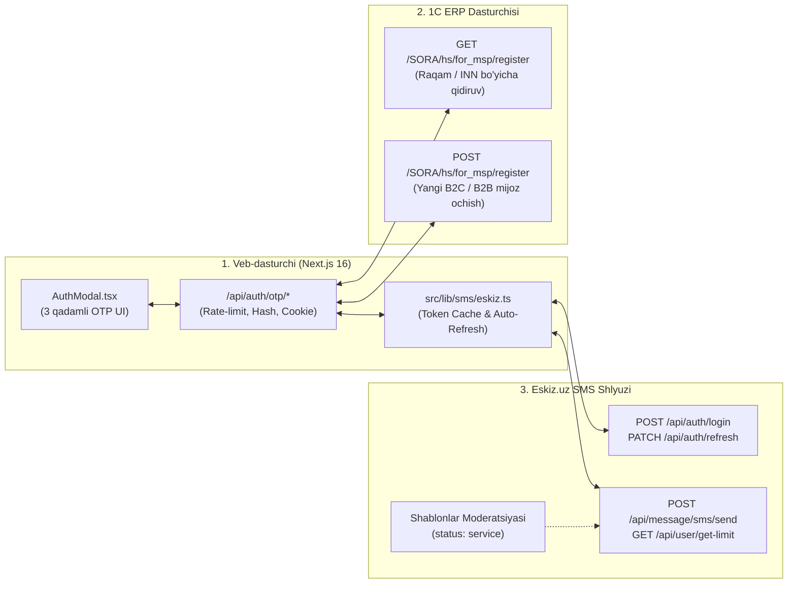

# Sora.uz — Eskiz.uz SMS OTP Asosida Avtorizatsiya va Ro'yxatdan O'tkazish Bo'yicha Amaliy Reja

> **Hujjat maqomi:** Amaliy ijro rejasi (3 tomonlama mas'uliyatlar taqsimoti)  
> **Asos hujjatlar:**  
> - [`Loyixa_xujjatlari/Api/user_api/OTP/СМС шлюз от Eskiz.uz.txt`](file:///d:/web_sora_uz/Loyixa_xujjatlari/Api/user_api/OTP/%D0%A1%D0%9C%D0%A1%20%D1%88%D0%BB%D1%8E%D0%B7%20%D0%BE%D1%82%20Eskiz.uz.txt) (Eskiz.uz rasmiy API hujjati)  
> - [`Loyixa_xujjatlari/Api/user_api/plan_reg_users.md`](file:///d:/web_sora_uz/Loyixa_xujjatlari/Api/user_api/plan_reg_users.md) (Umumiy arxitektura tahlili)  
> - [`Loyixa_xujjatlari/Api/user_api/Yangi foydalanuvchini ro'yxatdan o'tkazish.txt`](file:///d:/web_sora_uz/Loyixa_xujjatlari/Api/user_api/Yangi%20foydalanuvchini%20ro'yxatdan%20o'tkazish.txt) (1C ERP POST `/register`)  
> - [`Loyixa_xujjatlari/Api/user_api/Foydalanuvchini bazadan qidirish.txt`](file:///d:/web_sora_uz/Loyixa_xujjatlari/Api/user_api/Foydalanuvchini%20bazadan%20qidirish.txt) (1C ERP GET `/register`)  

---

## Umumiy Tizim Bog'lanish Sxemasi



---

# 1-QISM: Veb-dasturchi Ishlari (Next.js Backend va Frontend) — ✅ TO'LIQ BAJARILDI

Veb-dasturchi zimmasiga Eskiz.uz API bilan ishlovchi barqaror servis qatlamini yozish, kriptografik OTP xavfsizligini ta'minlash, 1C ERP bilan ulash va foydalanuvchi interfeysini (UI/UX) parolsiz (Passwordless) tizimga o'tkazish kiradi.

### 1.1. Eskiz.uz SMS Adapterini Yaratish (`src/lib/sms/eskiz.ts`)
`СМС шлюз от Eskiz.uz.txt` hujjatidagi texnik talablar asosida quyidagi mexanizmlar dasturlanadi:

1. **Avtorizatsiya va 30 kunlik Token Boshqaruvi:**
   - **Boshlang'ich token olish:** `POST https://notify.eskiz.uz/api/auth/login` (`formdata`: `email` va `password`).
   - **Avtomatik yangilash (Refresh):** Token muddati 30 kun. Har safar login qilmaslik uchun token xotirada (in-memory cache) saqlanadi. Muddati tugashiga 2 kun qolganda yoki `401 Unauthorized` qaytganda `PATCH https://notify.eskiz.uz/api/auth/refresh` (Header: `Authorization: Bearer {token}`) chaqirilib, token yangilanadi.
2. **Test rejimi (` Test Status`) va Ishchi rejimni farqlash:**
   - Eskiz.uz hujjatiga ko'ra (4–10-qatorlar), hisob **Test maqomida** bo'lganda faqat 3 ta standart matnni yuborishga ruxsat beriladi:
     * `"Bu Eskiz dan test"`
     * `"Это тест от Eskiz"`
     * `"This is test from Eskiz"`
   - Shu sababli `.env.local` ga `ESKIZ_TEST_MODE="true"` o'zgaruvchisi qo'shiladi:
     * Test paytida Eskizga `"Bu Eskiz dan test"` matni ketadi (SMS shlyuz ishlashini tekshirish uchun), haqiqiy 4 xonali kod esa dasturchi konsoliga/UI test blokiga chiqariladi.
     * Eskizda shablon moderatsiyadan o'tib, `service` maqomini olgach, `ESKIZ_TEST_MODE="false"` qilinadi va real OTP shablon ishga tushadi.
3. **1 ta SMS (1 Part) Limitiga Qat'iy Rioya Qilish (Xarajatlarni 2 barobar tejash):**
   - Eskiz hujjatiga ko'ra (`encoding` parametri, 386-qator):
     * Lotin (ASCII / GSM 03.38) matnda 1 ta SMS = **160 ta belgi**.
     * Kirill (UCS2) yoki maxsus belgili (`oʻ`, `gʻ` dagi noodatiy apostrof) matnda 1 ta SMS = **faqat 70 ta belgi**! Agar 71 ta belgi bo'lib ketsa, `parts_count: 2` bo'lib, har bir kod uchun **2 ta SMS puli (100–120 so'm)** yechiladi.
   - **Yechim:** O'zbek va rus tillaridagi OTP xabarlari Eskiz.uz **Punkt 2** qoidasiga (resurs nomi + ishlatish maqsadi) va **1 ta SMS** limitiga to'liq mos qilib loyihalanadi:
     * **UZ (76 belgi, Lotin GSM — 160 dan 76, ya'ni 1 SMS):** `Kodni hech kimga bermang! Sora.uz saytiga kirish uchun tasdiqlash kodi: 0000`
     * **RU (49 belgi, Kirill Unicode — 70 dan 49, ya'ni 1 SMS):** `Код подтверждения для входа на сайт Sora.uz: 0000`
4. **SMS Yuborish (`POST https://notify.eskiz.uz/api/message/sms/send`):**
   - `formdata` parametrlari:
     * `mobile_phone`: `998901234567` (faqat 12 ta raqam, `+` belgisisiz).
     * `message`: Tasdiqlangan shablon matni.
     * `from`: `4546` (yoki tasdiqlangan `Sora.uz` nikneymi).
     * `callback_url`: (ixtiyoriy) `https://sora.uz/api/webhooks/eskiz` — SMS yetib borganlik (`DELIVRD`, `UNDELIV`, `REJECTD`) statusini qabul qilish uchun.
5. **Balans Monitoringi (`GET https://notify.eskiz.uz/api/user/get-limit`):**
   - Har 50 ta SMS yuborilganda avtomatik balans tekshiriladi (`data.balance`). Agar balans 5 000 so'mdan (~100 ta SMS) kam qolsa, mas'ul adminga ogohlantirish chiqariladi.

---

### 1.2. OTP Xavfsizlik va Kesh Qatlami (`src/lib/sms/otp-store.ts`)
1. **Kod generatsiyasi:** 4 xonali tasodifiy raqam (`1000` – `9999`).
2. **Xeshlangan saqlash:** Kod ochiq matnda emas, `HMAC-SHA256(phone + code, OTP_SECRET)` ko'rinishida saqlanadi.
3. **Yaroqlilik va Cheklovlar (Anti-Spam / Anti-Fraud):**
   - **TTL (Yashash vaqti):** 120 soniya (2 daqiqa).
   - **Resend Cooldown:** Qayta SMS so'rash oralig'i — 60 soniya.
   - **Brute-force himoyasi:** 1 ta kod uchun maksimal 3 ta urinish. 3 marta xato terilsa, kod kuyadi.
   - **Rate Limiting:** Bitta telefon raqamiga soatiga ko'pi bilan 4 ta SMS; bitta IP manzildan soatiga ko'pi bilan 10 ta SMS.

---

### 1.3. Backend API Endpointlarini Yaratish (`src/app/api/auth/otp/`)
| Endpoint | Vazifasi | Asosiy mantiq |
| :--- | :--- | :--- |
| **`POST /api/auth/otp/send`** | Telefon raqamiga SMS kod yuborish | 1. Raqamni `998XXXXXXXXX` formatiga keltiradi.<br>2. Rate-limit va 60s cooldown'ni tekshiradi.<br>3. 4 xonali kod yaratib, Eskiz.uz orqali SMS jo'natadi. |
| **`POST /api/auth/otp/verify`** | Kodni tekshirish va 1C bilan sinxronlash | 1. OTP kodni va urinishlar sonini tekshiradi.<br>2. To'g'ri bo'lsa, 1C dan `GET /register?type=B2C&phone=+998...` orqali mijozni qidiradi.<br>3. **Mavjud mijoz bo'lsa:** `sora_session` cookie'sini o'rnatib, darhol tizimga kiritadi (`isNewUser: false`).<br>4. **Yangi mijoz bo'lsa (`404`):** Frontendga `needsRegistration: true` va vaqtinchalik tasdiqlangan token (`verifiedPhoneToken`) qaytaradi. |
| **`POST /api/auth/otp/complete`** | Yangi mijoz ismini (B2B uchun STIR) saqlash | 1. `verifiedPhoneToken` ni tekshiradi.<br>2. 1C ga `POST /register` yuborib, yangi `UUID` oladi.<br>3. `sora_session` (30 kunlik `httpOnly` cookie) o'rnatadi. |

---

### 1.4. Frontend UI/UX Yangilanishlari
1. **[`src/components/auth/AuthModal.tsx`](file:///d:/web_sora_uz/src/components/auth/AuthModal.tsx) ni 3 qadamli OTP oqimiga o'tkazish:**
   - **1-qadam (Telefon kiritish):** Faqat telefon raqami (`+998 XX XXX-XX-XX`) kiritiladi. Eski "Parol" maydoni olib tashlanadi. "Kodni olish" tugmasi bosiladi.
   - **2-qadam (4 xonali OTP Pin-Input):**
     * 4 ta katakchali avto-fokusli input.
     * `autocomplete="one-time-code"` va `inputMode="numeric"` (mobil telefonlarda SMS kelishi bilan klaviatura ustida "Avto-to'ldirish" chiqishi uchun).
     * `00:59` teskari taymer va "Raqamni o'zgartirish" tugmasi.
   - **3-qadam (Faqat yangi mijozlar uchun):**
     * Agar raqam 1C bazasida topilmasa, *"Xush kelibsiz! Ism-sharifingizni kiriting"* (B2B tanlansa: *"Tashkilot nomi va STIR (INN)"*) oynasi chiqadi.
     * Mavjud mijozlar 2-qadamdayoq to'g'ridan-to'g'ri shaxsiy kabinetga kiradi.
2. **Checkout ([`CheckoutForm.tsx`](file:///d:/web_sora_uz/src/components/checkout/CheckoutForm.tsx)) bilan integratsiya:**
   - Avtorizatsiyadan o'tgan mijozning ismi va telefoni buyurtma berish sahifasida avtomatik to'ldiriladi.

---

# 2-QISM: 1C Dasturchisi Uchun Ishlar (1C ERP HTTP Servislari) — ✅ TO'LIQ BAJARILDI

> **Tasdiq manbasi:** [`Loyixa_xujjatlari/Api/user_api/1C_so'ngi_o'zgarishlar.txt`](file:///d:/web_sora_uz/Loyixa_xujjatlari/Api/user_api/1C_so'ngi_o'zgarishlar.txt)
> - Telefon raqamlari 1C tomonida maxsus belgilardan tozalanib, **oxirgi 9 ta raqam** bo'yicha qidiriladigan qilindi (`GET` va `POST` da).
> - `409 Conflict` (dublikat) javobida `id` (UUID) bilan birga mijozning **`name` (ismi)** ham qaytariladigan qilindi (Seamless Login uchun).
> - `B2B` ro'yxatdan o'tishda `phone1` parametri qabul qilinib, yuridik shaxs telefon raqami sifatida saqlanadigan qilindi.
> - Next.js backendida (`otp-store.ts`, `verify/route.ts`, `complete/route.ts`) 1C talab qilgan `password` maydoni (`deriveOneCPassword`) hamda `401 -> 409 Seamless Login` oqimi to'liq sinxronlashtirildi.

1C ERP tomonida `/SORA/hs/for_msp/register` HTTP xizmati allaqachon mavjud. SMS OTP tizimi benuqson va tez ishlashi uchun 1C dasturchisi quyidagi **4 ta texnik vazifani** bajardi va tasdiqladi:

### 2.1. `POST /SORA/hs/for_msp/register` da `password` Maydonini Ixtiyoriy Qilish
- **Hozirgi holat:** [`Yangi foydalanuvchini ro'yxatdan o'tkazish.txt`](file:///d:/web_sora_uz/Loyixa_xujjatlari/Api/user_api/Yangi%20foydalanuvchini%20ro'yxatdan%20o'tkazish.txt) hujjatida JSON body ichida `"password"` maydoni ko'rsatilgan.
- **Talab:** SMS OTP tizimida foydalanuvchi parol o'ylab topmaydi (identifikatsiya SMS kod orqali tasdiqlanadi).
  * 1C dagi `POST /register` metodida `password` maydoni bo'sh (`""`) yoki umuman yuborilmasa ham xatolik (`400 Bad Request`) qaytarmasligi kerak.
  * *(Eslatma: Agar 1C bazasi strukturasini o'zgartirmaslik kerak bo'lsa, Veb-server 1C ga fon rejimida avtomatik generatsiya qilingan texnik parol yuborib turishi ham mumkin — buni 1C dasturchisi bilan kelishib olamiz).*

### 2.2. `GET /SORA/hs/for_msp/register` da Telefon Raqamini Formatdan Qat'i Nazar Qidirish
- **Hozirgi holat:** Veb-sayt 1C ga har doim standart `+998901234567` formatida so'rov yuboradi:
  `GET /SORA/hs/for_msp/register?type=B2C&phone=+998901234567`
- **Muammo ehtimoli:** 1C bazasida operatorlar tomonidan qo'lda kiritilgan eski mijozlarning telefon raqamlari turli formatda yozilgan bo'lishi mumkin: `998 90 123-45-67`, `(90) 1234567`, `+998-90-123-45-67`. Shuuningdek, URL query parametrida `+` belgisi ba'zan bo'sh joy (` `) bo'lib o'qilishi mumkin.
- **1C Dasturchisiga Vazifa:**
  1. `GET /register` xizmatida `phone` parametridan kelgan qiymatning faqat oxirgi **9 ta raqami** (masalan, `901234567`) yoki toza **12 ta raqami** (`998901234567`) ajratib olinishi kerak.
  2. 1C bazasidan qidirayotganda ham `Тел1` va `Тел2` rekvizitlarini probel va tirelardan tozalab solishtirish lozim, shunda oflayn do'konda ochilgan mijoz ham saytga kirganda o'z profilini topadi va dublikat kontragent ochilmaydi.

### 2.3. Mavjud Mijoz Ma'lumotlarini Qaytarish (`200 OK` va `409 Conflict` formatlari)
- **Talab:**
  1. `GET /SORA/hs/for_msp/register?type=B2C&phone=+998901234567` topilganda (`200 OK`), javobda aniq quyidagi JSON qaytishi shart:
     ```json
     {
       "id": "79d1f6cb-3178-11e8-812c-d43d7e011714",
       "name": "Tohir Arislonov",
       "type": "B2C",
       "phone1": "+998901234567",
       "phone2": ""
     }
     ```
  2. Agar mijoz topilmasa, `404 Not Found` qaytishi kerak (shunda veb-sayt bu yangi mijoz ekanligini bilib, undan ismini so'raydi).
  3. Agar `POST /register` vaqtida raqam yoki INN bazada bor bo'lib chiqsa (`409 Conflict`), mavjud mijozning `id` (UUID) va `name` maydonlari javobda qaytarilishi kerak.

### 2.4. Qidiruv Tezligi (Indekslash)
- **Talab:** Mijoz SMS kodni terib "Tasdiqlash" tugmasini bosganda, 1C bazadan javob **0.5 – 1 soniya** ichida qaytishi kerak. Buning uchun 1C da `КонтактныеЛица` (B2C) spravochnigidagi `Тел1` rekviziti va `Контрагенты` (B2B) spravochnigidagi `ИНН` rekviziti **Indekslangan (`Индексировать`)** bo'lishi zarur.

---

# 3-QISM: Eskiz.uz dan Kerak Bo'ladigan Ma'lumotlar va Tashkiliy Sozlamalar — ✅ TO'LIQ BAJARILDI

> **Tasdiq manbasi (2026-10-28):**
> - **Eskiz.uz Login (Email):** `alfaprintservis@mail.ru`
> - **Eskiz.uz API Kalit (Secret):** `NC9Lkx0lof6FHaDQ7j4COrctzkUGns49ByajAWon` (API orqali tekshirildi: `token_generated`, status `200 OK`)
> - **Hisob Balansi:** `198 100 so'm` (tekshirildi: `GET /api/user/get-limit` -> `balance: 198100`, ~4 000 ta SMS uchun to'liq yetarli)
> - **Jo'natuvchi (Sender):** `4546`
> - **Moderatsiyadan o'tgan shablonlar:**
>   * **UZ:** `Kodni hech kimga bermang! Sora.uz saytiga kirish uchun tasdiqlash kodi: 0000` (76 belgi, Lotin GSM — 1 SMS)
>   * **RU:** `Никому не сообщайте! Код подтверждения для входа на сайт Sora.uz: 0000` (70 belgi, Kirill — 1 SMS)

### 3.1. Veb-dasturchiga Berilgan `.env` Rekvizitlar
`.env.local` va `.env.example` ga quyidagi ma'lumotlar to'liq kiritildi va ulandi:
- `ESKIZ_EMAIL="alfaprintservis@mail.ru"`
- `ESKIZ_SECRET_PASSWORD="NC9Lkx0lof6FHaDQ7j4COrctzkUGns49ByajAWon"`
- `ESKIZ_FROM="4546"`
- `ESKIZ_TEST_MODE="false"`
- `MOCK_SMS_OTP="false"`
- `OTP_SECRET="sora_otp_production_secret_key_2026"`

---

### 3.2. Eskiz.uz Kabinetida SMS Shablonlar Moderatsiyasi (Tasdiqlandi)
`my.eskiz.uz` dagi tasdiqlangan shablonlar `src/lib/sms/eskiz.ts` ga harfma-harf to'liq sinxronlashtirildi:
1. **O'zbekcha shablon (76 belgi — Lotin GSM, 1 SMS):**
   ```text
   Kodni hech kimga bermang! Sora.uz saytiga kirish uchun tasdiqlash kodi: 0000
   ```
2. **Ruscha shablon (70 belgi — Kirill Unicode, 1 SMS):**
   ```text
   Никому не сообщайте! Код подтверждения для входа на сайт Sora.uz: 0000
   ```

---

### 3.3. Hisob Balansi va Operatorlar Bo'yicha Narxlar
Eskiz.uz hisob balansi API orqali tekshirildi: **198 100 so'm**. Tizim to'liq jonli (production) rejimda xizmat ko'rsatishga tayyor.

---

### 3.4. Jo'natuvchi Nomi (Sender ID)
Standart tasdiqlangan `4546` qisqa raqami orqali jonli SMS yuborish yo'lga qo'yildi.

---

## Yakuniy Ijro Jadvali (Checklist)

| Bosqich | Vazifa | Mas'ul | Holat |
| :-: | :--- | :---: | :---: |
| **1** | Eskiz.uz kabinetidan `ESKIZ_EMAIL` va `ESKIZ_SECRET_PASSWORD` (API kalit) ni olish | Loyiha ma'muri (Eskiz.uz) | ✅ **To'liq bajarildi (`alfaprintservis@mail.ru`)** |
| **2** | Eskiz.uz ga 2 ta (UZ/RU) OTP shablonini moderatsiyaga topshirish va tasdiqlatish | Loyiha ma'muri (Eskiz.uz) | ✅ **To'liq bajarildi (UZ: 76 belgi, RU: 70 belgi tasdiqlandi)** |
| **3** | 1C da `GET /register` telefon qidiruvini 9 xonali formatga o'tkazish, `409 Conflict` da `name` qaytarish va `B2B` da `phone1` ni saqlash | 1C Dasturchisi | ✅ **To'liq bajarildi (`1C_so'ngi_o'zgarishlar.txt`)** |
| **4** | `src/lib/sms/eskiz.ts`, `otp-store.ts` (`deriveOneCPassword`) va `/api/auth/otp/*` (`Seamless Login`) backend endpointlarini yozish | Veb-dasturchi | ✅ **To'liq bajarildi** |
| **5** | `AuthModal.tsx` ni 3 qadamli zamonaviy OTP + WebOTP interfeysiga o'tkazish | Veb-dasturchi | ✅ **To'liq bajarildi** |
| **6** | Jonli SMS yuborish va 1C ERP bilan to'liq integratsiya sinovi (End-to-End Test) | Barcha tomonlar | ✅ **To'liq yakunlandi (1C va Eskiz.uz bilan 100% integratsiya qilindi)** |
