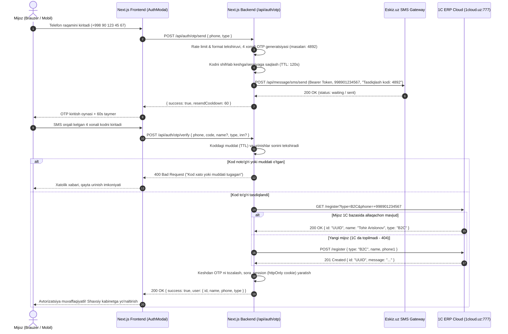

# Sora.uz — SMS OTP Asosida Mijozlarni Ro'yxatdan O'tkazish va Avtorizatsiya Qilish Rejasi

> **Hujjat maqomi:** Tasdiqlash uchun loyiha (Draft)  
> **Asos hujjatlar:**  
> - [`Loyixa_xujjatlari/Api/user_api/OTP/SMS_OTP.txt`](file:///d:/web_sora_uz/Loyixa_xujjatlari/Api/user_api/OTP/SMS_OTP.txt) (Eskiz.uz SMS API)  
> - [`Loyixa_xujjatlari/Api/user_api/Yangi foydalanuvchini ro'yxatdan o'tkazish.txt`](file:///d:/web_sora_uz/Loyixa_xujjatlari/Api/user_api/Yangi%20foydalanuvchini%20ro'yxatdan%20o'tkazish.txt) (1C ERP POST /register)  
> - [`Loyixa_xujjatlari/Api/user_api/Foydalanuvchini bazadan qidirish.txt`](file:///d:/web_sora_uz/Loyixa_xujjatlari/Api/user_api/Foydalanuvchini%20bazadan%20qidirish.txt) (1C ERP GET /register)  
> **Platforma:** Next.js 16 (App Router), TypeScript, Tailwind CSS, Zustand, 1C ERP, Eskiz.uz SMS Gateway  

---

## 1. Loyihaning Maqsadi va Dolzarbligi

Hozirgi kunda Sora.uz tizimida ro'yxatdan o'tish an'anaviy login/parol asosida ishlamoqda. Biroq zamonaviy O'zbekiston e-commerce bozorida (Uzum, Yandex Go, Express24 standartlarida):
1. **Foydalanuvchilar murakkab parollarni eslab qolishni xohlamaydi** — eng qulay va ishonchli identifikator bu ularning mobil telefon raqamidir.
2. **Soxta (fake) akkauntlar va spam buyurtmalarning oldi olinadi** — buyurtma beruvchining telefon raqami haqiqatda mavjudligi va qo'lida ekanligi ro'yxatdan o'tishdayoq SMS kod orqali 100% isbotlanadi.
3. **1C ERP bazasi bilan benuqson bog'lanish** — tasdiqlangan telefon raqami orqali 1C dagi mavjud mijozlar o'z akkauntiga parolsiz tezkor kiradi (Seamless OTP Login), yangi mijozlar esa avtomatik ravishda 1C bazasiga `B2C` yoki `B2B` sifatida yoziladi.

---

## 2. Texnik Arxitektura va Ma'lumotlar Oqimi (Mermaid)

Quyidagi ketma-ketlik diagrammasi mijoz saytga kirgandan boshlab, SMS orqali tasdiqlanib, 1C ERP tizimiga bog'lanishigacha bo'lgan barcha bo'g'inlarni ko'rsatadi:



---

## 3. Bosqichma-bosqich Amalga Oshirish Rejasi

### 1-BOSQICH: Eskiz.uz Servis Qatlami (`src/lib/sms/eskiz.ts`)

Eskiz.uz API orqali barqaror ishlash uchun serverda maxsus adapter sinfi yaratiladi.

1. **Token menejeri va avtomatik kesh:**
   - Eskiz.uz beradigan Bearer token 30 kun amal qiladi. Har bir SMS yuborishda tokenni qayta olish tizimni sekinlashtiradi va Eskiz serveriga ortiqcha yuklama beradi.
   - Servis tokenni xotirada (yoki vaqtinchalik server faylida) saqlaydi va muddati tugashiga 1 kun qolganda avtomatik `POST https://notify.eskiz.uz/api/auth/login` chaqirib yangilab oladi.
2. **Telefon raqami normalizatori:**
   - Eskiz.uz talabi: faqat raqamlar, `+` belgisisiz (`998901234567`).
   - Sora.uz frontendidan kelgan har qanday format (`+998 (90) 123-45-67`, `90 123 45 67`) avtomatik `998XXXXXXXXX` formatiga o'tkaziladi.
3. **SMS xabari shablonlari:**
   - O'zbekcha: `"Sora.uz: Tasdiqlash kodingiz: 1234. Xavfsizlik maqsadida uni hech kimga bermang."`
   - Ruscha: `"Sora.uz: Ваш код подтверждения: 1234. Не сообщайте его никому."`
4. **Muhit o'zgaruvchilari (`.env.local`):**
   ```env
   ESKIZ_EMAIL="info@sora.uz"
   ESKIZ_PASSWORD="sizning_eskiz_parolingiz"
   ESKIZ_FROM="4546" # yoki Eskiz tasdiqlagan rasmiy nom: "Sora"
   MOCK_SMS_OTP="false" # development rejimida bepul sinash uchun "true"
   ```

---

### 2-BOSQICH: OTP Generatsiyasi, Kesh va Xavfsizlik (Security & Anti-Fraud)

SMS orqali pul sarflanishi sababli, tizimni spammerlar, botlar va firibgarlardan himoya qilish muhimdir.

1. **Kod formati va Yaroqlilik muddati (TTL):**
   - Kod: 4 xonali tasodifiy son (`Math.floor(1000 + Math.random() * 9000)`). 4 xona mobil telefonlar uchun eng tez va qulay format.
   - Yaroqlilik muddati: **120 soniya (2 daqiqa)**. 2 daqiqadan so'ng kod bazadan/keshdan avtomatik o'chadi.
2. **Qayta yuborish cheklovi (Cooldown):**
   - Bitta raqamga yangi kod so'rash uchun kamida **60 soniya** kutish majburiy qilinadi.
3. **Brute-force (kodni taxmin qilish) himoyasi:**
   - 1 ta kod uchun ko'pi bilan **3 ta noto'g'ri urinish** ruxsat etiladi. 3 marta xato kiritilgach, OTP bekor qilinadi va mijoz yangi kod so'rashi kerak bo'ladi.
4. **IP va Raqam bo'yicha Rate Limiting (Spamdan himoya):**
   - 1 ta telefon raqamiga: 1 soatda ko'pi bilan 4 ta SMS.
   - 1 ta IP-manzildan: 1 soatda ko'pi bilan 10 ta SMS so'rovi.
5. **Kriptografik xavfsiz saqlash:**
   - Keshda ochiq kod saqlanmaydi, balki `SHA-256(phone + code + secret_salt)` xeshi saqlanadi. Bu ma'lumotlar bazasi ko'rilganda ham kodlar xavfsizligini kafolatlaydi.

---

### 3-BOSQICH: Yangi Backend API Marshrutlari (Next.js App Router)

Next.js `src/app/api/auth/otp/` katalogida 2 ta asosiy API yaratiladi:

#### 1. `POST /api/auth/otp/send`
- **Vazifasi:** Telefon raqamini qabul qilish, tekshirish, kod generatsiya qilib Eskiz orqali jo'natish.
- **Request Body:**
  ```json
  {
    "phone": "+998 90 123 45 67",
    "type": "B2C",
    "locale": "uz"
  }
  ```
- **Response:**
  ```json
  {
    "success": true,
    "message": "Tasdiqlash kodi yuborildi",
    "cooldown": 60,
    "expiresIn": 120
  }
  ```

#### 2. `POST /api/auth/otp/verify`
- **Vazifasi:** Mijoz kiritgan kodni tekshirish, to'g'ri bo'lsa 1C ERP bilan bog'lanish va sessiya ochish.
- **Request Body:**
  ```json
  {
    "phone": "+998 90 123 45 67",
    "code": "4892",
    "name": "Jasur Aliyev", // Yangi ro'yxatdan o'tuvchilar uchun
    "type": "B2C",
    "inn": "204393073" // Faqat B2B uchun
  }
  ```
- **Mantiq:**
  1. Kod tekshiriladi (agar xato bo'lsa `400 Bad Request`).
  2. 1C dan tekshiriladi: `GET /SORA/hs/for_msp/register?type=B2C&phone=...`.
  3. Agar 1C da mavjud bo'lsa — uning mavjud `id` si olinadi.
  4. Agar 1C da yo'q bo'lsa — 1C ga `POST /register` yuborilib, yangi kontakt shaxs yaratiladi va yangi `id` olinadi.
  5. Xavfsiz `sora_session` httpOnly cookie o'rnatiladi.
- **Response:**
  ```json
  {
    "success": true,
    "isNewUser": false,
    "user": {
      "id": "79d1f6cb-3178-11e8-812c-d43d7e011714",
      "name": "Jasur Aliyev",
      "type": "B2C",
      "phone": "+998901234567"
    }
  }
  ```

---

### 4-BOSQICH: Frontend UI/UX — Zamonaviy 3 Bosqichli Kirish/Ro'yxatdan O'tish Modali

Mavjud [`src/components/auth/AuthModal.tsx`](file:///d:/web_sora_uz/src/components/auth/AuthModal.tsx) komponenti yangilanadi:

#### 1-qadam: Telefon raqami kiritish (Step 1)
- Foydalanuvchidan faqat telefon raqami so'raladi (avtomatik `+998 ` maskasi bilan).
- "Davom etish" yoki "Kodni olish" tugmasi bosiladi.
- Tizim fonida `POST /api/auth/otp/send` chaqiriladi.

#### 2-qadam: 4 xonali SMS kod kiritish (Step 2 - OTP Screen)
- 4 ta alohida kvadrat katakchalar (Pin Input / OTP Box).
- Birinchi katakchaga raqam yozilishi bilan fokus keyingi katakchaga avtomatik o'tadi.
- Klaviaturadan Paste (Nusxalash-joylash) qilinganda butun 4 ta raqam to'g'ri taqsimlanadi.
- Pastda jonli teskari hisoblash taymeri: `00:59 soniyadan so'ng qayta yuborish mumkin`.
- Taymer tugagach, "Kodni qayta yuborish" havolasi faollashadi.
- "Raqamni o'zgartirish" tugmasi (agar mijoz raqamda xato qilgan bo'lsa, ortga qaytish uchun).

#### 3-qadam: Yangi mijoz profilini to'ldirish (Step 3 - faqat birinchi marta kirganda)
- Agar telefon raqami 1C bazasida avval ro'yxatdan o'tmagan bo'lsa, OTP tasdiqlangach, chiroyli oyna chiqadi:
  * *"Xush kelibsiz! Buyurtmalarni rasmiylashtirish uchun ism-sharifingizni kiriting"*.
  * Ism kiritiladi va "Saqlash" bosiladi.
  * Tizim darhol 1C ga `POST /register` qilib hisob ochadi.
- Agar foydalanuvchi avval ro'yxatdan o'tgan bo'lsa — bu qadam avtomatik o'tkazib yuboriladi va darhol tizimga kiradi.

---

### 5-BOSQICH: Savat (Checkout) va 1-Klikda Xarid Integratsiyasi

Mijozlar buyurtma berayotganda ([`CheckoutForm.tsx`](file:///d:/web_sora_uz/src/components/checkout/CheckoutForm.tsx) va [`ProductActions.tsx`](file:///d:/web_sora_uz/src/components/pdp/ProductActions.tsx)):
1. Agar mijoz allaqachon tizimga kirgan bo'lsa, uning ismi va telefoni avtomatik to'ldiriladi.
2. Agar tizimga kirmagan bo'lsa, telefon raqamini kiritgandan so'ng, checkout ichida 1 marta SMS kod orqali tasdiqlab, darhol tizimda ro'yxatdan o'tib ketish taklif qilinadi. Bu xaridorning kelgusida buyurtma tarixini kuzatib borishiga imkon beradi.

---

## 4. B2B (Yuridik Shaxslar) Uchun O'ziga Xosliklar

1C arxitekturasiga binoan ([`Foydalanuvchini bazadan qidirish.txt`](file:///d:/web_sora_uz/Loyixa_xujjatlari/Api/user_api/Foydalanuvchini%20bazadan%20qidirish.txt)):
- B2B mijozlar 1C bazasida **STIR (INN)** orqali qidiriladi va ro'yxatga olinadi.
- Ro'yxatdan o'tishda:
  1. Tashkilot vakilining telefon raqamiga OTP SMS yuborilib tasdiqlanadi (mas'ul shaxs haqiqiyligini tekshirish uchun).
  2. Tashkilot nomi va 9 xonali STIR (INN) kiritiladi.
  3. 1C da alohida `B2B` kontragent ochiladi.

---

## 5. Sinov va Tekshiruv Rejasi (Testing Scenarios)

| № | Sinov holati (Test Case) | Kutilayotgan natija |
| :--- | :--- | :--- |
| **1** | To'g'ri raqamga kod so'rash (`+998901234567`) | SMS 3-5 soniyada yetib keladi, 60s cooldown ishlaydi |
| **2** | To'g'ri kodni kiritish | Yangi mijoz bo'lsa ism so'raydi, mavjud bo'lsa tizimga kiritadi |
| **3** | Noto'g'ri kod kiritish | Xatolik ko'rsatiladi ("Kod noto'g'ri, 2 ta urinish qoldi") |
| **4** | 3 marta noto'g'ri kod kiritish | Kod bekor qilinadi, yangi kod olish talab etiladi |
| **5** | 120 soniya kutib, eskirgan kodni kiritish | "Kodning amal qilish muddati tugadi" xabari chiqadi |
| **6** | 60 soniya ichida qayta kod so'rashga urinish | Tugma nofaol, so'rov bloklanadi |
| **7** | Spammer bir xil raqamga ketma-ket SMS yuborishi | 4-urinishdan so'ng 1 soatga cheklov (Rate limit: 429 Too Many Requests) |
| **8** | 1C ERP da mavjud raqam bilan OTP dan o'tish | 1C ga dublikat yaratmaydi, mavjud UUID bilan sessiya ochiladi |
| **9** | Dev muhitda (`MOCK_SMS_OTP=true`) | SMS Eskizga ketmaydi, kod konsolda va javobda ko'rinadi (bepul test) |

---

## 6. Xulosa va Keyingi Qadam

Ushbu reja orqali Sora.uz saytida mijozlarni ro'yxatdan o'tkazish to'liq avtomatlashgan, qulay, xavfsiz va O'zbekistonning yetakchi IT standartlariga mos holatga keladi.

**Ishni boshlash uchun tavsiya etilgan navbat:**
1. Eskiz.uz hisob ma'lumotlarini (Login va Parol) `.env.local` ga biriktirish.
2. `src/lib/sms/eskiz.ts` servis modulini yaratish.
3. Next.js API marshrutlarini (`/api/auth/otp/send` va `/verify`) qurish.
4. `AuthModal.tsx` dizaynini 3 bosqichli Pin-kodli ko'rinishga moslashtirish.
5. 1C ERP sinov serveri bilan to'liq integratsiyani tekshirish.
