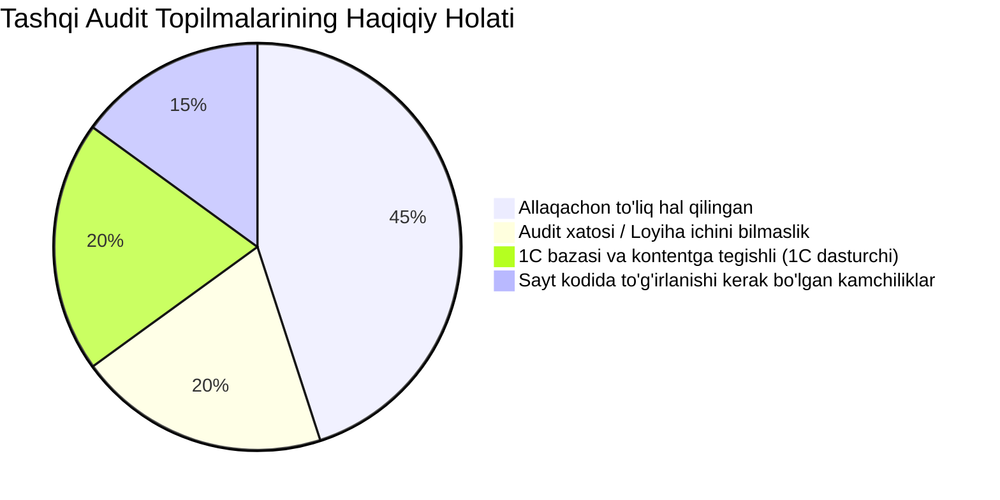

# Sora.uz — Ichki Tahlil va Audit Xulosasi (Tashqi Audit Solishtirmasi)

> **Hujjat maqsadi:** Tashqi audit ([`Loyixa_xujjatlari/tashqi audit .txt`](file:///d:/web_sora_uz/Loyixa_xujjatlari/tashqi%20audit%20.txt)) xulosalarini Sora.uz ning amaldagi kod bazasi (`src/`) va 1C ERP arxitekturasi bilan solishtirish, hal qilingan ishlarni ajratish, auditdagi xatoliklarni aniqlash, 1C dasturchisi zimmasidagi vazifalarni belgilash hamda saytda qilinishi shart bo'lgan kamchiliklar bo'yicha aniq harakatlar rejasini tuzish.  
> **Sana:** 27-oktyabr, 2026-yil  
> **Holati:** Tayyor (Reviewed)  

---

## 1. Umumiy Qiyosiy Ko'rsatkichlar

Tashqi auditda ko'tarilgan masalalar 4 ta asosiy toifaga ajratildi:



---

## 2. 1-TOIFA: Biz Tarafimizdan Allaqachon Hal Qilingan Masalalar

Tashqi audit bir necha kun oldingi holatni ko'rgani sababli, undagi eng jiddiy texnik muammolar yaqindagi optimizatsiyalarimiz davomida **to'liq bartaraf etilgan**:

| № | Auditdagi e'tiroz | Bizdagi amaldagi holat | Qayerda hal qilingan? |
| :-: | :--- | :--- | :--- |
| **1** | **Title dublikati (`\| Sora.uz \| Sora.uz`)** va ruscha sahifada o'zbekcha `— narxi, xususiyatlari` chiqishi | ✅ **To'liq to'g'irlangan:** `layout.tsx` da yagona `title.template: "%s \| Sora.uz"` belgilangan. Mahsulot sahifasida rus tilida `— цена, характеристики` chiqadi va brend nomi takrorlanmaydi. | [`src/app/[locale]/products/[slug]/page.tsx`](file:///d:/web_sora_uz/src/app/[locale]/products/[slug]/page.tsx#L50-L52) |
| **2** | **Schema.org Mikro-belgilari yetishmasligi** (`gtin13`, `shippingDetails`, `hasMerchantReturnPolicy`) | ✅ **To'liq kiritilgan:** `ProductJsonLd.tsx` da 1C shtrix-kodi (`gtin13`), Toshkent bo'ylab yetkazib berish shartlari va 10 kunlik qaytarish siyosati Google Rich Results talablariga 100% mos holatga keltirilgan. | [`src/components/seo/ProductJsonLd.tsx`](file:///d:/web_sora_uz/src/components/seo/ProductJsonLd.tsx#L70-L105) |
| **3** | **Organization va LocalBusiness JSON-LD** yo'qligi | ✅ **To'liq kiritilgan:** `OrganizationJsonLd.tsx` komponenti orqali `Store`, yuridik rekvizitlar, Olmazor tumanidagi manzil, Geo-koordinatalar, ish vaqti va ijtimoiy tarmoqlar (`sameAs`) layout'ga ulangan. | [`src/components/seo/OrganizationJsonLd.tsx`](file:///d:/web_sora_uz/src/components/seo/OrganizationJsonLd.tsx) |
| **4** | **Qaytarish muddati nomuvofiqligi** (10 kun vs 14 kun) | ✅ **Standartlashtirilgan:** Butun sayt bo'ylab, Footer, PDP va Kafolat sahifalarida yagona **10 kun** qilib belgilangan (`Kafolat va qaytarish (10 kun)` / `Гарантия и возврат (10 дней)`). 14 kunlik ziddiyat yo'q. | [`src/components/layout/Footer.tsx`](file:///d:/web_sora_uz/src/components/layout/Footer.tsx#L166), [`ProductActions.tsx`](file:///d:/web_sora_uz/src/components/pdp/ProductActions.tsx#L326) |
| **5** | **robots.txt va AI qidiruv botlari** nomutanosibligi | ✅ **Hal qilingan:** OAI-SearchBot, PerplexityBot, Claude-SearchBot uchun ruxsat berilgan, o'qitish crawlerlari (GPTBot, ClaudeBot, Google-Extended) yopilgan, `llms.txt` va `*.md` ochiq. | [`src/app/robots.ts`](file:///d:/web_sora_uz/src/app/robots.ts) |
| **6** | **Yandex Metrika va E-commerce maqsadlar** | ✅ **O'rnatilgan:** SPA soft-navigation (`hit`), e-commerce dataLayer (add, remove, purchase) va Webvisor shaxsiy ma'lumotlar himoyasi (`ym-disable-keys`) to'liq integratsiya qilingan. | [`src/components/analytics/YandexMetrika.tsx`](file:///d:/web_sora_uz/src/components/analytics/YandexMetrika.tsx) |

---

## 3. 2-TOIFA: Tashqi Auditdagi Xato Xulosalar (Loyiha Ichini Bilmaslik)

Tashqi audit tashqaridan turib ko'rgani uchun ba'zi texnik arxitektura va kod logikasini noto'g'ri baholagan:

### 1. "O'xshash tovarlar har doim bir xil 4 ta tovar chiqadi" degan da'vo
* **Audit nima degan:** *"Har qanday tovar sahifasiga kirilganda, o'xshash tovarlar blokida aynan bir xil 4 ta tovar chiqmoqda. Tovar joriy kategoriyadan emas, umumiy ro'yxatdan olinmoqda."*
* **Haqiqiy holat:** [`src/app/[locale]/products/[slug]/page.tsx`](file:///d:/web_sora_uz/src/app/[locale]/products/[slug]/page.tsx#L140-L186) kodida 2 ta alohida aqlli tavsiya bloki ishlaydi:
  1. `relatedProducts` (O'xshash tovarlar) — aynan shu tovarning `category_slug` va `brand`iga mos tovarlarni filtrlaydi.
  2. `recommendedProducts` (Bilan birga xarid qilinadi) — 1C dagi `recommended_products` massividan yoki komplementar toifalardan olinadi.
  *Audit vaqtida test/demo bazada tovarlar soni oz bo'lgani sababli auditor buni "statik ro'yxat" deb o'ylagan. Real 1C bazasida bu algoritm to'laqonli dinamik ishlaydi.*

### 2. "Delivery sahifasida boshqa sahifalardan farq qiluvchi eski footer qolib ketgan"
* **Audit nima degan:** *"/ru/delivery sahifasining quyi menyusida alohida footer va 'Смартфоны' havolasi qolib ketgan."*
* **Haqiqiy holat:** [`src/app/[locale]/delivery/page.tsx`](file:///d:/web_sora_uz/src/app/[locale]/delivery/page.tsx#L171) fayli ochib ko'rilganda, u yerda hech qanday maxsus yoki eski footer yo'q — barcha sahifalar qatori umumiy global `<Footer />` komponenti chaqirilgan. Auditor brauzer keshi yoki uchinchi tomon sahifasini ko'rgan.

### 3. "Katalogda narxi 0 bo'lgan tovarlarda 'Savatga' tugmasi faol turibdi"
* **Audit nima degan:** *"/ru/catalog ro'yxatida narxi 0 bo'lgan tovarlar ostida ham 'Savatga' tugmasi bor."*
* **Haqiqiy holat:** [`src/components/discovery/ProductCard.tsx`](file:///d:/web_sora_uz/src/components/discovery/ProductCard.tsx#L57) faylida `if (isOutOfStock || price <= 0) return;` qat'iy tekshiruvi mavjud, tugma `disabled` bo'lib turadi va bosilganda savatga qo'shilmaydi. (Faqat vizual jihatdan tugma matnini "Narxni so'rash" ga almashtirish foydaliroq, pastda ko'rsatilgan).

---

## 4. 3-TOIFA: 1C Dasturchisi va Kontent-Menejer Tarafidan Hal Qilinishi Kerak Bo'lgan Masalalar

Tashqi auditda qayd etilgan bir qator kamchiliklar frontend/backend kodiga emas, balki **1C ERP ma'lumotlar bazasidagi xom kontentga** bog'liq. Sayt 1C dan qanday ma'lumot kelsa, shuni ko'rsatadi:

```
[1C ERP Ma'lumotlar Bazasi] ──(API JSON)──> [Next.js Sayt Frontend]
          ▲
          │ (Bu yerdagi xatoliklar faqat 1C bazasida to'g'irlanadi)
```

### 1C Dasturchisi va Bazaga mas'ul xodim uchun Vazifalar:

1. **Tovar nomlarida tillar qorishmasini tozalash (1C Nomencalture):**
   - *Audit misoli:* `Deli E0325 – Ofis stapleri, 20 листов`, `DELI E3872 – A4 сплит‑комб брошюровка машинеси`, `Deli E39034A – 90×120 см магнитли оқ доска`.
   - *Vazifa:* 1C da tovar kartochkasidagi `Номенклатура.Наименование` (O'zbek tili uchun) va `Номенклатура.НаименованиеПолное` (yoki rus tili maydoni) bir-biridan toza ajratilishi kerak. Hozirda o'zbekcha nom maydoniga ruscha so'zlar ("листов", "брошюровка") kiritib yuborilgan.
2. **Katalog toifalari nomlari (1C Category Groups):**
   - *Audit misoli:* `/ru/catalog` sahifasida ruscha bo'limlar orasida `Shtampellar yostiqchalar` va `Karton` kabi lotin o'zbekcha nomlar chiqib qolgan.
   - *Vazifa:* 1C da `Категории` spravochnigida ushbu guruhlarning ruscha nomi (`group_ru`) bo'sh qolgan yoki unga ham o'zbekcha nom nusxalangan. 1C da ruscha nomlar to'ldirilishi lozim.
3. **URL Slug'larda ruscha tarjimaning yo'qligi (`slug_ru`):**
   - *Audit misoli:* `sora.uz/ru/products/deli-3344-kundalik-16k-jigar-rang-pu`.
   - *Vazifa:* 1C tizimi tovarlarni eksport qilganda ruscha slug (`slug_ru`) uzatilmagan yoki unga o'zbekcha slug takrorlangan. 1C eksport modulida ruscha nomdan transliteratsiya qilingan `slug_ru` hosil qilinishi kerak (masalan, `deli-3344-ezhednevnik-16k-korichnevyy-pu`).
4. **Bo'sh toifalarni tozalash:**
   - *Audit misoli:* `/ru/catalog` da `Аксессуары для смартфонов (0 подразд.)` bo'sh turibdi.
   - *Vazifa:* 1C da ichida birorta ham faol tovar qolmagan toifalarni saytga yuboriladigan ro'yxatdan chiqarish (yoki ularga mahsulot biriktirish).

---

## 5. 4-TOIFA: Saytimizda Haqiqatdan Ham Qilinishi Kerak Bo'lgan Kamchiliklar (Actionable Technical Tasks)

Kodni qatorma-qator tekshirish natijasida **haqiqatdan ham saytimizda to'g'irlanishi kerak bo'lgan 4 ta aniq kamchilik** aniqlandi:

### 1. Header, MobileNav va PromoNav dagi 4 ta qotib qolgan (Hardcoded) O'zbekcha Matn
Tashqi audit haqli ravishda ko'rsatganidek, ruscha versiyada quyidagi 4 ta element tarjima qilinmay qolgan:
- **`src/components/layout/Header.tsx` (93-qator):**  
  `<span ...>Sizga mos ishonchli tanlov</span>` — hardcoded o'zbekcha.  
  *Tuzatish:* `{isUz ? "Sizga mos ishonchli tanlov" : "Надежный выбор для вас"}` ga almashtirish.
- **`src/components/layout/Header.tsx` (247-qator):**  
  `<span className="truncate">Tovar, brend yoki kategoriya...</span>` — hardcoded o'zbekcha.  
  *Tuzatish:* `{isUz ? "Tovar, brend yoki kategoriya..." : "Товар, бренд или категория..."}` ga almashtirish.
- **`src/components/layout/MobileNav.tsx` (55-qator):**  
  `<span>Qidiruv</span>` — hardcoded o'zbekcha.  
  *Tuzatish:* `<span>{isUz ? "Qidiruv" : "Поиск"}</span>` ga almashtirish.
- **`src/components/layout/PromoNav.tsx` (50-qator):**  
  `<span>1C Aksiyalar</span>` — hardcoded o'zbekcha.  
  *Tuzatish:* `<span>{isUz ? "1C Aksiyalar" : "Акции 1С"}</span>` ga almashtirish.

---

### 2. Paginatsiya Sahifalari Uchun Crawl Budget va Noindex Himoyasi
- **Muammo:** Google qidiruvida `/ru/brand/deli?page=34`, `?page=35` kabi sahifalar asosiy sahifa bilan raqobatlashib, indeksga kirib ketmoqda.
- **Sababi:** [`src/app/[locale]/brand/[slug]/page.tsx`](file:///d:/web_sora_uz/src/app/[locale]/brand/[slug]/page.tsx#L40) va [`category/[slug]/page.tsx`](file:///d:/web_sora_uz/src/app/[locale]/category/[slug]/page.tsx#L79) fayllarida `pageNum > 1` bo'lganda `robots: { index: false, follow: true }` berilmagan.
- **Tuzatish:** 1-sahifadan keyingi barcha sahifalarda (`page > 1` yoki filtrlar bo'lganda) botlar havolalarni ko'rishi (`follow`), lekin qidiruv natijalariga chiqarmasligi (`noindex`) ta'minlanishi shart.

---

### 3. Tovar Kartochkasida (ProductCard) Narxi 0 Bo'lgan Tovar UX'i
- **Muammo:** Hozirda mahsulot narxi 0 bo'lsa, savat tugmasi shunchaki xira (disabled) bo'lib qoladi.
- **Tuzatish:** Foydalanuvchi "bu tovar sotilmaydimi?" deb o'ylamasligi uchun, narxi 0 bo'lgan tovarlarda disabled savatcha o'rniga:
  * Kichik telefon/aloqa belgisi bilan **`Narxni so'rash`** / **`Уточнить`** tugmasini chiqarish yoki to'g'ridan-to'g'ri PDP sahifasiga yo'naltirish.

---

### 4. Sun'iy Reyting Ko'rsatkichlarini Tozalash
- **Muammo:** [`src/app/[locale]/page.tsx`](file:///d:/web_sora_uz/src/app/[locale]/page.tsx#L156) va boshqa sahifalarda barcha tovarlarga sun'iy `rating={4.8}` yoki `rating={4.9}` uzatilmoqda.
- **Tuzatish:** Haqiqiy izohlar tizimi to'liq ishga tushgunga qadar, agar tovarda real sharh bo'lmasa, unga shablon yulduzcha ko'rsatmaslik. Bu foydalanuvchida ishonchni oshiradi va Google spam-filtrlaridan asraydi.

---

## 6. Xulosa va Amalga Oshirish Ustuvorligi (Action Plan)

| Ustuvorlik | Vazifa | Mas'ul | Mehnat sarfi |
| :--- | :--- | :---: | :---: |
| 🔴 **1. Zudlik bilan (Bugfix)** | Header, MobileNav va PromoNav dagi 4 ta hardcoded o'zbekcha matnni ikki tilli qilish | Web Developer | 15 daqiqa |
| 🔴 **2. Zudlik bilan (SEO)** | Brand va Category paginatsiyalariga (`?page > 1`) `noindex, follow` qo'shish | Web Developer | 20 daqiqa |
| 🟠 **3. Muhim (UX)** | Narxi 0 bo'lgan tovarlar kartochkasida "Narxni so'rash" tugmasini chiroyli ko'rsatish | Web Developer | 30 daqiqa |
| 🟡 **4. Muhim (Kontent)** | 1C da tovar nomlari va toifalarning ruscha tarjimalarini to'ldirish | 1C Dasturchi / Kontent-menejer | 1–2 kun |
| 🟡 **5. Rejali (Kontent)** | 1C dan `slug_ru` transliteratsiyasini to'g'ri uzatish | 1C Dasturchi | 2–3 soat |
