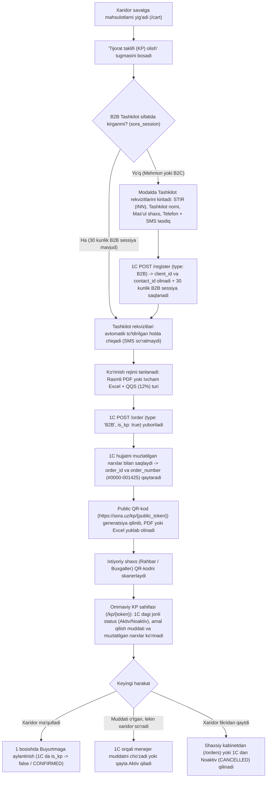

# Sora.uz — 1C ERP Bazasiga Integratsiyalashgan «Tirik Tijorat Taklifi (KP)» Arxitekturasi va Biznes Logikasi

> **Hujjat nomi:** `Loyixa_xujjatlari/dop_plan_tijorat.md`  
> **Asosiy va bog‘liq hujjatlar:**  
> - `Loyixa_xujjatlari/plan_tijorat_taklifi.md` (Boshlang‘ich KP rejasi — Cloudflare R2 CORS masalasi hal etilgan)  
> - `Loyixa_xujjatlari/new_order_stay_plan.md` («Mening buyurtmalarim» yagona markazi)  
> - `Loyixa_xujjatlari/Api/user_api/Buyurtma yaratish.txt` (`POST /order`)  
> - `Loyixa_xujjatlari/Api/user_api/Buyurtma holati va tarixini olish.txt` (`GET /order`)  
>
> **Maqsad:** Tijorat taklifini (KP) oddiy "statik PDF fayl" emas, balki **1C ERP bazasida saqlanadigan, narxlari kafolatlangan (muzlatilgan), ommaviy (public) QR-kod orqali real vaqtda tekshiriladigan va 1 bosishda haqiqiy buyurtmaga aylanadigan B2B oldindan buyurtma (Pre-Order) hujjati** sifatida joriy etish.

---

## 1. Taklifning Biznes va Texnik Bahosi (Ekspert Xulosasi)

Siz bergan taklif B2B elektron tijorat va 1C ERP arxitekturasi nuqtayi nazaridan **juda to‘g‘ri va professional yechim**. Bu yondashuv oldingi rejadagi ikkita eng nozik muammoni tubdan hal qiladi va biznesga 5 ta katta ustunlik beradi:

| № | Mezon | Oldingi yondashuv (Stateless URL) | Yangi yondashuv (1C `POST /order` + `is_kp: true`) | Biznes va Texnik Yutuq |
| :-: | :--- | :--- | :--- | :--- |
| **1** | **Narxlarning o‘zgarmasligi (Price Lock)** | QR skanerlanganda katalogdagi *joriy* narx olinardi. 3 kundan keyin saytda narx oshsa, qog‘ozdagi KP bilan saytdagi summa farq qilib, buxgalteriyada muammo chiqardi. | KP shakllangan paytdagi narxlar **1C hujjatining jadval qismida (`products[].price`) saqlanib qoladi**. Saytda narx o‘zgarsa ham, KP faol ekan, undagi narx o‘zgarmaydi. | **100% B2B ishonch:** Rahbar va buxgalter tasdiqlagan summa tiyinigacha o‘zgarishsiz qoladi. |
| **2** | **QR-kod havolasi uzunligi** | Savatda 50–100 ta mahsulot bo‘lsa, URL juda uzayib (`?items=sku1:2,sku2:5...`), QR-kod zichlashib, skanerlash qiyinlashardi. | QR-kod ichida faqat 1C hujjatiga olib boruvchi qisqa havola (`https://sora.uz/uz/kp/{id}`) bo‘ladi. | Savatda 1 ta mahsulot bo‘lsa ham, **500 ta mahsulot bo‘lsa ham QR-kod bir xil — kichik va 0.5 soniyada o‘qiladigan** bo‘ladi. |
| **3** | **Ommaviy (Public) QR-kod tekshiruvi** | Skanerlagan odamning savatiga mahsulotlarni yuklab qo‘yardi, hujjat haqiqiymi yoki bekor qilinganmi — bilib bo‘lmasdi. | QR-kodni **istalgan shaxs** (korxona rahbari, hisobchi, ta’minotchi, auditor) tizimga kirmasdan skanerlab, KP ning **1C dagi jonli holatini (Aktiv / Noaktiv / Muddati / Muzlatilgan narxlar)** ko‘ra oladi. | Hujjat qalbakilashtirishdan himoyalanadi (Didox / E-imzo hujjat tekshiruvi kabi). |
| **4** | **B2B Lidlar sifati** | Rekvizitsiz anonim yuklab olishda kim KP olgani noma’lum qolardi. | KP **faqat tashkilot rekvizitlari (STIR/INN, Tashkilot nomi, Mas’ul shaxs)** kiritilgandagina shakllanadi. | Har bir KP 1C `Контрагенты` bazasida tayyor, tasdiqlangan korporativ mijoz va issiq lid yaratadi. |
| **5** | **Moslashuvchan boshqaruv (1C + Kabinet)** | KP yuklab olingach, uni boshqarish, muddatini cho‘zish yoki bekor qilish imkoni yo‘q edi. | 1C orqali menejer KP muddatini cho‘zishi, aktiv/noaktiv qilishi; xaridor esa `/orders` kabinetida uni tahrirlashi, bekor qilishi yoki buyurtmaga aylantirishi mumkin. | Savdo bo‘limi mijoz bilan savdolashuvni to‘liq 1C ichidan boshqaradi. |

> [!NOTE]
> **Hal bo‘lgan masala:** Cloudflare R2 (`cdn.sora.uz`) uchun CORS Policy JSON qoidasi sozlangani sababli, brauzerda `@react-pdf/renderer` orqali mahsulot rasmlarini PDF ichiga to‘g‘ridan-to‘g‘ri yuklash muammosi to‘liq yechildi (qo‘shimcha rasm proxy serveriga ehtiyoj qolmadi).

---

## 2. Yangilangan Yaxlit Biznes Oqimi (Workflow)



---

## 3. Asosiy Biznes Qoidalar va Shartlar

### 3.1. 1-Shart: Majburiy Tashkilot (B2B) Identifikatsiyasi va Rekvizitlar
Tijorat taklifi faqat yuridik shaxslar (tashkilotlar) uchun mo‘ljallangan rasmiy hujjat bo‘lgani hamda 1C `POST /order` (`type: "B2B"`) majburiy ravishda `client_id` (`Контрагенты` GUID) talab qilgani sababli:

1. **KP shakllantirish uchun majburiy maydonlar:**
   - **STIR / INN** (9 ta raqam — `formatInnInput` maskasi bilan);
   - **Tashkilotning rasmiy nomi** (masalan: *«Navruz Office Trade» MCHJ*);
   - **Mas’ul shaxs F.I.Sh.** (ta’minotchi / buxgalter / rahbar);
   - **Telefon raqami** (`+998 XX XXX-XX-XX`).
2. **Qo‘shimcha (ixtiyoriy, lekin hujjatda chiqadigan) tashkilot rekvizitlari:**
   - **Yuridik manzil**, **Hisob raqami (H/R, 20 ta raqam)**, **Bank MFO (5 ta raqam)**, **OKED**.
   - *Eslatma:* STIR, Tashkilot nomi, Mas’ul shaxs va Telefon majburiy bo‘ladi. Hisob raqam va MFO esa ixtiyoriy qoldirilgani ma’qul (chunki oddiy ta’minotchi yo‘l-yo‘lakay KP olayotganda korxonasining 20 xonali bank hisob raqamini yoddan bilmasligi mumkin, STIR va tashkilot nomini esa har doim biladi).
3. **30 kunlik B2B sessiya bilan uyg‘unlik (`sora_session`):**
   - Xaridor birinchi marta KP olayotganda telefon raqamini SMS kod bilan tasdiqlaydi — tizim 1C da `POST /register` (`type: "B2B"`) orqali `client_id` va `contact_id` ni ro‘yxatdan o‘tkazadi hamda qurilmada **30 kunlik B2B sessiyani** saqlaydi.
   - Keyingi safar shu xaridor savatga mahsulot solib «Tijorat taklifi olish» tugmasini bossa, **barcha rekvizitlari tayyor to‘ldirilgan turadi va SMS tasdiqlashsiz 1 bosishda** 1C ga KP yuborilib, PDF/Excel yuklab olinadi!

---

### 3.2. 2-Shart: 1C Bazasida Narxlarni Muzlatish (Saqlab Qolish) Mantiqi
- Xaridor KP shakllantirgan vaqtda `POST /order` so‘rovi orqali har bir mahsulotning o‘sha lahzadagi narxi (`products: [{ product_id, quantity, price }]`) 1C ga yuboriladi.
- 1C bu hujjatni o‘z bazasida saqlaydi va qator narxlarini hujjat ichida muhrlaydi.
- Ertasi kuni saytda (katalogda) mahsulot narxi `45 000 so‘m` dan `52 000 so‘m` ga oshsa ham:
  - 1C `GET /order` orqali ushbu KP so‘ralganda, 1C hujjatda saqlangan **`45 000 so‘m`** narxni qaytaradi.
  - Xaridor yoki rahbar QR-kodni skanerlaganda ham, shaxsiy kabinetdan (`/orders`) ochganda ham, KP **Aktiv** ekan, aynan kafolatlangan `45 000 so‘m` narx ko‘rinadi.

---

### 3.3. 3-Shart: Ommaviy (Public) QR-Kod Havolasi va Tekshiruv Sahifasi (`/[locale]/kp/[token]`)
PDF va Excel hujjatning pastki qismiga joylanadigan QR-kod endi `/cart?items=...` ga emas, balki **maxsus ommaviy Tijorat Taklifi Pasporti sahifasiga** yo‘naltiradi:

- **Havola formati:** `https://sora.uz/uz/kp/{public_token}` (yoki `https://sora.uz/uz/kp/{order_id}?sig={hmac}`).
- **Kimlar ko‘ra oladi?** Havola **Public (ommaviy)** bo‘ladi — QR-kodni skanerlagan ixtiyoriy shaxs (direktor, bosh hisobchi, hamkor) hech qanday login/SMS kiritmasdan hujjatni ko‘ra oladi.
- **Skanerlanganda ekranda nima ko‘rinadi?**
  1. **1C dagi Jonli Status Banneri:**
     - 🟢 **FAOL (AKTIV) TIJORAT TAKLIFI:** *"Ushbu tijorat taklifi kuchda. Amal qilish muddati: 27.11.2026 gacha (Narxlar 1C bazasida kafolatlangan)."*
     - 🟡 **MUDDATI TUGAGAN:** *"Tijorat taklifining amal qilish muddati (27.11.2026) yakunlangan. Ushbu narxlarda muddatni uzaytirish uchun menejer bilan bog‘laning."*
     - 🔴 **BEKOR QILINGAN (NOAKTIV):** *"Ushbu tijorat taklifi bekor qilingan (noaktiv)."*
     - 🔵 **BUYURTMAGA AYLANTIRILGAN:** *"Ushbu tijorat taklifi asosida xarid tasdiqlangan va buyurtma jarayonda (`CONFIRMED` / `ASSEMBLED` / `DELIVERED`)."*
  2. **Hujjat rekvizitlari:**
     - KP raqami (`#0000-001425`), berilgan sana, Sotuvchi (`Sora.uz` rekvizitlari) va Buyurtmachi tashkilot (`customer.client_name`, STIR, mas’ul shaxs).
  3. **1C da saqlangan mahsulotlar jadvali:**
     - Katalog rasmlari (`40×40`), mahsulot sahifasiga havola, miqdori, **KP dagi kafolatlangan narx** va jami summa (`total_amount`).
     - *Konversiyani oshiruvchi psixologik ustunlik:* Agar saytda biror mahsulotning narxi KP olingandan keyin oshgan bo‘lsa, qator yonida kichik yashil yorliq chiqadi: *"Saytdagi joriy narx: 52 000 so‘m — Siz uchun KP narxi: 45 000 so‘m"*. Bu rahbarni muddat tugamasdan tezroq to‘lov qilishga undaydi!
  4. **Tezkor harakat tugmalari:**
     - **«Xaridni tasdiqlash (Buyurtmaga aylantirish)»** (faqat KP aktiv bo‘lganda);
     - **«PDF (Rasmli) yuklab olish»** va **«Excel (.xlsx) yuklab olish»** (1C dagi ma’lumot asosida istalgan qurilmada qayta generatsiya qilib beradi);
     - **«Muddatni uzaytirishni so‘rash (Menejer bilan aloqa)»** (muddati o‘tgan yoki noaktiv bo‘lganda).

---

### 3.4. 4-Shart: KP ni Aktiv / Noaktiv Qilish, Muddatini Cho‘zish va Tahrirlash

Tijorat taklifining hayotiy sikli (Lifecycle) ikki tomondan — **1C ERP (Menejer)** va **Shaxsiy kabinet (`/orders` — Xaridor)** tomonidan boshqariladi:

| Amal | Kim bajaradi? | Qanday ishlaydi? |
| :--- | :--- | :--- |
| **1. Muddati o‘tgan KP ni cho‘zish yoki qayta Aktiv qilish** | **1C Menejer** (xaridor iltimosiga ko‘ra) | Menejer 1C bazasida ushbu hujjatni ochib, amal qilish sanasini (`kp_valid_until` / `СрокДействияКП`) yangi sanaga o‘zgartiradi (yoki bekor qilish belgisini oladi). Shu zahoti QR-kod skanerlanganda ham, xaridor kabinetida ham KP yana **🟢 FAOL (Aktiv)** bo‘lib, eski kafolatlangan narxlar bilan ishlay boshlaydi! |
| **2. KP ni Noaktiv qilish (Bekor qilish)** | **Xaridor** (`/orders` kabinetida) yoki **1C Menejer** | Xaridor shaxsiy kabinetida *«Bekor qilish (Noaktiv qilish)»* tugmasini bosadi (yoki menejer 1C da `ПометкаУдаления` qo‘yadi). Hujjat `status_code: "CANCELLED"` holatiga o‘tadi. QR-kod skanerlanganda **🔴 NOAKTIV / BEKOR QILINGAN** deb ko‘rsatadi. |
| **3. KP ni Tahrirlash (Miqdor yoki tarkibni o‘zgartirish)** | **Xaridor** (`/orders` kabinetida) yoki **1C Menejer** | • **Menejer 1C da o‘zgartirsa:** `GET /order` har doim 1C dagi eng oxirgi qatorlar va summani qaytargani uchun, QR-kod sahifasida ham, kabinetda ham avtomatik yangilangan tarkib ko‘rinadi!<br>• **Xaridor saytda o‘zgartirmoqchi bo‘lsa:** Kabinetda KP kartochkasidagi *«Tahrirlash (Savatga yuklash)»* tugmasini bosadi -> mahsulotlar savatga tushadi -> miqdorni o‘zgartirib yangi KP yoki buyurtma shakllantiradi (eski KP noaktiv qilinadi). |
| **4. KP ni Haqiqiy Buyurtmaga aylantirish** | **Xaridor** (`/orders` yoki `/kp/{token}` da) yoki **1C Menejer** | Xaridor *«Buyurtmani tasdiqlash»* tugmasini bosganda (yoki hisob-faktura bo‘yicha to‘lov qilganda), 1C dagi hujjatda buleva rekvizit `is_kp = false` qilinib, hujjat o‘tkaziladi (`posted: true`, `status_code: "CONFIRMED"`). |

---

## 4. 1C Dasturchisi Uchun Aniq va Ixcham Texnik Topshiriq (TZ)

Mavjud `POST /order` va `GET /order` HTTP-servislarining arxitekturasini buzmasdan, 1C dasturchisidan faqat quyidagi **kichik va tushunarli qo‘shimchalarni** so‘rash yetarli bo‘ladi:

### 4.1. 1C Hujjatiga Qo‘shiladigan Rekvizitlar
1. **`ЭтоКП` (`is_kp`)** — turi: `Булево` (Boolean).
   - `Истина (true)` — Hujjat **Tijorat taklifi (KP)** hisoblanadi.
   - `Ложь (false)` — Hujjat **Oddiy xarid buyurtmasi** hisoblanadi (standart holat).
2. **`СрокДействияКП` (`kp_valid_until`)** — turi: `Дата` (Date, ixtiyoriy lekin juda foydali).
   - `is_kp: true` bo‘lganda standart holda `HujjatSanasi + 5 kun` qilib to‘ldiriladi.
   - Agar muddat o‘tib ketsa-yu, xaridor iltimos qilsa, 1C menejeri shu sanani 1C ichidan oldinga surib qo‘yishi bilan KP muddati avtomatik cho‘ziladi!

### 4.2. `POST /SORA/hs/for_msp/order` ga Kiritiladigan O‘zgarish
- **Kiruvchi JSON (`Request Body`) ga qo‘shimcha ixtiyoriy maydonlar:**
  ```json
  {
    "type": "B2B",
    "client_id": "aaaaaaaa-bbbb-cccc-dddd-eeeeeeeeeeee",
    "contact_id": "11112222-3333-4444-5555-666677778888",
    "is_kp": true,
    "kp_valid_until": "2026-11-27",
    "without_delivery": true,
    "comment": "Tijorat taklifi (KP) | H/R: 20208000... | MFO: 00444",
    "products": [
      {
        "product_id": "99998888-7777-6666-5555-444433332222",
        "quantity": 50,
        "price": 45000
      }
    ]
  }
  ```
- **1C tomonda ishlash qoidasi (`is_kp: true` kelganda):**
  1. Hujjatda `ЭтоКП = Истина` va `СрокДействияКП` saqlanadi.
  2. **Muhim ombor qoidasi:** `is_kp: true` hujjat hali haqiqiy sotuv emasligi uchun ombor qoldig‘ini kesib qo‘ymasligi kerak (ya’ni `Проведение` qilinmasdan, `posted: false` holatida saqlanadi).
  3. **Qaytuvchi javob (`201 Created`):**
     ```json
     {
       "message": "Tijorat taklifi muvaffaqiyatli shakllantirildi",
       "status_code": "PENDING",
       "status": "Tijorat taklifi (Faol)",
       "posted": false,
       "is_kp": true,
       "kp_valid_until": "2026-11-27T23:59:59",
       "order_number": "0000-001430",
       "order_id": "c3d4e5f6-a1b2-7890-abcd-ef1234567890",
       "total_amount": 2250000
     }
     ```

### 4.3. `GET /SORA/hs/for_msp/order` ga Kiritiladigan O‘zgarish
1. **1-Rejim (Bitta hujjat tafsiloti) va 2-Rejim (Ro‘yxat) javobiga 2 ta maydon qo‘shish:**
   - `"is_kp": true | false`
   - `"kp_valid_until": "2026-11-27T23:59:59" | null`
2. **Ommaviy QR-kod tekshiruvi uchun (`GET /order?order_id=...`):**
   - *1-variant (1C tomonidan):* Agar so‘ralayotgan `order_id` hujjatida `ЭтоКП = Истина` bo‘lsa, `client_id` talab qilmasdan hujjat tafsilotini qaytarishga ruxsat berish (chunki KP linki public QR-kodda bo‘ladi).
   - *2-variant (Agar 1C da egalik tekshiruvini o‘zgartirmaslik ma’qul ko‘rilsa):* Web-ilova (Next.js) QR-kod URL manziliga kriptografik imzolangan token (`/kp/{token}`) qo‘yadi va Next.js serverining o‘zi token ichidan `client_id` ni ochib, 1C ga standart `GET /order?order_id=...&type=B2B&client_id=...` so‘rovini yuboradi. *(Bu variant 1C dasturchisidan `GET` avtorizatsiyasini o‘zgartirishni ham talab qilmaydi!)*

### 4.4. KP Holatini O‘zgartirish Uchun Qo‘shimcha Kichik Metod (Ixtiyoriy — Xaridor Kabinetidan Boshqarishi Uchun)
Agar xaridor o‘z shaxsiy kabinetida (`/orders`) menejerga telefon qilmasdan KP ni **Noaktiv qilish (Bekor qilish)** yoki **Buyurtmaga aylantirish (Tasdiqlash)** tugmasini bosishini xohlasak, 1C da kichik `POST` yoki `PATCH` amali qo‘shiladi:
- `POST /SORA/hs/for_msp/order_action` (yoki `POST /order` ichida `action` parametri):
  ```json
  {
    "order_id": "c3d4e5f6-a1b2-7890-abcd-ef1234567890",
    "type": "B2B",
    "client_id": "aaaaaaaa-bbbb-cccc-dddd-eeeeeeeeeeee",
    "action": "CONVERT_TO_ORDER" // yoki "CANCEL_KP"
  }
  ```
  - `"CONVERT_TO_ORDER"` kelganda: 1C hujjatdagi `ЭтоКП = Ложь` qiladi va hujjatni o‘tkazishga (`Проведение`) beradi (qoldiq yetsa `CONFIRMED`, yetmasa menejer tekshiruvida `PENDING` buyurtmaga aylanadi).
  - `"CANCEL_KP"` kelganda: 1C hujjatni bekor qilingan (`ПометкаУдаления = Истина` -> `status_code: "CANCELLED"`) holatga o‘tkazadi.

---

## 5. «Mening Buyurtmalarim» (`/orders`) va Ommaviy QR Sahifasi (`/kp/[token]`) UI/UX Yechimi

### 5.1. `/[locale]/orders` Sahifasida Tijorat Takliflari Bo‘limi
`new_order_stay_plan.md` asosida qurilgan **«Mening buyurtmalarim»** sahifasidagi status tablariga B2B mijozlar uchun maxsus tab qo‘shiladi:
- **Tablar:** `Barchasi` · `Faol buyurtmalar` · **`Tijorat takliflari (KP)`** · `Yetkazilgan` · `Bekor qilingan`.
- **KP Kartochkasining ko‘rinishi (`is_kp: true`):**
  - Yuqorida: **`KP #0000-001430`** + binafsharang badge: **«Tijorat taklifi»**.
  - Holat indikatori:
    - Agar `status_code !== "CANCELLED"` va `kp_valid_until >= bugun` bo‘lsa → 🟢 **«Faol (27.11.2026 gacha narxlar kafolatlangan)»**;
    - Agar `kp_valid_until < bugun` bo‘lsa → 🟡 **«Muddati o‘tgan (Cho‘zish uchun menejerga yozing)»**;
    - Agar `status_code === "CANCELLED"` bo‘lsa → 🔴 **«Noaktiv (Bekor qilingan)»**.
  - **Kartochka ichidagi tezkor tugmalar:**
    1. **«Xaridni tasdiqlash (Buyurtma berish)»** — KP ni muzlatilgan narxlarda 1 bosishda buyurtmaga aylantiradi.
    2. **«PDF / Excel yuklab olish»** — Hujjatni istalgan vaqtda qayta yuklab oladi.
    3. **«Tahrirlash (Savatga ko‘chirish)»** — KP tarkibini savatga yuklab, miqdor yoki mahsulotlarni o‘zgartirish imkonini beradi.
    4. **«Noaktiv qilish»** — Dolzarbligini yo‘qotgan KP ni bekor qiladi.

### 5.2. `/[locale]/kp/[token]` — QR-Kod Skanerlanganda Ochiladigan Ommaviy Sahifa
- **Avtorizatsiya talab qilinmaydi** (kriptografik imzolangan token orqali faqat shu KP hujjatini o‘qish huquqi beriladi).
- **Sahifa dizayni:** Rasmiy davlat/bank elektron hujjat tekshiruvi uslubida (toza, ishonchli, muhrlangan elektron pasport).
- **Sahifa imkoniyatlari:**
  - Hujjatning 1C bazasidagi real vaqtdagi statusi (`FAOL`, `NOAKTIV / BEKOR QILINGAN`, `MUDDATI TUGAGAN` yoki `BUYURTMAGA AYLANTIRILGAN`);
  - 1C dagi kafolatlangan (o‘zgarmas) narxlar jadvali va jami summa;
  - Rasmiy **PDF (Rasmli taqdimot)** yoki **Excel (`.xlsx` formulali jadval)** formatida shu sahifaning o‘zidan yuklab olish;
  - Rahbar yoki ta’minotchi uchun **«Ushbu taklifni tasdiqlash va Buyurtma berish»** tugmasi.

---

## 6. Bosqichma-Bosqich Amalga Oshirish Rejasi (Yangilangan)

| Bosqich | Qilinadigan ishlar | Natija / Tekshiruv mezoni |
| :--- | :--- | :--- |
| **1-bosqich: 1C API Kelishuvi va Sxemalar** | • 1C dasturchisi bilan `is_kp: boolean` va `kp_valid_until` rekvizitlarini tasdiqlash<br>• `src/lib/schemas/order.ts` ga `is_kp` va `kp_valid_until` maydonlarini qo‘shish<br>• QR-kod uchun HMAC-SHA256 asosida imzolangan qisqa `kpToken` (`encodeKpToken` / `verifyKpToken`) yordamchi modulini yaratish | 1C `POST /order` va `GET /order` da oddiy buyurtma bilan tijorat taklifi aniq ajraladi; QR-kod havolasi xavfsiz va qisqa bo‘ladi. |
| **2-bosqich: Majburiy B2B Rekvizitli KP Modali** | • `CartSummary.tsx` da **«Tijorat taklifi (KP) olish»** tugmasi<br>• `CommercialOfferModal.tsx`:<br>  - Majburiy B2B tashkilot formasi (**STIR/INN**, **Tashkilot nomi**, **Mas’ul shaxs**, **Telefon** + ixtiyoriy **H/R, MFO, Manzil**)<br>  - 30 kunlik `sora_session` bo‘lsa avtomatik to‘ldirish, mehmon bo‘lsa SMS OTP orqali tasdiqlab 1C da B2B kontragent yaratish<br>  - **Rasmli jadval (PDF)** va **Ixcham jadval (Excel)** + QQS 12% rejimi tanlovi | Faqat tashkilot rekvizitlari kiritilgandagina KP shakllanadi; kirgan B2B mijozdan qayta SMS so‘ralmaydi. |
| **3-bosqich: 1C ga KP Yuborish + PDF/Excel va QR Generatsiya** | • Tugma bosilganda `POST /api/kp/create` -> 1C `POST /order (is_kp: true)` chaqiriladi va 1C dan `order_id`, `order_number`, `total_amount` olinadi<br>• `@react-pdf/renderer` (Roboto UZ/RU shriftlari, `cdn.sora.uz` CORS rasmlari, kompaniya va xaridor rekvizitlari, muhr/imzo) va `exceljs` (tirik formulalar bilan) orqali hujjat ichiga **`https://sora.uz/uz/kp/{token}`** QR-kodi tushirilib yuklab olinadi | Hujjat raqami 1C dagi haqiqiy `#0000-001430` raqami bilan bir xil bo‘ladi; narxlar 1C bazasida muzlatiladi. |
| **4-bosqich: Ommaviy QR Tekshiruv Sahifasi (`/[locale]/kp/[token]`)** | • QR-kod skanerlanganda ochiladigan public sahifa va `GET /api/kp/public?token=...` endpointi<br>• 1C dan real vaqtda hujjat holati (`Aktiv`, `Noaktiv / Bekor qilingan`, `Muddati o‘tgan`, `Buyurtmaga aylantirilgan`) va muzlatilgan narxlar jadvalini ko‘rsatish<br>• Sahifaning o‘zidan PDF/Excel qayta yuklab olish va *«Buyurtmaga tasdiqlash»* tugmasi | Istalgan shaxs telefon kamerasida QR-kodni skanerlab, 1C dagi hujjatni, uning bekor qilingan-qilinmaganini va o‘zgarmas narxlarini ko‘ra oladi. |
| **5-bosqich: Shaxsiy Kabinet (`/orders`) Integratsiyasi** | • `OrdersHistoryClient.tsx` ga **«Tijorat takliflari (KP)»** tabini qo‘shish<br>• KP kartochkasi va tafsilot oynasida (`OrderDetailModal.tsx`): *«Buyurtmaga aylantirish»*, *«Noaktiv qilish (Bekor qilish)»*, *«Tahrirlash (Savatga yuklash)»* va *«PDF/Excel yuklab olish»* amallarini ulash | Xaridor barcha KP larini `/orders` markazida ko‘radi va boshqaradi; 1C menejeri muddatni cho‘zsa kabinetda darhol aks etadi. |
| **6-bosqich: Testlar va Sifat Nazorati** | • `npx tsc --noEmit`, `npx eslint`, `npm run build` va Playwright E2E testlari | Barcha testlar yashil va xatosiz ishlaydi. |
