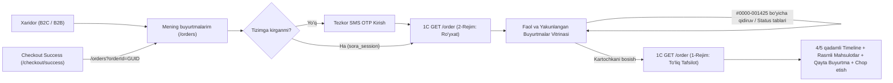

# Buyurtmalarni Kuzatish va «Mening Buyurtmalarim» Bo‘limining Yangi Biznes Logikasi va UI/UX Rejasi

> **Hujjat nomi:** `Loyixa_xujjatlari/new_order_stay_plan.md`  
> **Tayanch hujjatlar:** `Loyixa_xujjatlari/new_order.md` (`POST /order`) va `Loyixa_xujjatlari/new_order_get_st.md` (`GET /order`)  
> **Maqsad:** Eski API davridan qolgan noqulay *«Buyurtma holatini tekshirish (Проверить статус заказа)»* GUID-modalidan voz kechib, yangi 1C API imkoniyatlariga 100% mos, mijoz uchun tabiiy va biznes uchun sotuvni oshiruvchi yagona **«Mening buyurtmalarim»** tajribasini yaratish.

---

## 1. Muammo Tahlili: Nega hozirgi «Проверить статус заказа» (`OrderTrackerModal`) mantiqqa to‘g‘ri kelmaydi?

Avvalgi 1C API versiyasida mijozning buyurtmalar ro‘yxatini olish imkoni yo‘q edi va bitta buyurtmani ko‘rish uchun faqat 36 belgili 1C GUID (`e44c21a0-318a-11e8-812c-d43d7e011714`) yuborilardi. Shu sababli vaqtinchalik yechim sifatida Header’ga `OrderTrackerModal` qo‘shilgan edi.

Yangi 1C `POST /order` va `GET /order` ishga tushgach, bu modal **3 ta jiddiy biznes va UX ziddiyatini** keltirib chiqardi:

| № | Hozirgi holatdagi muammo | Nega bu xato? (Biznes va UX nuqtayi nazaridan) |
| :-: | :--- | :--- |
| **1** | **Mijozdan 36 belgili 1C GUID so‘ralishi** (`e44c21a0-318a-11e8-...`) | Hech qaysi haqiqiy xaridor yoki B2B buxgalter 1C bazasining ichki GUID kodini bilmaydi va eslab qolmaydi. Xaridor faqat odam o‘qiy oladigan **`#0000-001425`** buyurtma raqamini va o‘z telefon raqamini biladi. |
| **2** | **Avtorizatsiya talabi fonida GUID so‘rashning ma’nosizligi** | Yangi 1C `GET /order` baribir majburiy egalik tekshiruvini (`type` + `contact_id` yoki `client_id`) talab qiladi. Foydalanuvchi tizimga kirgan zahoti 1C uning **barcha buyurtmalarini** avtomatik qaytaradi. Tizimga kirgan odamdan yana GUID kiritishni so‘rash — mantiqsiz ortiqcha qadam. |
| **3** | **Header menyusida ikkita bir-birini takrorlovchi tugma** (*«Mening buyurtmalarim»* va *«Buyurtma holati / Статус заказа»*) | Foydalanuvchi profil menyusini ochganda qaysi birini bosishni bilmay ikkilanadi. Zamonaviy e-commerce (Uzum, Wildberries, Amazon, Kaspi) standartida barcha joriy holatlar ham, tarix ham **bitta «Mening buyurtmalarim»** markazida bo‘ladi. |

---

## 2. Yangi Biznes Logika Konsepsiyasi: «Yagona Buyurtmalar Markazi»

### Asosiy Biznes Qoidalar:
1. **`OrderTrackerModal` butunlay olib tashlanadi:** Header profil menyusida faqat bitta aniq **«Mening buyurtmalarim / Мои заказы»** (`/orders`) bandi qoladi.
2. **GUID o‘rniga `#0000-001425` raqami va vizual kartochkalar:** Foydalanuvchi hech qachon GUID ko‘rmaydi (GUID faqat kod ichida 1C ga so‘rov yuborish uchun ishlatiladi). Ekranda faqat `#0000-001425` ko‘rinadi va qidiruv ham shu raqam bo‘yicha ishlaydi.
3. **Faol buyurtmalar har doim birinchi (Action-First UX):** Hali yetkazib berilmagan buyurtmalar (`PENDING`, `CONFIRMED`, `ASSEMBLED`, `SHIPPED`, `READY_FOR_PICKUP`) sahifa tepasida vizual progress-bar bilan ajratib ko‘rsatiladi.
4. **Chuqur havola (Deep Linking):** `/checkout/success` sahifasidan *«Buyurtma holatini kuzatish»* tugmasi bosilganda `/orders?orderId={GUID}` ochiladi va o‘sha buyurtmaning tafsilot oynasi avtomatik tarzda ekranga chiqadi.
5. **Katalog bilan boyitish va Qayta xarid (Repeat Order):** Buyurtma tafsilotidagi mahsulotlar 1C `product_id` orqali sayt katalogi bilan boyitilib, rasmi va sahifa havolasi bilan chiqadi hamda **«Buyurtmani takrorlash»** tugmasi orqali 1 klikda savatchaga qayta yig‘iladi.

---

## 3. Yangi Ko‘rinish (UI/UX) Tuzilmasi — `/[locale]/orders`

### 3.1. Sahifa Tepasi: Xulosa Карtochkalari va Aqlli Filtrlar
Foydalanuvchi `/orders` sahifasiga kirganda darhol umumiy holatni ko‘radi:
- **Tezkor ko‘rsatkichlar (Mini-statistika):**
  - *Faol buyurtmalar:* `N ta` (jarayondagi buyurtmalar)
  - *Yakunlangan xaridlar:* `M ta` (`DELIVERED`)
- **Status bo‘yicha guruhlangan Tablar:**
  1. **Barchasi (Все)**
  2. **Faol / Jarayonda (Активные)** — `PENDING`, `CONFIRMED`, `ASSEMBLED`, `SHIPPED`, `READY_FOR_PICKUP`
  3. **Yetkazilgan (Завершённые)** — `DELIVERED`
  4. **Bekor qilingan (Отменённые)** — `CANCELLED`
- **Odamga qulay qidiruv satri:**
  - *Placeholder:* `Buyurtma raqami bo'yicha qidirish (masalan: 1425 yoki 0000-001425)...`
  - Mijoz faqat oxirgi raqamlarni (`1425`) yozsa ham darhol topadi.
- **B2B Manba Filtri (faqat `user.type === "B2B"` uchun):**
  - `Barchasi (Sayt + 1C oflayn)` (`only_online=false`) | `Faqat sayt buyurtmalari` (`only_online=true`).

---

### 3.2. Yangilangan Buyurtma Kartochkasi (Ro‘yxatdagi ko‘rinish)
Har bir buyurtma kartochkasi shunchaki matn emas, balki **bir qarashda holatni tushuntiruvchi vizuallikka** ega bo‘ladi:

1. **Yuqori qator:**
   - Buyurtma raqami: **`#0000-001425`** (yonida 1 klikda nusxa olish `Copy` ikonkasi bilan).
   - Yaratilgan sana va vaqt (`20.11.2026 • 09:15`).
   - Agar `online: false` bo‘lsa — kulrang **«1C Oflayn xarid»** yorlig‘i.
   - O‘ng tomonda: yorqin `status_code` badge (*«Omborda yig‘ildi»* / *«Собран на складе»*).
2. **O‘rta qator (Faol buyurtmalar uchun Mini-Progress Bar):**
   - Agar buyurtma faol bo‘lsa (`CONFIRMED`, `ASSEMBLED`, `SHIPPED`, `READY_FOR_PICKUP`), kartochkaning o‘zidayoq 4 bo‘lakli chiziqli indikator ko‘rinadi:
     - `CONFIRMED` → 25% (1/4 qadam yashil)
     - `ASSEMBLED` → 50% (2/4 qadam yashil)
     - `SHIPPED` / `READY_FOR_PICKUP` → 75% (3/4 qadam yashil)
     - `DELIVERED` → 100% (to‘liq yashil)
     - `PENDING` → Sariq nuqtali indikator (*«Menejer tasdig‘i kutilmoqda»*)
3. **Pastki qator:**
   - Yetkazib berish usuli (`Kuryer orqali` yoki `Samovivoz`) va pozitsiyalar soni (`3 ta mahsulot`).
   - Yakuniy summa: **`450 000 so'm`** hamda **«Batafsil va tarkib →»** tugmasi.

---

### 3.3. Boyitilgan Buyurtma Tafsiloti Oynasi (`OrderDetailModal`)
Kartochka bosilganda (yoki `/orders?orderId=...` orqali kirilganda) ochiladigan tafsilot oynasiga quyidagi **4 ta yangi biznes imkoniyat** qo‘shiladi:

#### 1) Katalog bilan boyitilgan mahsulotlar jadvali (Rasm + Havola + Artikul)
1C `GET /order` javobidagi `products[]` massivida `product_id` (GUID), `product_name`, `unit`, `quantity`, `price`, `amount` keladi.
- Katalogdagi mahsulotlar bilan `product_id` orqali solishtirilib:
  - Mahsulotning **rasmi (`40x40` thumbnail)** chiqariladi;
  - Mahsulot nomi bosilganda **mahsulot sahifasiga (`/products/[slug]`)** olib o‘tadi;
  - Agar menejer 1C ichida miqdor yoki narxni o‘zgartirgan bo‘lsa, 1C dagi eng so‘nggi aktual miqdor va summa ko‘rsatiladi.

#### 2) «Buyurtmani takrorlash / Повторить заказ» tugmasi
- Oynaning pastki qismida **«Ushbu buyurtmani takrorlash (Savatga qo‘shish)»** tugmasi joylashadi.
- Bosilganda buyurtma ichidagi mahsulotlar `useCartStore` orqali savatchaga qo‘shiladi (mavjud katalog ma’lumotlari va miqdorlari bilan) hamda foydalanuvchi `/cart` sahifasiga o‘tadi.
- **Biznes foydasi:** Doimiy ofis va B2B mijozlar har oy A4 qog‘oz, ruchka, papka kabi o‘nlab mahsulotlarni qaytadan qidirib o‘tirmasdan, 3 soniyada qayta buyurtma qiladi.

#### 3) «Chop etish / Печать» (Buyurtma varaqasi)
- **«Chop etish»** tugmasi orqali buyurtma raqami, mijoz/tashkilot nomi, status, mahsulotlar jadvali va jami summa toza A4 formatda qog‘ozga chiqariladi yoki PDF sifatida saqlanadi (B2B hisobot va ombor qabul qilishi uchun juda qulay).

#### 4) Buyurtma bo‘yicha Menejerga Tezkor Bog‘lanish
- Oyna pastida **«Buyurtma bo‘yicha savol bormi? Telegram orqali yozish»** havolasi bo‘ladi (`https://t.me/sora_uz`). Mijoz `#0000-001425` raqamini nusxalab darhol operatorga murojaat qilishi mumkin.

---

### 3.4. `OrderSuccessView` (`/checkout/success`) bilan Choksiz Bog‘lanish
Buyurtma rasmiylashtirilgandan keyin ochiladigan `/checkout/success` sahifasida:
- Boshlang‘ich holat (`CONFIRMED` yoki `PENDING`) va `OrderTimeline` darhol ko‘rinadi.
- Pastki asosiy harakat tugmasi **«Buyurtma holatini kuzatish (#0000-001425)»** bo‘lib, u `/orders?orderId={orderId}` manziliga yo‘naltiradi.
- Foydalanuvchi u tugmani bossa, `/orders` sahifasi ochiladi va aynan shu buyurtmaning tafsilot oynasi avtomatik ochiq holda chiqadi.

---

## 4. Bosqichma-Bosqich Amalga Oshirish Rejasi

| Bosqich | Vazifa | Qilinadigan ishlar |
| :-: | :--- | :--- |
| **1-Bosqich** | **Eskirgan GUID-modalni (`OrderTrackerModal`) olib tashlash va navigatsiyani tozalash** | • `Header.tsx` dan `OrderTrackerModal` va *«Buyurtma holati / Статус заказа»* tugmasini olib tashlash. • Profil menyusida yagona, aniq **«Mening buyurtmalarim / Мои заказы»** (`/orders`) bandini qoldirish. • `OrderTrackerModal.tsx` faylini loyihadan tozalash. |
| **2-Bosqich** | **`/orders` sahifasiga Status Tablari, `#0000-001425` Qidiruvi va Mini-Progress Bar qo‘shish** | • `OrdersHistoryClient.tsx` da 4 ta status tabini (*Barchasi*, *Faol*, *Yetkazilgan*, *Bekor qilingan*) va buyurtma raqami bo‘yicha jonli qidiruv inputini qo‘shish. • Faol buyurtma kartochkalariga 4 bosqichli vizual mini-progress bar va buyurtma raqamini nusxalash (`Copy`) tugmasini qo‘shish. • `?orderId={GUID}` query parametri bilan kelganda o‘sha buyurtma tafsilotini avtomatik ochish (Deep Link). |
| **3-Bosqich** | **`OrderDetailModal` ni Katalog Rasmlari, «Buyurtmani takrorlash» va «Chop etish» bilan boyitish** | • `/[locale]/orders/page.tsx` dan katalog mahsulotlarining ixcham indeksini (`id → { slug, pic, sku, price, unit }`) uzatish. • `OrderDetailModal.tsx` dagi mahsulotlar jadvalida mahsulot rasmi (`pic`), artikuli va PDP sahifasiga havolasini chiqarish. • **«Buyurtmani takrorlash»** (barcha mahsulotlarni savatchaga qo‘shib `/cart` ga o‘tish) va **«Chop etish»** tugmalarini qo‘shish. |
| **4-Bosqich** | **`OrderSuccessView.tsx` va Tarjimalarni (`uz.json`, `ru.json`) uyg‘unlashtirish** | • `OrderSuccessView.tsx` dagi *«Mening buyurtmalarim»* tugmasini `/orders?orderId={displayOrderId}` chuqur havolasiga bog‘lash. • `messages/uz.json` va `messages/ru.json` dagi `orders` bo‘limiga yangi tablar, qidiruv, qayta buyurtma va chop etish tarjimalarini qo‘shish. |
| **5-Bosqich** | **Sifat Nazorati va Testlar** | • `tests/order.spec.ts` ga `/orders` qidiruvi, status tablari va deep-link tekshiruvlarini qo‘shish. • `npx tsc --noEmit`, `npx eslint`, `npm run build` va Playwright testlarini o‘tkazish. |

---

## 5. O‘zgaradigan Fayllar Xulosasi

| Fayl | Amal | Qisqacha mazmuni |
| :--- | :---: | :--- |
| `src/components/checkout/OrderTrackerModal.tsx` | **O‘chiriladi** | Eskirgan GUID kiritish modali butunlay olib tashlanadi |
| `src/components/layout/Header.tsx` | O‘zgaradi | Ikki tugma o‘rniga yagona «Mening buyurtmalarim» (`/orders`) kirish nuqtasi |
| `src/app/[locale]/orders/page.tsx` | O‘zgaradi | Katalog mahsulotlari (`id → pic/slug/sku`) xaritasi va `orderId` deep-link qo‘llab-quvvatlashi |
| `src/components/orders/OrdersHistoryClient.tsx` | O‘zgaradi | Status tablari (*Faol / Yetkazilgan / Bekor qilingan*), `#0000-001425` qidiruvi, mini-progress bar, deep-link |
| `src/components/orders/OrderDetailModal.tsx` | O‘zgaradi | Rasmli va havolali mahsulotlar jadvali, *«Buyurtmani takrorlash»*, *«Chop etish»*, Telegram yordam |
| `src/components/checkout/OrderSuccessView.tsx` | O‘zgaradi | `/orders?orderId=...` chuqur havolasi orqali buyurtma tafsilotiga to‘g‘ridan-to‘g‘ri o‘tish |
| `messages/uz.json`, `messages/ru.json` | O‘zgaradi | Yangi biznes mantiq va tugmalar uchun UZ / RU tarjimalar |
| `tests/order.spec.ts` | O‘zgaradi | Yangilangan `/orders` UX oqimi uchun Playwright testlari |
