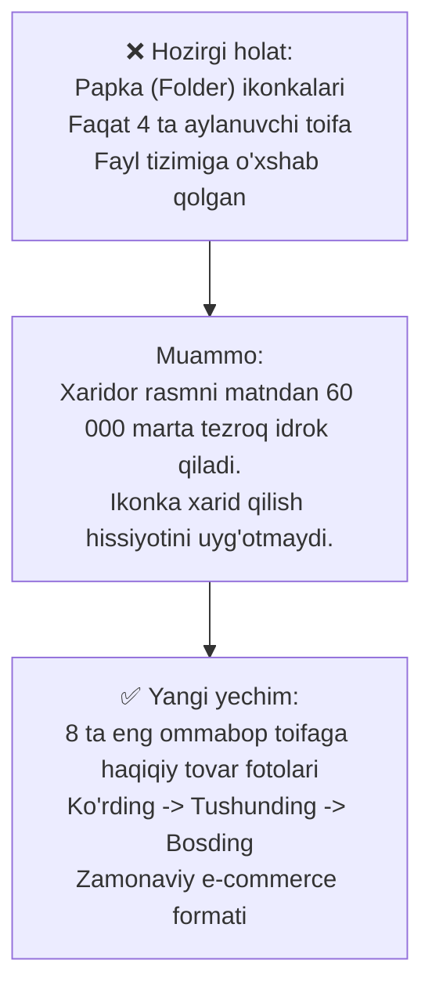

# 📁 Bosh Sahifada Kategoriyalarga Haqiqiy Mahsulot Rasmlarini Qo‘yish Rejasi

> **Hujjat nomi:** `plan_kategoriyal.md`  
> **Loyiha:** Sora.uz — E-commerce platformasi  
> **Vazifa:** "Ommabop kategoriyalar" blokidagi bir xil sariq/ko‘k papka (`Folder`) ikonkalari o‘rniga har bir toifaga mos **yuqori sifatli haqiqiy tovar fotolarini** joylashtirish hamda eng xaridorgir **8 ta asosiy toifani** jozibador formatda taqdim etish.  
> **Asosiy maqsad:** Xaridorning vizual idrokini oshirish (Visual Merchandising), sahifani haqiqiy do‘konga aylantirish, mahsulotlarni topishni tezlashtirish va savdo konversiyasini oshirish.

---

## 1. Muammo Tahlili va Nima Uchun O‘zgartirish Shart?



1. **Vizual idrok qonuni:** E-commerce xaridori matn o‘qishdan erinadi. Daftarlar, ruchkalar yoki A4 qog‘ozini uning rasmi orqali bir soniyadayoq taniydi.
2. **Keng qamrov:** 1C ERP tizimida jami **177 ta kategoriya** mavjud bo‘lib, ularning asosi **12 ta katta guruhga** bo‘linadi. Hozirda esa faqat 4 ta tasodifiy toifa ko‘rinadi.
3. **Eng xaridorgir 8 toifa:** Do‘kon savdosining 85-90% qismi aynan eng mashhur 8 ta toifaga to‘g‘ri keladi. Ularni bosh sahifada doimiy ko‘rinadigan qilib qo‘yish savdoni sezilarli oshiradi.

---

## 2. Yangi Blokning Arxitekturasi va Joylashuv Strukturasi

Bosh sahifadagi `RandomCategories` bloki o‘rniga yangi zamonaviy **`TopCategories`** bloki joriy etiladi:

```
┌────────────────────────────────────────────────────────────────────────┐
│  Ommabop Kategoriyalar                           [ Barcha toifalar -> ] │
├────────────────────────────────────────────────────────────────────────┤
│ ┌──────────────┐ ┌──────────────┐ ┌──────────────┐ ┌──────────────┐   │
│ │ 1. Qog'oz    │ │ 2. Yozuv     │ │ 3. Papkalar  │ │ 4. Ofis      │   │
│ │ Mahsulotlari │ │ Qurollari    │ │ va Fayllar   │ │ Buyumlari    │   │
│ │ [Real Foto]  │ │ [Real Foto]  │ │ [Real Foto]  │ │ [Real Foto]  │   │
│ └──────────────┘ └──────────────┘ └──────────────┘ └──────────────┘   │
│ ┌──────────────┐ ┌──────────────┐ ┌──────────────┐ ┌──────────────┐   │
│ │ 5. Maktab va │ │ 6. Savdo va  │ │ 7. Doskalar  │ │ 8. Kompyuter │   │
│ │ O'qish       │ │ Uskunalar    │ │ & Taqdimot   │ │ Aksessuarlar │   │
│ │ [Real Foto]  │ │ [Real Foto]  │ │ [Real Foto]  │ │ [Real Foto]  │   │
│ └──────────────┘ └──────────────┘ └──────────────┘ └──────────────┘   │
└────────────────────────────────────────────────────────────────────────┘
```

* **Desktop (Kompyuter):** 4 ta ustun x 2 qator = **8 ta yirik chiroyli kartochka**.
* **Planshet:** 4 ta ustun x 2 qator yoki 3 ta ustun.
* **Mobil:** 2 ta ustun x 4 qator (yoki barmoq bilan gorizontal suriluvchi qulay Carousel/Grid).

---

## 3. 8 Ta Asosiy Kategoriya Pasporti (Har Bir Toifa Uchun Batafsil)

1C ERP dagi 177 ta toifadan eng ko‘p sotiladigan 8 ta asosiy ildiz toifasi tanlab olindi:

---

### 📄 1. Qog‘oz Mahsulotlari (Бумажная продукция)
* **1C Slug:** `/category/qogoz-mahsulotlari` (RU: `bumazhnaya-produkciya`)
* **Haqiqiy Mahsulot Fotosi:**  
  SvetoCopy / Double A / Deli A4 qog‘oz pachkasi, yonida oqlangan bloknot va qog‘oz bloklari.
* **Qo‘shimcha ko‘rinuvchi teglar:**  
  *A4 Qog‘oz • Bloknotlar • Kassa lentasi • Qayd qog‘ozlari*
* **Fon va Bezak:**  
  Och moviy gradient fon (`from-sky-50 to-blue-50 dark:from-sky-950/30 dark:to-blue-950/20`), ko‘k aksent.
* **Xaridor auditoriyasi:** Ofislar, buxgalteriya, maktab va xususiy shaxslar.

---

### 🖊️ 2. Yozuv Qurollari (Письменные принадлежности)
* **1C Slug:** `/category/yozuv-qurollari` (RU: `pismennye-prinadlezhnosti`)
* **Haqiqiy Mahsulot Fotosi:**  
  Deli gel va sharikli ruchkalari, yorqin tekst-markerlar (highlighter) va qalamlar to‘plami.
* **Qo‘shimcha ko‘rinuvchi teglar:**  
  *Gel ruchkalar • Markerlar • Avtomatik qalamlar • Korrektor*
* **Fon va Bezak:**  
  Och qahrabo/oltin fon (`from-amber-50 to-orange-50 dark:from-amber-950/30 dark:to-orange-950/20`), sarg‘ish-oltin aksent.
* **Xaridor auditoriyasi:** Talabalar, o‘quvchilar, bank xodimlari, ofislar.

---

### 📁 3. Papkalar va Fayllar (Папки и файлы)
* **1C Slug:** `/category/papkalar-va-fayllar` (RU: `papki-i-fajly`)
* **Haqiqiy Mahsulot Fotosi:**  
  Deli registrator papkalari (arch files), shaffof perfofayllar to‘plami va qisqichli papkalar.
* **Qo‘shimcha ko‘rinuvchi teglar:**  
  *Registratorlar • Perfofayllar • Tugmali papkalar • Tez-tikgichlar*
* **Fon va Bezak:**  
  Och zumrad/yashil fon (`from-emerald-50 to-teal-50 dark:from-emerald-950/30 dark:to-teal-950/20`), yashil aksent.
* **Xaridor auditoriyasi:** Hujjatlar bilan ishlovchi tashkilotlar, arxivlar, huquqshunoslar.

---

### 📎 4. Ofis Buyumlari va Mayda Anjomlar (Офисные принадлежности)
* **1C Slug:** `/category/ofis-buyumlari` (RU: `ofisnye-prinadlezhnosti`)
* **Haqiqiy Mahsulot Fotosi:**  
  Metall stepler, teshgich (dirokol), skoch dispenser, skrepka va qisqichlar (binder clip) to‘plami.
* **Qo‘shimcha ko‘rinuvchi teglar:**  
  *Steplerlar • Skrepkalar • Skoch • Qaychilar • Qisqichlar*
* **Fon va Bezak:**  
  Och binafsha fon (`from-purple-50 to-violet-50 dark:from-purple-950/30 dark:to-violet-950/20`), binafsha aksent.
* **Xaridor auditoriyasi:** Har qanday korxona va uy ish stoli.

---

### 🎒 5. Maktab va O‘qish Uchun Tovarlar (Товары для школы и обучения)
* **1C Slug:** `/category/maktab-va-oqish-uchun` (RU: `tovary-dlya-shkoly-i-obucheniya`)
* **Haqiqiy Mahsulot Fotosi:**  
  Rangli qalamlar qutisi, akvarel bo‘yoqlar, plastilin, sirkul to‘plami va penal.
* **Qo‘shimcha ko‘rinuvchi teglar:**  
  *Rangli qalamlar • Bo‘yoqlar • Plastilin • Sirkul • Penallar*
* **Fon va Bezak:**  
  Och iliq pushti-to‘q sariq fon (`from-rose-50 to-pink-50 dark:from-rose-950/30 dark:to-pink-950/20`), jonli aksent.
* **Xaridor auditoriyasi:** Ota-onalar, maktab o‘quvchilari, rasm va ijod to‘garaklari.

---

### 🧮 6. Savdo va Ofis Uskunalari (Оборудование для торговли и офиса)
* **1C Slug:** `/category/savdo-uchun-uskunalar` (RU: `oborudovanie-dlya-torgovli`)
* **Haqiqiy Mahsulot Fotosi:**  
  Katta hisob-kitob kalkulyatori, Deli perpletka mashinasi, laminator va pul sanash apparati.
* **Qo‘shimcha ko‘rinuvchi teglar:**  
  *Kalkulyatorlar • Perpletkalar • Laminatorlar • Maydalagichlar*
* **Fon va Bezak:**  
  Och po‘lat-ko‘k fon (`from-slate-100 to-cyan-50 dark:from-slate-900/60 dark:to-cyan-950/30`), texnologik aksent.
* **Xaridor auditoriyasi:** Buxgalterlar, do‘konlar, nashriyot va nusxa ko‘chirish markazlari.

---

### 📋 7. Namoyish va Taqdimot Doskalari (Демонстрационные доски)
* **1C Slug:** `/category/namoyish-doskalari` (RU: `demonstracionnye-doski`)
* **Haqiqiy Mahsulot Fotosi:**  
  Oq magnitli marker doska, oyoqli flipchart, doska tozalagich va magnitlar.
* **Qo‘shimcha ko‘rinuvchi teglar:**  
  *Magnit doskalar • Flipchartlar • E‘lon doskalari • Doska markerlari*
* **Fon va Bezak:**  
  Och osmon rang fon (`from-blue-50 to-indigo-50 dark:from-blue-950/30 dark:to-indigo-950/20`), ko‘k aksent.
* **Xaridor auditoriyasi:** O‘quv markazlari, kovorkinglar, IT kompaniyalar, konferensiya zallari.

---

### 🖱️ 8. Kompyuter va Smartfon Aksessuarlari (Аксессуары для компьютеров)
* **1C Slug:** `/category/kompyuter-aksessuarlari` (RU: `aksessuary-dlya-kompyuterov`)
* **Haqiqiy Mahsulot Fotosi:**  
  Simsiz sichqoncha, ergonomik klaviatura, fleshka, USB hab va monitor tozalovchi vositalar.
* **Qo‘shimcha ko‘rinuvchi teglar:**  
  *Sichqonchalar • Klaviaturalar • USB Fleshkalar • Kabellar*
* **Fon va Bezak:**  
  To‘q kulrang-binafsha fon (`from-zinc-100 to-indigo-50 dark:from-zinc-900/60 dark:to-indigo-950/30`), gadjet aksenti.
* **Xaridor auditoriyasi:** Barcha kompyuter foydalanuvchilari va zamonaviy ofis xodimlari.

---

## 4. Kartochkaning Zamonaviy Dizayni va Animatsiyasi (Card Anatomy)

Har bir toifa kartochkasi oddiy kvadrat emas, balki zamonaviy e-commerce kartochkasi shaklida yasaladi:

```
┌────────────────────────────────────────────────────────┐
│  Qog‘oz Mahsulotlari                       [ Icon -> ] │
│  42 xil turdagi tovarlar                                │
│                                                        │
│                  ┌──────────────────────┐              │
│                  │  Haqiqiy Mahsulot    │              │
│                  │  Fotosi (A4 qog'oz)  │              │
│                  │  (Hover: Zoom + 3D)  │              │
│                  └──────────────────────┘              │
│  A4 • Bloknot • Kassa lentasi                          │
└────────────────────────────────────────────────────────┘
```

* **Hover (Sichqoncha borganda):**  
  - Rasm 5% ga silliq kattalashadi (`group-hover:scale-105 transition-transform duration-300`).
  - Kartochka chegarasi do‘konning o‘ziga xos moviy rangiga o‘zgaradi (`hover:border-sora-400 dark:hover:border-sora-500`).
  - Yengil zamonaviy soya paydo bo‘ladi (`hover:shadow-lg`).
* **Mobil teginish (Active touch):**  
  - Barmoq tekkan paytda 98% masshtabga qisqarib (press effect), bosilganini sezdiradi.

---

## 5. Texnik Arxitektura va Fayllar Strukturasi

Yangi komponentlar quyidagi tartibda joylashtiriladi:

```
src/
├── components/
│   └── discovery/
│       ├── TopCategories.tsx          <-- YANGI: 8 ta toifani chiqaruvchi asosiy blok
│       ├── CategoryVisualCard.tsx     <-- YANGI: Haqiqiy fotosi bor boy kartochka
│       └── RandomCategories.tsx       <-- Saqlanadi (kerak bo'lsa pastki qismda)
├── lib/
│   └── data/
│       └── category-visuals.ts        <-- YANGI: 8 ta toifaning rasmlari, sluglari, teglari xaritasi
public/
└── categories/
    ├── qogoz.webp                     <-- O'lchami: 400x400px (40-60 KB WebP)
    ├── yozuv.webp
    ├── papkalar.webp
    ├── ofis.webp
    ├── maktab.webp
    ├── texnika.webp
    ├── doskalar.webp
    └── aksessuarlar.webp
```

---

## 6. Tezlik (Core Web Vitals) va Kesh Xavfsizligi

1. **Vercel xarajatiga 0% ta’sir:**  
   Toifalar rasmlari bepul va tezkor mahalliy `/public/categories/` papkasida yoki optimallashgan WebP formatida saqlanadi. Ular tashqi xizmatlardan (masalan `i.ibb.co` dan) tortilmaydi, shu sababli hech qachon "timed out" bo‘lmaydi.
2. **0 CLS (Sakramaydigan yuklanish):**  
   Har bir kartochka va rasmning kenglik hamda balandlik nisbati (`aspect-square` yoki `h-40`) qat’iy belgilab qo‘yiladi.
3. **Lazy Loading:**  
   Bu blok bosh sahifaning 2-ekranida (Hero bannerdan keyin) turgani uchun, rasmlar `loading="lazy"` orqali faqat foydalanuvchi pastga tushganda olinadi. Bu orqali 1-ekran LCP ko‘rsatkichi o‘ta tez (0.1–0.2s) bo‘lib qoladi.

---

## 7. Bosqichma-bosqich Amalga Oshirish Rejasi (Checklist)

- [ ] **1-qadam:** 8 ta asosiy toifa uchun tiniq, orqa foni oq/shaffof qilingan yuqori sifatli tovar fotolarini tayyorlash (`/public/categories/*.webp`).
- [ ] **2-qadam:** `src/lib/data/category-visuals.ts` ma'lumotlar xaritasini yaratish (1C sluglari, ikki tilli nomlar va teglar).
- [ ] **3-qadam:** `src/components/discovery/CategoryVisualCard.tsx` kartochka komponentini ishlab chiqish.
- [ ] **4-qadam:** `src/components/discovery/TopCategories.tsx` konteynerini yaratish (Desktop 4x2 grid, mobil moslashuvchanlik).
- [ ] **5-qadam:** `src/app/[locale]/page.tsx` faylida eski `RandomCategories` o‘rniga yangi `TopCategories` ni ulash.
- [ ] **6-qadam:** Playwright testlari bilan tekshirish (rasmlar ochilishi, to‘g‘ri kategoriyaga yo‘naltirilishi, mobil ko‘rinish).
- [ ] **7-qadam:** Git commit va GitHub `main` tarmog‘iga push qilish.

---

*Ushbu reja tasdiqlangach, sanab o‘tilgan 7 ta qadam bo‘yicha to‘liq joriy etishga kirishiladi.*
