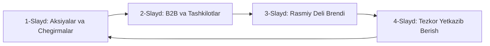

# 🚀 Bosh Sahifa Hero Bannerni Dinamik Slayderga (Carousel) Aylantirish Rejasi

> **Hujjat nomi:** `plan_slayd.md`  
> **Loyiha:** Sora.uz — E-commerce platformasi  
> **Vazifa:** Bosh sahifadagi statik bir dona perpletka mashinasi rasmini zamonaviy, ko‘p funksiyali, interaktiv va sotuvni oshiruvchi 4 ta dinamik slaydga aylantirish.  
> **Asosiy talablar:** 100% Mobil va Desktop moslashuvchanlik, Touch Swipe (barmog‘i bilan surish), 0 CLS (sakramaydigan), yuqori LCP tezligi, professional 3D kompozitsiya va ikki tilli (O‘zbekcha / Ruscha) to‘liq integratsiya.

---

## 1. Loyihaning Maqsadi va Biznes Afzalliklari

1. **Birinchi taassurotni boyitish:** Xaridor do‘konda faqat bitta perpletka apparati emas, balki maktab, ofis, qog‘oz, orgtexnika va B2B korporativ tovarlari borligini birinchi 5 soniyadayoq ko‘radi.
2. **Savdoni oshirish (Conversion):** Aksiyalar, yangi tovarlar va B2B xizmatlarga to‘g‘ridan-to‘g‘ri "Call to Action" tugmalari orqali xaridorlarni kerakli bo‘limga yo‘naltirish.
3. **B2B korporativ mijozlarni jalb qilish:** Ofislar, banklar va korxonalarga Didox va shartnoma orqali ulgurji xarid imkoniyatini darhol yetkazish.

---

## 2. 4 Ta Slaydning To‘liq Loyihasi (Har Bir Slayd Pasporti va Vizual Dizayni)



---

### 🏷️ 1-SLAYD: Aksiyalar va Maxsus Chegirmalar (Aksiya Fasli)

* **Maqsadi:** Yangi xaridorni arzon narxlar, ulgurji chegirmalar va boy assortiment bilan jalb qilish.
* **Fon va Rang Palitrasi:**  
  `bg-gradient-to-br from-rose-950 via-sora-950 to-slate-950`  
  *Orqa fon aurasining nuri:* O‘ng yuqori qismida yorqin qizil-olovrang radial nur (`bg-radial from-rose-500/25 via-amber-500/10 to-transparent`).

#### Kontent (Matnlar):
* **Badge (Yuqori teg):**  
  - 🇺🇿 *Aksiya • 30% gacha chegirma* (Ikonka: `Percent` yoki `Sparkles`)  
  - 🇷🇺 *Акция • Скидки до 30%*
* **Bosh Sarlavha (H1/H2):**  
  - 🇺🇿 **Kanselyariya va Ofis Jihozlari Ulgurji Narxlarda**  
  - 🇷🇺 **Канцелярия и Товары для Офиса по Оптовым Ценам**
* **Qisqa Tavsif (Subtitle):**  
  - 🇺🇿 *Daftarlar, qog‘ozlar, yozuv qurollari va ofis anjomlarini eng maqbul narxlarda xarid qiling. 1C omboridan to‘g‘ridan-to‘g‘ri kafolat bilan.*  
  - 🇷🇺 *Тетради, бумага, письменные принадлежности и офисные товары по лучшим ценам с гарантией со склада 1С.*

#### Tugmalar (CTA Buttons):
1. **Asosiy tugma:**  
   - Matn: `[ 🔥 Chegirmalarni ko'rish ]` / `[ 🔥 Смотреть акции ]`  
   - Havola: `/catalog/promotions`  
   - Uslub: `bg-rose-600 hover:bg-rose-500 text-white font-bold shadow-lg shadow-rose-600/30`  
   - Ikonka: `ArrowRight`
2. **Ikkilamchi tugma:**  
   - Matn: `[ 📁 Katalogni ko'rish ]` / `[ 📁 Каталог товаров ]`  
   - Havola: `/catalog`  
   - Uslub: `bg-white/10 hover:bg-white/20 text-white border border-white/20 backdrop-blur-xs`

#### 🎨 1-Slayd Rasmining Aniq Vizual Dizayni va Art Direction:
* **Fayl nomi va yo‘li:** `/public/banners/hero-slide-sale.webp`
* **Texnik o‘lchami:** 800 $\times$ 600 px (2x Retina), Shaffof orqa fon (Transparent PNG/WebP, 0 ta qora yoki oq chetlar), hajmi: ~65 KB.
* **Kompozitsiya (Aniq ob'ektlar joylashuvi):**
  1. **Markaziy ob'ekt:** Ochiq yashil va oq o‘ramdagi yangi SvetoCopy / Double A A4 qog‘oz pachkasi (45 daraja izometrik burchak ostida, qog‘ozning tiniq fakturasi ko‘rinadi).
  2. **Yozuv qurollari guruhi (Oldingi plan):** Shaffof akril stakanchada Deli gel ruchkalari, neon tekst-markerlar (yorqin sariq va pushti) hamda qalamlar.
  3. **Aksessuarlar:** Metall stepler (och ko‘k rangda), qora rangli binder qisqichlar (binder clips) va yaltiroq skrepkalar stol ustiga estetik sochilgan holda.
  4. **3D Mikro-effekt:** Havoda suzib yurgan yaltiroq qizil-oltin 3D chegirma foiz nishoni (`-30%` yoki `Sale`).
* **Frame (Konteyner ramkasi):**  
  `relative w-48 sm:w-80 lg:w-96 h-40 sm:h-72 lg:h-80 bg-white/10 backdrop-blur-md rounded-3xl border border-white/15 shadow-2xl p-3 flex items-center justify-center`
* **Floating Mini-Badge (Pastki burchak nishoni):**  
  - Joylashuvi: Pastki chap burchak (`absolute -bottom-3 -left-3 sm:-bottom-4 sm:-left-4`)
  - Dizayni: Oq orqa fon, to‘q slate matn, `shadow-xl border border-slate-100`
  - Ikonka: `CheckCircle2` (Zumrad yashil, `text-emerald-500`)
  - Matn: 🇺🇿 `⭐ 10 000+ tovar mavjud` / 🇷🇺 `⭐ 10 000+ товаров в наличии`

---

### 🏢 2-SLAYD: B2B va Korporativ Mijozlar (Kompaniyalar, Ofislar, Banklar)

* **Maqsadi:** Yuridik shaxslarga ulgurji xarid, shartnoma, QQS va Didox orqali ishlashni taklif qilish.
* **Fon va Rang Palitrasi:**  
  `bg-gradient-to-br from-indigo-950 via-slate-900 to-sora-950`  
  *Orqa fon aurasining nuri:* Chuqur indigo-moviy radial nur (`bg-radial from-indigo-500/30 via-sora-500/15 to-transparent`).

#### Kontent (Matnlar):
* **Badge (Yuqori teg):**  
  - 🇺🇿 *B2B Hamkorlik • Didox EHF* (Ikonka: `Building2`)  
  - 🇷🇺 *B2B Сотрудничество • ЭСФ Didox*
* **Bosh Sarlavha (H1/H2):**  
  - 🇺🇿 **Ofisingiz Uchun Barcha Anjomlar — 24 Soatda Yetkazamiz**  
  - 🇷🇺 **Всё для Вашего Офиса — С Доставкой за 24 Часа**
* **Qisqa Tavsif (Subtitle):**  
  - 🇺🇿 *QQS bilan to‘lov, shartnoma, Didox elektron hisob-faktura va doimiy korporativ mijozlar uchun shaxsiy menejer hamda ulgurji narxlar.*  
  - 🇷🇺 *Оплата с НДС, официальный договор, ЭСФ через Didox, персональный менеджер и оптовые цены для компаний.*

#### Tugmalar (CTA Buttons):
1. **Asosiy tugma:**  
   - Matn: `[ 🏢 B2B Bo'limi & Shartnoma ]` / `[ 🏢 Для Юр. лиц (B2B) ]`  
   - Havola: `/b2b`  
   - Uslub: `bg-indigo-600 hover:bg-indigo-500 text-white font-bold shadow-lg shadow-indigo-600/30`  
   - Ikonka: `Building2`
2. **Ikkilamchi tugma:**  
   - Matn: `[ 💬 Telegram Menejer ]` / `[ 💬 Менеджер в Telegram ]`  
   - Havola: `https://t.me/sora_uz`  
   - Uslub: `bg-white/10 hover:bg-white/20 text-white border border-white/20`  
   - Ikonka: `Send`

#### 🎨 2-Slayd Rasmining Aniq Vizual Dizayni va Art Direction:
* **Fayl nomi va yo‘li:** `/public/banners/hero-slide-b2b.webp`
* **Texnik o‘lchami:** 800 $\times$ 600 px, Shaffof orqa fon (Transparent Alpha), hajmi: ~60 KB.
* **Kompozitsiya (Aniq ob'ektlar joylashuvi):**
  1. **Markaziy ob'ekt:** 2 ta qalin korporativ Deli registrator arxiv papkasi (to‘q ko‘k va kulrang-qora rangda, metall burchakli himoya bilan tik turgan holda).
  2. **Raqamli B2B belgisi:** Papkalar yonida zamonaviy yupqa planshet ekrani, unda Didox elektron hisob-faktura hujjati va tasdiqlovchi yashil ERI (Elektron raqamli imzo) muhri aks etgan.
  3. **Oldingi plan:** Premium qora-oltin rangli metall ruchka, qog‘oz bloknoti hamda zamonaviy katta hisob-kitob kalkulyatori.
  4. **Vizual kayfiyat:** Tartibli, professional biznes ofis muhiti, qat’iy ishonchlilik ramzi.
* **Frame (Konteyner ramkasi):**  
  `relative w-48 sm:w-80 lg:w-96 h-40 sm:h-72 lg:h-80 bg-white/10 backdrop-blur-md rounded-3xl border border-white/15 shadow-2xl p-3 flex items-center justify-center`
* **Floating Mini-Badge:**  
  - Joylashuvi: Pastki chap burchak (`absolute -bottom-3 -left-3 sm:-bottom-4 sm:-left-4`)
  - Ikonka: `ShieldCheck` (Ko‘k-indigo, `text-indigo-400`)
  - Matn: 🇺🇿 `✅ 100% Rasmiy hujjatlar & Didox` / 🇷🇺 `✅ 100% Документы и ЭСФ`

---

### 🏆 3-SLAYD: Rasmiy Deli Brendi va Kafolatlangan Orgtexnika

* **Maqsadi:** Rasmiy dilerlik va texnika kafolatini namoyish etish (Deli uskunalariga bo‘lgan ishonchni mustahkamlash).
* **Fon va Rang Palitrasi:**  
  `bg-gradient-to-br from-amber-950 via-slate-900 to-sora-950`  
  *Orqa fon aurasining nuri:* Yorqin tilla-amber rangli radial nur (`bg-radial from-amber-400/25 via-orange-500/10 to-transparent`).

#### Kontent (Matnlar):
* **Badge (Yuqori teg):**  
  - 🇺🇿 *Rasmiy Brend • 1C Kafolati* (Ikonka: `Award`)  
  - 🇷🇺 *Официальный Бренд • Гарантия 1С*
* **Bosh Sarlavha (H1/H2):**  
  - 🇺🇿 **Deli: Perpletka, Laminator va Professional Jihozlar**  
  - 🇷🇺 **Deli: Переплетчики, Ламинаторы и Офисная Техника**
* **Qisqa Tavsif (Subtitle):**  
  - 🇺🇿 *Deli brendining original perpletka mashinalari, maydalagichlar (shredder), skanerlar va muhrlash texnikasi rasmiy 1C kafolati bilan.*  
  - 🇷🇺 *Оригинальные брошюровщики, уничтожители бумаг, ламинаторы и техника Deli с официальной гарантией 1С.*

#### Tugmalar (CTA Buttons):
1. **Asosiy tugma:**  
   - Matn: `[ 🏆 Deli Mahsulotlari ]` / `[ 🏆 Каталог Deli ]`  
   - Havola: `/brand/deli`  
   - Uslub: `bg-amber-500 hover:bg-amber-400 text-slate-950 font-bold shadow-lg shadow-amber-500/30`  
   - Ikonka: `Award`
2. **Ikkilamchi tugma:**  
   - Matn: `[ 🛡 Kafolat shartlari ]` / `[ 🛡 Условия гарантии ]`  
   - Havola: `/warranty`  
   - Uslub: `bg-white/10 hover:bg-white/20 text-white border border-white/20`

#### 🎨 3-Slayd Rasmining Aniq Vizual Dizayni va Art Direction:
* **Fayl nomi va yo‘li:** `/public/banners/hero-slide-deli.webp`
* **Texnik o‘lchami:** 800 $\times$ 600 px, Shaffof orqa fon (Transparent Alpha), hajmi: ~70 KB.
* **Kompozitsiya (Aniq ob'ektlar joylashuvi):**
  1. **Markaziy ob'ekt:** Deli E3871 professional Kombi perpletka (broshuryor) mashinasi yoki Deli metall korpusli A3 laminatori. Metall tutqichi, perforatsiya tishlari va o‘lchov shkalasi tiniq yaltirab turadi.
  2. **Yordamchi elementlar:** Mashinadan chiqqan, chiroyli qora spiral bilan muqovalangan taqdimot broshyurasi (birinchi sahifasi ochiq).
  3. **Yonida:** Rangli plastik va metall spirallar qutisi hamda yaltiroq termolaminatsiya plyonkalari to‘plami.
  4. **Vizual kayfiyat:** Yuqori aniqlikdagi sanoat dizayni, ishonchli mexanika va yapon-nemis sifatidagi orgtexnika taassuroti.
* **Frame (Konteyner ramkasi):**  
  `relative w-48 sm:w-80 lg:w-96 h-40 sm:h-72 lg:h-80 bg-white/10 backdrop-blur-md rounded-3xl border border-white/15 shadow-2xl p-3 flex items-center justify-center`
* **Floating Mini-Badge:**  
  - Joylashuvi: Pastki chap burchak (`absolute -bottom-3 -left-3 sm:-bottom-4 sm:-left-4`)
  - Ikonka: `CheckCircle2` (Oltin-amber rang, `text-amber-400`)
  - Matn: 🇺🇿 `⚡ 1C ERP Sinxron va Kafolat` / 🇷🇺 `⚡ Синхронизация с 1С`

---

### 🚚 4-SLAYD: Tezkor Yetkazib Berish va Qulay To‘lovlar

* **Maqsadi:** Mijozning yetkazib berish va to‘lov xavfsizligi bo‘yicha har qanday ikkilanishlarini yo‘qotish.
* **Fon va Rang Palitrasi:**  
  `bg-gradient-to-br from-emerald-950 via-slate-900 to-sora-950`  
  *Orqa fon aurasining nuri:* Zumrad yashil radial nur (`bg-radial from-emerald-500/30 via-teal-500/10 to-transparent`).

#### Kontent (Matnlar):
* **Badge (Yuqori teg):**  
  - 🇺🇿 *24 Soatda Yetkazish • Bepul kuryer* (Ikonka: `Truck`)  
  - 🇷🇺 *Доставка за 24 Часа • Бесплатный курьер*
* **Bosh Sarlavha (H1/H2):**  
  - 🇺🇿 **Toshkent Bo‘ylab 24 Soatda, Viloyatlarga 1–3 Kunda**  
  - 🇷🇺 **По Ташкенту за 24 Часа, в Регионы за 1–3 Дня**
* **Qisqa Tavsif (Subtitle):**  
  - 🇺🇿 *500 000 so‘mdan yuqori xaridlarga Toshkent shahrida bepul kuryer. Qabul qilgach to‘lash (Naqd, Click, Payme, Uzum).*  
  - 🇷🇺 *Бесплатная доставка по Ташкенту при заказе от 500 000 сум. Оплата при получении (Наличные, Click, Payme, Uzum).*

#### Tugmalar (CTA Buttons):
1. **Asosiy tugma:**  
   - Matn: `[ 🛒 Xaridni Boshlash ]` / `[ 🛒 Начать покупки ]`  
   - Havola: `/catalog`  
   - Uslub: `bg-emerald-600 hover:bg-emerald-500 text-white font-bold shadow-lg shadow-emerald-600/30`  
   - Ikonka: `ArrowRight`
2. **Ikkilamchi tugma:**  
   - Matn: `[ 🚚 Yetkazib berish shartlari ]` / `[ 🚚 Условия доставки ]`  
   - Havola: `/delivery`  
   - Uslub: `bg-white/10 hover:bg-white/20 text-white border border-white/20`

#### 🎨 4-Slayd Rasmining Aniq Vizual Dizayni va Art Direction:
* **Fayl nomi va yo‘li:** `/public/banners/hero-slide-delivery.webp`
* **Texnik o‘lchami:** 800 $\times$ 600 px, Shaffof orqa fon (Transparent Alpha), hajmi: ~55 KB.
* **Kompozitsiya (Aniq ob'ektlar joylashuvi):**
  1. **Markaziy ob'ekt:** Sora.uz logotipli ekologik toza kraft qutilar (ustiga ko‘k rangli brend lenta yopishtirilgan, sifatli qadoqlangan posilka).
  2. **Yetkazish ramzi:** Qutilar yonida zamonaviy yashil rangli tezkor yetkazib beruvchi kuryer skuter/furgonining 3D ramzi yoki piktogrammasi.
  3. **Tezlik va muddat belgisi:** Havoda suzuvchi neon-yashil raqamli taymer (`24h Express Delivery`) va Toshkent xaritasi lokatsiya belgisi (Map Pin).
  4. **To‘lov qulayligi belgilari:** Posilka tagida xavfsiz to‘lov belgilarining ramzlari (Payme, Click, Uzum va Naqd pul ramziy miniatyuralari).
  5. **Vizual kayfiyat:** Tezkorlik, qulaylik, posilkaning butun holda tez yetib kelishi ishonchi.
* **Frame (Konteyner ramkasi):**  
  `relative w-48 sm:w-80 lg:w-96 h-40 sm:h-72 lg:h-80 bg-white/10 backdrop-blur-md rounded-3xl border border-white/15 shadow-2xl p-3 flex items-center justify-center`
* **Floating Mini-Badge:**  
  - Joylashuvi: Pastki chap burchak (`absolute -bottom-3 -left-3 sm:-bottom-4 sm:-left-4`)
  - Ikonka: `Truck` (Zumrad yashil, `text-emerald-400`)
  - Matn: 🇺🇿 `⏱ 24 soatda eshigingizgacha` / 🇷🇺 `⏱ До дверей за 24 часа`

---

## 3. Banner Rasmlarining Umumiy Standartlari va Texnik Qoidalari

| Parametr | Standart Ko‘rsatkich | Izoh va Maqsadi |
| :--- | :--- | :--- |
| **Fayl formati** | **WebP** (yoki AVIF) | JPEG/PNG ga nisbatan 3 barobar yengil, shaffoflikni to‘liq qo‘llab-quvvatlaydi. |
| **Orqa fon (Background)** | **100% Shaffof (Transparent)** | Rasm atrofida oq yoki qora to‘rtburchak kvadrat bo‘lmaydi. Saytning gradient foniga tabiiy singadi. |
| **O‘lchamlari (Dimensions)** | **800 $\times$ 600 px** | 2x Retina ekranlarda mutlaqo xira bo‘lmaydi, Desktop va Mobile uchun yagona yengil fayl. |
| **Fayl hajmi (Weight)** | **50 KB – 75 KB** | Slaydlar almashganda qotmasligi va mobil internetda bir zumda ochilishi uchun. |
| **Soya effekti (Shadow)** | `drop-shadow-[0_25px_35px_rgba(0,0,0,0.45)]` | Rasmga tabiiy 3D hajm beradi, uni fondan ajratib ko‘rsatadi. |
| **Konteyner ramkasi** | Glassmorphism (`backdrop-blur-md bg-white/10`) | Oyna orqali nurning sinishi zamonaviy Apple/Stripe uslubini beradi. |
| **Mobil moslashuv (Mobile)** | `sizes="(max-width: 640px) 192px, 384px"` | Mobil telefonda rasm matn ostida ixcham `w-48 h-40` bo‘lib chiqadi, matnni to‘smaydi. |

---

## 4. Boshqaruv Elementlari va Interaktivlik (UX / UI Mexanikasi)

| Element | Qanday Ishlaydi? | Desktop Ko‘rinishi | Mobil Ko‘rinishi |
| :--- | :--- | :--- | :--- |
| **Avtomatik aylanish (Autoplay)** | Har 6 soniyada keyingi slaydga silliq o‘tadi (Fade / Slide transition). | Faol | Faol |
| **Pause on Hover / Touch** | Sichqoncha olib borilganda yoki barmoq bosib turilganda aylanish to‘xtaydi. | Sichqoncha ustiga borganda | Barmoq tekkanda (`touchstart`) |
| **Oldinga / Orqaga O‘qlar (Arrows)** | Oldingi va keyingi slaydga zudlik bilan o‘tkazadi. | Chekkalarda yarim shaffof dumaloq tugmalar (`ChevronLeft`, `ChevronRight`). | Ixcham / yashirin (joyni tejash uchun) |
| **Progress Dots (Chiziqli Indikatorlar)** | Pastki markazda qaysi slayd turganini va qancha vaqt qolganini ko‘rsatadi. | 4 ta kengroq pill-chiziq (aktiv slayd kengayadi va to‘ladi). | 4 ta ixcham nuqta/chiziqcha. |
| **Touch Swipe (Barmog‘i bilan surish)** | Telefonda xaridor barmoq bilan chapga/o‘ngga surib slaydni almashtiradi. | Sichqoncha bilan ham drag qilsa bo‘ladi. | **Asosiy qulaylik (Native touch gesture)**. |

---

## 5. Texnik Arxitektura va Fayllar Tuzilishi

```
public/
└── banners/
    ├── hero-slide-sale.webp       <-- YANGI: 1-slayd rasmi (Aksiya va kanselyariya to'plami, 65 KB)
    ├── hero-slide-b2b.webp        <-- YANGI: 2-slayd rasmi (B2B Didox va registrator papkalar, 60 KB)
    ├── hero-slide-deli.webp       <-- YANGI: 3-slayd rasmi (Deli original texnika renderi, 70 KB)
    └── hero-slide-delivery.webp   <-- YANGI: 4-slayd rasmi (Sora.uz 24h yetkazish qutisi, 55 KB)
src/
├── components/
│   └── home/
│       ├── HeroSlider.tsx         <-- YANGI: Asosiy slayder komponenti ("use client")
│       └── hero-slides.data.ts    <-- YANGI: 4 ta slaydning ma'lumotlari va havolalari
├── app/
│   └── [locale]/
│       └── page.tsx               <-- O'zgaradi: Statik banner o'rniga <HeroSlider /> ulanadi
messages/
├── uz.json                        <-- O'zgaradi: 4 ta slayd uchun matnlar qo'shiladi
└── ru.json                        <-- O'zgaradi: 4 ta slayd ruscha matnlari qo'shiladi
```

---

## 6. Tezlik (Core Web Vitals) va SEO Xavfsizligi

1. **LCP (Largest Contentful Paint) Xavfsizligi:**
   - 1-slaydning rasmi (`hero-slide-sale.webp`) `priority={true}` orqali dastlabki HTML yuklanishidayoq olinadi.
   - Qolgan 2, 3, 4-slayd rasmlari esa `loading="lazy"` orqali fon rejimida navbati bilan olinadi (tarmoq trafigini aslo band qilmaydi).
2. **CLS (Cumulative Layout Shift) 0 bo‘lishi:**
   - Slayder konteyneriga qat’iy minimal balandlik beriladi:  
     `min-h-[380px] sm:min-h-[440px] lg:min-h-[480px]`.  
     Bu sahifaning sakrab ketishining (layout shift) oldini oladi.
3. **Rasmlar formati va Vercel sarfi:**
   - Barcha 4 ta rasm mahalliy `/public/banners/` da joylashadi — tashqi saytlarga bog‘liq bo‘lmaydi va Vercel image transformatsiyasi uchun $0 qo‘shimcha xarajat talab qilmaydi.

---

## 7. Bosqichma-bosqich Amalga Oshirish Tartibi (Checklist)

- [x] **1-qadam:** 4 ta slayd uchun yuqoridagi aniq vizual pasport bo‘yicha 800x600px shaffof WebP rasmlarni tayyorlash va `/public/banners/` ga joylash.
- [x] **2-qadam:** `messages/uz.json` va `messages/ru.json` fayllariga `home.slides` bo‘limini kiritish (ikki tilli to‘liq qo‘llab-quvvatlash).
- [x] **3-qadam:** `src/components/home/hero-slides.data.ts` ma'lumotlar konfiguratsiyasini yaratish.
- [x] **4-qadam:** `src/components/home/HeroSlider.tsx` komponentini yaratish (Autoplay, Touch Swipe, Progress Dots, Pause on Hover).
- [x] **5-qadam:** `src/app/[locale]/page.tsx` fayliga `<HeroSlider />` ni integratsiya qilish.
- [x] **6-qadam:** Playwright testlari bilan tekshirish (Desktop va Mobile touch swipe, 0 CLS, LCP < 2s).
- [x] **7-qadam:** Git commit va GitHub `main` ga push qilish.

---

*Ushbu kengaytirilgan reja asosida Hero banner rasmlari va slayderi to‘liq standartlar bo‘yicha amalga oshiriladi.*
