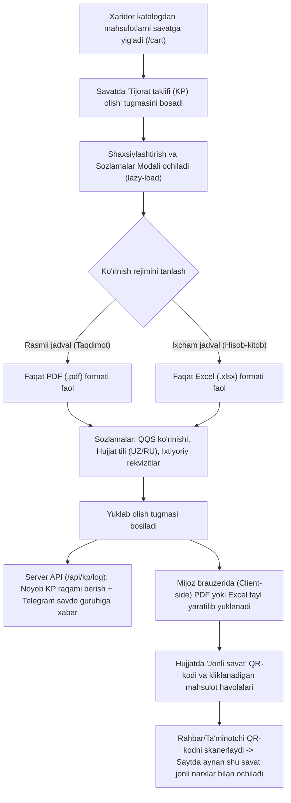

# Sora.uz — Avtomatik Tijorat Taklifi (KP: PDF va Excel) Tizimi Uchun Mukammal Amalga Oshirish Rejasi

> **Asosiy hujjat:** `Loyixa_xujjatlari/Tijorat_taklifi.txt`  
> **Loyiha muhiti:** Next.js 16 (App Router) · React 19 · Tailwind CSS v4 · `next-intl` (UZ/RU) · Zustand (`useCartStore`, `useAuthStore`) · 1C ERP · Cloudflare R2 (`cdn.sora.uz`) · Vercel Serverless (`fra1`)  
> **Maqsad:** Xaridor savatga yig‘gan mahsulotlar asosida menejer kutmasdan 5–10 soniya ichida rasmiy, brendlangan **Tijorat taklifi (KP)** ni **PDF (rasmli taqdimot)** yoki **Excel `.xlsx` (ixcham hisob-kitob)** formatida yuklab olishi, savdo bo‘limi esa darhol tayyor B2B lid va noyob KP raqamini olishi.

---

## 1. Umumiy Biznes Mantiq va Ish Jarayoni (Workflow)

---

## 2. Loyihamiz Uchun Eng Optimal Texnologiyalar Tanlovi

Sora.uz loyihasi **Vercel Serverless** muhitida ishlagani, tezlik (`fast.md`) ustuvor bo‘lgani va alohida SQL ma’lumotlar bazasi yo‘qligi (asosiy baza — 1C ERP) hisobga olinib, quyidagi texnologiyalar tanlanadi:

| Vazifa | Tanlangan Texnologiya | Qayerda ishlaydi | Nima uchun aynan Sora.uz uchun eng yaxshi tanlov? |
| :--- | :--- | :--- | :--- |
| **Rasmli PDF yaratish** | `@react-pdf/renderer` | Brauzer (Client-side, `next/dynamic` bilan lazy-load) | Vercel serverless RAM/CPU va timeout chekloviga umuman tegmaydi (0 server xarajati); React komponentlari kabi brending, `cdn.sora.uz` rasmlari, bosiladigan `<Link>` havolalar, ko‘p sahifali jadval va muhr/imzoni mukammal yig‘adi. |
| **Ixcham Excel yaratish** | `exceljs` | Brauzer (Client-side, `next/dynamic` bilan lazy-load) | Oddiy CSV emas, haqiqiy formatlangan **`.xlsx`** yaratadi: ustun kengliklari, brend rangli sarlavha, ramkalar, **tirik Excel formulalari** (`=SUM(...)`, QQS `12%`, qator summasi), bosiladigan mahsulot havolalari va boshidagi `0` larni saqlaydigan artikul formati. |
| **QR-kod generatsiya** | `qrcode` (yengil JS kutubxona) | Brauzer (Client-side) | "Jonli savat" URL manzilini yuqori sifatli PNG Data URL ko‘rinishiga o‘tkazib, to‘g‘ridan-to‘g‘ri PDF pastki qismiga joylaydi (tashqi QR xizmatiga bog‘lanmaydi). |
| **O‘zbek (lotin) va Rus (kirill) shriftlari** | **Roboto** yoki **Inter** (`.ttf` lokal `public/fonts/` da) | Lokal statik fayl | O‘zbekcha `o‘`, `g‘`, `‘` va barcha kirill harflari PDF ichida `???` bo‘lib buzilmasligini 100% kafolatlaydi; tashqi Google Fonts uzilishidan mustaqil. |
| **Noyob KP raqami va Lidlar xabarnomasi** | Next.js API Route + **Telegram Bot API** | Vercel Serverless (`fra1`) | Pullik CRM yoki alohida SQL baza qurmasdan har bir KP ga noyob raqam (`KP-2026-XXXX`) beradi va savdo menejerlarining yopiq Telegram guruhiga barcha mahsulotlar + mijoz aloqasi + "Savatni ochish" havolasini 1 soniyada yuboradi. |
| **"Jonli savat" havolasi (QR)** | Stateless siqilgan URL (`?kp=...&items=...`) | Next.js `/[locale]/cart` + 1C `/all_product` & `/price` | Alohida baza talab qilmaydi; havola ochilganda 1C dan aynan o‘sha mahsulotlarning eng so‘nggi jonli narx va qoldig‘ini yuklab savatni avtomatik tiklaydi. |

> **Nima uchun Playwright/Puppeteer tanlanmadi?** Vercel Serverless muhitida Chromium ~150–250 MB RAM va 4–8 soniya vaqt oladi, sovuq startda timeout xavfi yuqori. Client-side `@react-pdf/renderer` + `exceljs` esa **0 MB serverless yuklama**, **< 1.5 soniya generatsiya** va cheksiz bir vaqtli foydalanuvchilarni qo‘llab-quvvatlaydi.

---

## 3. Foydalanuvchi Tajribasi (UX) va Interfeys Tuzilishi

### 3.1. Kirish nuqtalari
1. **Savatcha sahifasi (`/[locale]/cart` — asosiy nuqta):**
   - `CartSummary` blokida **"Buyurtmani rasmiylashtirish"** asosiy tugmasining ostida aniq, ko‘zga tashlanadigan ikkinchi darajali tugma:
     - UZ: **«Tijorat taklifi (KP) yuklab olish»** (kichik izoh: *PDF yoki Excel*)
     - RU: **«Скачать коммерческое предложение (КП)»** (*PDF или Excel*)
2. **B2B sahifasi (`/[locale]/b2b` — ma’lumot beruvchi blok):**
   - Korporativ mijozlarga 3 qadamli eslatma: *1) Katalogdan mahsulotlarni savatga yig‘ing → 2) Savatda «Tijorat taklifi» tugmasini bosing → 3) 10 soniyada muhrli PDF yoki Excel oling.*

### 3.2. Shaxsiylashtirish va Sozlamalar Modali (1 ta ixcham oyna)
Xaridor tugmani bosganda sahifadan chiqmasdan qulay modal ochiladi. Modal 3 ta mantiqiy blokdan iborat:

#### A. Ko‘rinish va Format Tanlovi (Qat’iy qoida asosida)
Foydalanuvchi 2 ta kartochkadan birini tanlaydi:
- **1-rejim: «Rasmli jadval (Taqdimot uchun)»** → faqat **PDF (`.pdf`)** yuklab olish faol bo‘ladi.
  - *Kim uchun:* Rahbariyatga ko‘rsatish, vizual tasdiqlash, rasmiy imzo va muhr bilan taqdim etish.
- **2-rejim: «Ixcham jadval (Hisob-kitob / Tender uchun)»** → faqat **Excel (`.xlsx`)** yuklab olish faol bo‘ladi.
  - *Kim uchun:* Buxgalteriya, ta’minot bo‘limi, 30–100+ nomdagi katta ro‘yxatlar, narxlarni solishtirish va o‘z jadvaliga ko‘chirish.

#### B. Hujjat Sozlamalari
- **QQS (12%) ko‘rsatish usuli:**
  - *«Umumiy narx ichida (shu jumladan QQS 12%)»* — standart Sora.uz narxlari, pastda `Shu jumladan QQS (12%): Jami × 12 / 112` alohida qatorda chiqadi.
  - *«QQS (12%) alohida ustunda»* — har bir mahsulot qatorida `QQSsiz narx (Narx / 1.12)`, `QQS 12%` va `QQS bilan jami` ustunlari aniq ajratib ko‘rsatiladi.
- **Hujjat tili:** `O‘zbekcha (UZ)` / `Русский (RU)` (standart holda joriy sahifa tili tanlangan bo‘ladi, lekin xaridor xohlasa boshqa tilga o‘tkazib yuklab olishi mumkin).

#### C. Shaxsiylashtirish (Ixtiyoriy — Lid Yig‘ish)
- **Tashkilot nomi** *(ixtiyoriy, masalan: «Navruz International» MCHJ)*
- **STIR / INN (9 raqam)** *(ixtiyoriy — `formatInnInput` maskasi bilan)*
- **Mas’ul shaxs ismi** *(ixtiyoriy)*
- **Telefon raqami** *(ixtiyoriy — `formatUzPhoneInput` maskasi bilan)*
- **Avto-to‘ldirish:** Agar xaridor saytga tizimga kirgan (`useAuthStore.user`) bo‘lsa, bu maydonlar avtomatik to‘ldirilgan holatda chiqadi.
- **Konversiyani saqlash qoidasi:** Maydonlar **majburiy qilinmaydi** — shoshayotgan xaridor ularni to‘ldirmasdan ham darhol yuklab ola oladi; to‘ldirgan xaridor esa o‘z tashkiloti nomiga rasmiylashtirilgan hujjat oladi va savdo bo‘limiga issiq lid sifatida yetib boradi.

---

## 4. Hujjatlar Dizayni va Tarkibi

### 4.1. PDF Hujjat Tarkibi («Rasmli jadval» — A4 format)
1. **Yuqori rasmiy shlyapa (Header):**
   - Chapda: **Sora.uz** logotipi (optimallashtirilgan PNG) va qisqa faoliyat tavsifi.
   - O‘ngda: **Kompaniya rekvizitlari** (Yuridik nomi, STIR/INN, MFO, H/R, bank nomi, manzil, telefonlar, `info@sora.uz`, `https://sora.uz`).
2. **Hujjat sarlavhasi va metama’lumotlari:**
   - **TIJORAT TAKLIFI № KP-2026-XXXX** *(yoki КОММЕРЧЕСКОЕ ПРЕДЛОЖЕНИЕ)*
   - Tuzilgan sana va **Amal qilish muddati** (avtomatik hisoblangan: *+3 ish kuni — dam olish kunlari hisobga olingan holda*, masalan: *"Ushbu taklif 2026-yil 24-noyabrgacha amal qiladi"*).
   - **Kim uchun:** Agar xaridor kiritgan bo‘lsa — Tashkilot nomi, STIR, Mas’ul shaxs, Telefon; kiritmagan bo‘lsa — *"Talab qilingan joyga"* / *"По месту требования"*.
3. **Asosiy rasmli mahsulotlar jadvali:**
   - Ustunlar: `№` · `Rasm` (36×36 px) · `Mahsulot nomi va Artikul` (**bosiladigan havola** — bosilganda `sora.uz` dagi mahsulot sahifasi ochiladi!) · `O‘lchov birligi` · `Miqdori` · `Narxi` *(+ QQS alohida rejimi tanlansa: `QQSsiz narx` va `QQS 12%`)* · `Summa`.
   - **Ko‘p sahifali qo‘llab-quvvatlash:** 10 tadan ko‘p mahsulot bo‘lsa jadval chiroyli tarzda keyingi sahifalarga o‘tadi, jadval sarlavha qatori har sahifada avtomatik takrorlanadi, pastki qismda `Sahifa 1 / 3` chiqadi.
   - **Narxi 0 («Kelishiladi») bo‘lgan mahsulotlar:** Summaga `0` deb qo‘shilmaydi, aniq `Kelishiladi` / `Договорная` yozuvi bilan belgilanadi.
4. **Yakuniy hisob-kitob bloki:**
   - Mahsulotlar summasi (`subtotal`), Yetkazib berish sharti (`500 000 so‘mdan yuqori — Toshkent bo‘yicha bepul`, aks holda `30 000 so‘m` yoki olib ketish bepul), QQS (12%) summasi va **Jami to‘lov (so‘m)**.
5. **Rasmiy shartlar, Imzo/Muhr va «Jonli savat» QR-kodi (Footer):**
   - Chapda: To‘lov shartlari (pul o‘tkazish, Didox EHF, 10 kunlik kafolat) + rahbar lavozimi, **faksimele imzo va ko‘k muhr** (PNG rasm — `public/assets/kp/` ichida saqlanadi, env orqali yoqib-o‘chirish mumkin).
   - O‘ngda: **«Jonli savat» QR-kodi** + qisqa izoh: *"Ushbu savatni saytda ochish va 1 bosishda buyurtma berish uchun QR-kodni skanerlang"* + bosiladigan qisqa havola.

### 4.2. Excel `.xlsx` Hujjat Tarkibi («Ixcham jadval»)
1. **Yuqori ma’lumot bloki (1–7-qatorlar):**
   - `TIJORAT TAKLIFI № KP-2026-XXXX`, sana, amal qilish muddati (+3 ish kuni), Sotuvchi (Sora.uz rekvizitlari + telefonlari) va Xaridor ma’lumotlari.
2. **Toza va formulali jadval (rasmsiz, ixcham):**
   - Ustunlar: `№`, `Artikul (SKU)` *(matn formatida — `0` lar saqlanadi)*, `Mahsulot nomi` *(saytga bosiladigan `HYPERLINK`)*, `O‘lchov birligi`, `Miqdori`, `Birlik narxi (so‘m)`, *(agar QQS alohida tanlansa: `QQSsiz summa`, `QQS 12%`)*, `Jami summa (so‘m)`.
   - **Tirik Excel formulalari:**
     - Har bir qatorda: `=E10*F10` (miqdor × narx)
     - Pastki qatorda: `=SUM(...)` va QQS formulasi (`=ROUND(H_TOTAL*12/112, 0)`) — ta’minotchi yoki buxgalter Excel ichida miqdorni tahrirlasa, barcha jami summalar avtomatik qayta hisoblanadi!
3. **Pastki blok:**
   - Yetkazib berish shartlari, Didox EHF eslatmasi va **"Savatni saytda 1 bosishda ochish"** bosiladigan havolasi.
   - **Chop etishga tayyor sozlama (Print Setup):** A4 landshaft/portret sahifaga 1 kenglikda sig‘adigan (`fitToWidth = 1`) qilib sozlanadi.

---

## 5. Texnik Nyuanlar va Xavfsizlik Yechimlari

| Texnik Nuqta | Potensial Muammo | Rejadagi Aniq Yechim |
| :--- | :--- | :--- |
| **`cdn.sora.uz` rasmlari va CORS** | Client-side PDF generatori rasm baytlarini o‘qiganda Cloudflare R2 da CORS sarlavhasi bo‘lmasa rasm tushmay qolishi mumkin. | 1) Cloudflare R2 (`cdn.sora.uz`) CORS siyosatida `GET` uchun `https://sora.uz` ga ruxsat tekshiriladi/yoqiladi. 2) Zaxira sifatida faqat `cdn.sora.uz` domeniga ruxsat beruvchi yengil Next.js rasm proxy endpointi (`/api/kp/image-proxy`) nazarda tutiladi (SSRF’dan himoyalangan whitelist bilan). |
| **O‘zbek/Rus shriftlari** | Standart Helvetica shrifti `o‘`, `g‘` va kirill harflarini ko‘rsatmaydi. | `public/fonts/` ichiga **Roboto Regular** va **Roboto Bold** (`.ttf`, to‘liq Latin Extended + Cyrillic) joylanadi va `@react-pdf/renderer` ga ulanadi. |
| **"Jonli savat" QR havolasi uzunligi** | Savatda 50+ mahsulot bo‘lsa, 36 belgilik UUID’lar QR-kodni haddan tashqari zich (o‘qilishi qiyin) qilib qo‘yadi. | 1C mahsulotining uzun UUID’i o‘rniga qisqa `sku` (yoki 8–10 belgilik indeks) + miqdor formatida siqish (`sku1:2,sku2:10`), bu QR-kodni 4 barobar ixcham va istalgan telefon kamerasida oson skanerlanadigan qiladi. |
| **Narxlarning dolzarbligi** | Xaridor savatni 2 kun oldin yig‘gan bo‘lsa, mahsulot narxi 1C da o‘zgargan bo‘lishi mumkin. | KP generatsiya qilinishidan oldin savatdagi mahsulotlarning narx va qoldig‘i 1C bilan qisqa tekshirilib (`/api/kp/log` yoki `/api/products/compare` orqali) eng dolzarb narx bilan chiqariladi. |
| **Sayt tezligiga ta’siri (`fast.md`)** | `@react-pdf/renderer` va `exceljs` kutubxonalari hajmi katta. | Ikkalasi ham **100% dinamik import (`import(...)`)** bilan faqat foydalanuvchi *"Yuklab olish"* tugmasini bosgandagina yuklanadi — saytning bosh sahifa, katalog va savat yuklanish tezligiga **0 ms** ta’sir qiladi! |
| **Spamdan himoya (Telegram)** | Botlar `/api/kp/log` orqali Telegram guruhiga tinimsiz xabar yuborishi mumkin. | IP bo‘yicha rate-limit (soatiga max 10–15 ta KP so‘rovi) va savat bo‘sh bo‘lmaganini qat’iy Zod validatsiyasi. |
| **SEO himoyasi** | `?kp=...&items=...` havolalari Google indeksiga tushmasligi kerak. | `/uz/cart` va `/ru/cart` allaqachon `robots.txt` da `Disallow` qilingan; qo‘shimcha ravishda `/api/kp/*` ga `X-Robots-Tag: noindex, nofollow` qo‘yiladi. |

---

## 6. Kerakli Tayyor Ma’lumotlar (Amalga oshirishdan oldin biznesdan olinadiganlar)

Kod yozishni boshlashdan oldin quyidagi 4 ta biznes rekviziti aniqlashtirib olinishi kerak:

1. **Sotuvchi yuridik rekvizitlari:** Korxonaning rasmiy nomi (masalan, *"..." MCHJ*), STIR (INN), bank nomi, hisob raqami (H/R), MFO, yuridik manzil, OKED va QQS to‘lovchi kodi.
2. **Muhr va imzo tasviri (ixtiyoriy, lekin juda ta’sirli):** Shaffof fonli (transparent PNG) faksimele muhr va direktor imzosi (yoki dastlabki bosqichda imzo chizig‘i bilan chiqarib, keyin PNG qo‘shish).
3. **Telegram Bot ma’lumotlari (ixtiyoriy, 2-bosqich uchun):** Savdo bo‘limi guruhiga xabar yuborish uchun `TELEGRAM_KP_BOT_TOKEN` va `TELEGRAM_KP_CHAT_ID`.
4. **Amal qilish muddati:** Standart **3 ish kuni** ma’qulmi yoki boshqa muddat (masalan, 5 ish kuni)?

---

## 7. Bosqichma-Bosqich Amalga Oshirish Rejasi

| Bosqich | Qilinadigan ishlar | Natija / Tekshiruv mezoni |
| :--- | :--- | :--- |
| **1-bosqich: Infratuzilma va Asoslar** | • `@react-pdf/renderer`, `exceljs`, `qrcode` paketlarini o‘rnatish • `public/fonts/` ga Unicode shriftlar (`Roboto`) va rekvizitlar konfiguratsiya faylini (`src/lib/config/company.ts`) qo‘shish • `cdn.sora.uz` CORS holatini tekshirish (kerak bo‘lsa whitelist rasm proxy’si) | Shriftlar UZ/RU belgilarini xatosiz ko‘rsatadi; rekvizitlar bitta markaziy fayldan boshqariladi. |
| **2-bosqich: Modal UX va Sozlamalar** | • `CartSummary.tsx` ga **«Tijorat taklifi (KP) yuklab olish»** tugmasini qo‘shish • `CommercialOfferModal` komponentini (`next/dynamic` lazy-load) yaratish: **Rasmli jadval → faqat PDF**, **Ixcham jadval → faqat Excel**, QQS 12% tanlovi, UZ/RU til tanlovi, ixtiyoriy mijoz/tashkilot formasi (sessiyadan avto-to‘ldirish bilan) | Boshlang‘ich sahifa JS hajmi o‘zgarmaydi; rejim almashganda mos format tugmasi aniq ishlaydi. |
| **3-bosqich: PDF («Rasmli jadval») va QR-kod** | • `@react-pdf/renderer` shablonini yaratish: brendlangan shlyapa, rekvizitlar, 3 ish kunlik muddat, rasmli + kliklanadigan jadval, QQS 12% hisobi, ko‘p sahifali tartib, imzo/muhr va **«Jonli savat» QR-kodi** | 1 ta ham, 50+ ta mahsulotli savatda ham chiroyli, UZ/RU shrifti toza, kliklanadigan PDF 1–2 soniyada yuklanadi. |
| **4-bosqich: Excel `.xlsx` («Ixcham jadval»)** | • `exceljs` generatorini yaratish: ixcham rasmsiz jadval, tirik Excel formulalari (`=E*F`, `=SUM`, QQS 12%), artikul matn formati, kliklanadigan mahsulot havolalari, A4 chop etish sozlamasi | Microsoft Excel va Google Sheets’da xatosiz ochiladi, miqdor o‘zgartirilganda jami summa avtomatik yangilanadi. |
| **5-bosqich: «Jonli savat» tiklash + Telegram Lid Xabarnomasi** | • `/[locale]/cart` sahifasida `?kp=...&items=...` parametrini o‘qib, 1C jonli narxlari bilan savatni avtomatik to‘ldiruvchi mexanizm • `POST /api/kp/log`: noyob `KP-2026-XXXX` raqam berish, Telegram guruhiga xabar yuborish, Yandex Metrika eventlarini (`KP_DOWNLOAD_PDF`, `KP_DOWNLOAD_EXCEL`) ulash | QR-kod skanerlanganda aynan shu mahsulotlar savatda ochiladi; menejer Telegram’da 1 soniyada lidni ko‘radi. |
| **6-bosqich: Sifat Nazorati va Playwright Testlari** | • `npx tsc --noEmit`, `npx eslint`, `npm run build` • Playwright E2E testlari: modal ochilishi, rejim → PDF/Excel bog‘liqligi, QQS hisob-kitobi unit-testi, PDF/Excel yuklanish tekshiruvi va `?kp=...&items=...` orqali savat tiklanishi | 100% testlar yashil, production’ga tayyor. |
