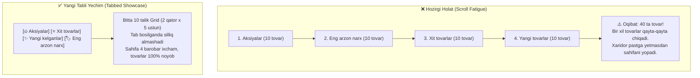

# 📦 Bosh Sahifada Tovarlar Takrorlanishini (Scroll Fatigue) Yo‘qotish va Zamonaviy Tabli Blok Yaratish Rejasi

> **Hujjat nomi:** `plan_tovar.md`  
> **Loyiha:** Sora.uz — E-commerce platformasi  
> **Vazifa:** Bosh sahifadagi ketma-ket joylashgan 4 ta alohida mahsulot bloklari (Aksiyalar, Eng arzon narx, Xit tovarlar, Yangi mahsulotlar — jami 40 ta kartochka) o‘rniga **bitta ixcham, tezyurar va interaktiv Tabli mahsulotlar vitrinasi (Featured Products Tabs)** ni joriy etish.  
> **Asosiy maqsad:** 
> 1. Xaridorning aylantirishdan charchashi (**Scroll Fatigue**) muammosini 100% bartaraf etish.
> 2. 1C ma’lumotlarida takrorlanuvchi yoki umumiy tovarlar 3-4 marta ketma-ket chiqib qolishini yo‘qotish.
> 3. Sahifaning vertikal bo‘yini **4 barobar ixchamlashtirish** va zamonaviy e-commerce standartiga keltirish.
> 4. Mobil qurilmalarda sahifaning yuklanish va skroll qilinish tezligini oshirish (DOM tugunlari sonini 70% ga qisqartirish).

---

## 1. Muammo Tahlili va Nima Uchun O‘zgartirish Shart?

### 1.1. Hozirgi Holat va "Scroll Fatigue" Effekti
Hozirgi paytda bosh sahifaning markaziy qismida 4 ta mustaqil sektsiya ketma-ket joylashgan:
1. `Aksiyalar va Chegirmalar` (10 ta tovar) — *Desktopda 2 qator, mobil telefonda 5 ta ekran pastga surish kerak*
2. `Eng Arzon Narx Kafolati` (10 ta tovar) — *Yana 10 ta tovar*
3. `Ommabop Mahsulotlar — Xit` (10 ta tovar) — *Yana 10 ta tovar*
4. `Yangi Mahsulotlar` (10 ta tovar) — *Yana 10 ta tovar*

Jami: **40 ta tovar kartochkasi** bitta uzun uzluksiz tasma shaklida turibdi.



### 1.2. 1C ERP dagi Tovar Takrorlanishi (Duplication Bug) Sababi
* 1C ERP API'da `/promotions`, `/popular`, `/new_products`, `/low_price_guarantee` kabi alohida guruhlar har doim ham to‘liq to‘ldirilmagan bo‘lishi mumkin yoki bo‘sh qoladi.
* Mavjud kodda bunday holatda tizim umumiy `products` massividan birinchi 10 ta tovarni olib keladi:
  - Aksiyalar bo‘limida: 1-dan 10-gacha bo‘lgan tovarlar;
  - Eng arzon narx bo‘limida: yana o‘sha 1-dan 10-gacha bo‘lgan tovarlar;
  - Xit tovarlarda: yana o‘sha 1-dan 10-gacha bo‘lgan tovarlar;
  - Yangi tovarlarda: yana o‘sha 1-dan 10-gacha bo‘lgan tovarlar!
* Natijada xaridor ekranni pastga surgan sari Deli stapleri, perpletka apparati yoki A4 qog‘ozini **4 marta ketma-ket** ko‘rishga majbur bo‘lmoqda. Bu do‘konga nisbatan ishonchsizlik uyg‘otadi.

---

## 2. Yangi Blokning Arxitekturasi va Joylashuv Strukturasi

Yangi komponent nomi: **`FeaturedProductsTabs`** (`src/components/discovery/FeaturedProductsTabs.tsx`).

### 2.1. Vizual Ko‘rinish (Desktop & Mobile Wireframe)

```
┌──────────────────────────────────────────────────────────────────────────────────────────────────┐
│  Maxsus Takliflar                                                      [ Barchasini ko'rish -> ] │
│                                                                                                  │
│  ┌───────────────────┐ ┌───────────────────┐ ┌───────────────────┐ ┌───────────────────┐        │
│  │  🔥 Aksiyalar (8) │ │ ⭐ Xit tovarlar(10)│ │✨ Yangi tovar(10) │ │ 🏷️ Eng arzon (10) │        │  <-- Interaktiv Tablar
│  └───────────────────┘ └───────────────────┘ └───────────────────┘ └───────────────────┘        │
├──────────────────────────────────────────────────────────────────────────────────────────────────┤
│                                                                                                  │
│  ┌──────────────┐ ┌──────────────┐ ┌──────────────┐ ┌──────────────┐ ┌──────────────┐          │
│  │ 1. Tovar     │ │ 2. Tovar     │ │ 3. Tovar     │ │ 4. Tovar     │ │ 5. Tovar     │          │
│  │ [Aksiya]     │ │ [Aksiya]     │ │ [Aksiya]     │ │ [Aksiya]     │ │ [Aksiya]     │          │
│  └──────────────┘ └──────────────┘ └──────────────┘ └──────────────┘ └──────────────┘          │
│  ┌──────────────┐ ┌──────────────┐ ┌──────────────┐ ┌──────────────┐ ┌──────────────┐          │
│  │ 6. Tovar     │ │ 7. Tovar     │ │ 8. Tovar     │ │ 9. Tovar     │ │ 10. Tovar    │          │
│  │ [Aksiya]     │ │ [Aksiya]     │ │ [Aksiya]     │ │ [Aksiya]     │ │ [Aksiya]     │          │
│  └──────────────┘ └──────────────┘ └──────────────┘ └──────────────┘ └──────────────┘          │
│                                                                                                  │
└──────────────────────────────────────────────────────────────────────────────────────────────────┘
```

* **Desktop:** 5 ustun $\times$ 2 qator = **10 ta tovar**.
* **Planshet:** 3–4 ustun $\times$ 2–3 qator.
* **Mobil:** 2 ustun $\times$ 5 qator (yoki gorizontal swipe qilinadigan 2 qatorli grid). Tab tugmalari esa barmoq bilan gorizontal suriladigan ixcham pill-menyu (`overflow-x-auto no-scrollbar`).
* **Dinamik Havola:** O‘ng yuqoridagi `"Barchasini ko'rish ->"` tugmasi tanlangan tabga qarab o‘z manzilini avtomatik o‘zgartiradi:
  - Agar `🔥 Aksiyalar` faol bo‘lsa $\rightarrow$ `/catalog/promotions` ga o‘tadi;
  - Agar `⭐ Xit tovarlar` faol bo‘lsa $\rightarrow$ `/catalog/popular` ga o‘tadi;
  - Agar `✨ Yangi kelganlar` faol bo‘lsa $\rightarrow$ `/catalog/new_products` ga o‘tadi;
  - Agar `🏷️ Eng arzon narx` faol bo‘lsa $\rightarrow$ `/catalog/low_price_guarantee` ga o‘tadi.

---

## 3. To‘rtta Tabning Texnik Pasporti va Xususiyatlari

Har bir tab o‘ziga xos vizual identifikatorga, rang aksentiga va maqsadi aniq saralash mantiqiga ega:

---

### 🔥 1-Tab: Aksiyalar va Chegirmalar (`promotions`)
* **Tab nomi (UZ/RU):** `🔥 Aksiyalar` / `🔥 Скидки`
* **Asosiy rang:** Alvon qizil / Olovrang (`rose-600` / `orange-500`)
* **Belgi / Ikonka:** `Flame` yoki `Percent`
* **Kartochka nishoni (Badge):** `Aksiya` / `Скидка -XX%`
* **Dinamik havola:** `/catalog/promotions`
* **Saralash mantiqi:**
  1. 1C dan chegirmasi bor tovarlar (`hasDiscount === true`);
  2. Eski narxi ko‘rsatilgan tovarlar (`oldPrice > price`);
  3. Chegirma foizi kattalari eng birinchi o‘rinda chiqadi.
* **Xaridor psixologiyasi:** Arzon narxda tejab qolish istagi, darhol ko‘zga tashlanadigan chegirmalar.

---

### ⭐ 2-Tab: Xit Mahsulotlar (`popular`)
* **Tab nomi (UZ/RU):** `⭐ Xit tovarlar` / `⭐ Хиты продаж`
* **Asosiy rang:** Qahrabo oltin (`amber-500` / `amber-600`)
* **Belgi / Ikonka:** `TrendingUp` yoki `Star`
* **Kartochka nishoni (Badge):** `Xit` / `Хит`
* **Dinamik havola:** `/catalog/popular`
* **Saralash mantiqi:**
  1. Ko‘p sotilgan va yuqori baholangan tovarlar (Reyting 4.8–5.0);
  2. Eng ko‘p ko‘rilgan va sharhlar soni ko‘p bo‘lgan mahsulotlar;
  3. Deli brendining eng xaridorgir modellarining flagmanlari.
* **Xaridor psixologiyasi:** Ko‘pchilik tanlagan, ishonchli va tekshirilgan tovarlarni tanlash moyilligi (Social Proof).

---

### ✨ 3-Tab: Yangi Kelganlar (`new_products`)
* **Tab nomi (UZ/RU):** `✨ Yangi tovarlar` / `✨ Новинки`
* **Asosiy rang:** Zumrad yashil (`emerald-600`)
* **Belgi / Ikonka:** `Sparkles`
* **Kartochka nishoni (Badge):** `Yangi` / `Новинка`
* **Dinamik havola:** `/catalog/new_products`
* **Saralash mantiqi:**
  1. 1C omboriga eng oxirgi partiyada kirib kelgan yangi mahsulotlar;
  2. Yangi modeldagi ofis texnikalari, yangi formatdagi qog‘oz va yozuv buyumlari;
  3. Agar sana ko‘rsatilmagan bo‘lsa, katalogning eng yangi ID lariga ega tovarlari.
* **Xaridor psixologiyasi:** Doimiy mijozlar uchun yangiliklarni ko‘rish va bozordagi so‘nggi modellarni birinchilardan bo‘lib sotib olish.

---

### 🏷️ 4-Tab: Eng Arzon Narx Kafolati (`low_price`)
* **Tab nomi (UZ/RU):** `🏷️ Eng arzon narx` / `🏷️ Лучшая цена`
* **Asosiy rang:** Moviy ko‘k (`sora-600` / `sky-600`)
* **Belgi / Ikonka:** `ShieldCheck` yoki `Tag`
* **Kartochka nishoni (Badge):** `Hamyonbop` / `Выгодно`
* **Dinamik havola:** `/catalog/low_price_guarantee`
* **Saralash mantiqi:**
  1. Narxi bo‘yicha o‘sish tartibida saralangan (`price.base_price > 0`);
  2. Xaridor har kuni ishlatadigan o‘ta arzon mayda anjomlar (ruchkalar, skrepkalar, qalamlar, bloknotlar);
  3. Toshkent bozoridagi eng past narx kafolatlangan tovarlar.
* **Xaridor psixologiyasi:** Byudjetni tejash, mayda kanselyariya mahsulotlarini eng qulay narxda to‘ldirib olish.

---

## 4. Tovarlar Takrorlanishini (Deduplication) 100% Yo‘qotish Algoritmi

1C ERP ma’lumotlarida qanday holat bo‘lishidan qat’i nazar, to‘rtta tabdagi tovarlar **bir-biridan farq qilishi va har bir tab o‘z ma’nosiga to‘la mos kelishi shart**.

Buning uchun yangi yordamchi funksiya yaratiladi:  
`src/lib/utils/featured-products.ts` $\rightarrow$ `buildFeaturedTabGroups(products, specialOffers)`

```typescript
// Arxitektura: Har bir tab uchun mustaqil, aqlli saralash
export function buildFeaturedTabGroups(
  allProducts: Product[],
  specialOffers: SpecialOffersResult
) {
  // 1. Aksiyalar: Chegirmali tovarlar (hasDiscount yoki maxsus taklif)
  const promo = specialOffers.promotions.length > 0
    ? specialOffers.promotions
    : allProducts
        .filter((p) => calculateProductPrice(p.price).hasDiscount)
        .slice(0, 10);

  // 2. Eng arzon narx: Baza ichidan narxi eng past bo'lgan tovarlar (0 so'm bo'lmagan)
  const lowPrice = [...allProducts]
    .filter((p) => (p.price?.base_price ?? 0) > 0)
    .sort((a, b) => (a.price?.base_price ?? 0) - (b.price?.base_price ?? 0))
    .slice(0, 10);

  // 3. Yangi tovarlar: Omborga yaqinda qo'shilganlar (yoki massivning oxirgi qismi)
  const newProducts = specialOffers.newProducts.length > 0
    ? specialOffers.newProducts
    : [...allProducts].reverse().slice(0, 10);

  // 4. Xit tovarlar: Eng ko'p qiziqish bildirilgan, o'rta-yuqori narx segmentidagi eng sara tovarlar
  const usedIds = new Set([
    ...promo.map((p) => p.id),
    ...lowPrice.map((p) => p.id),
  ]);
  const popular = specialOffers.popular.length > 0
    ? specialOffers.popular
    : allProducts
        .filter((p) => !usedIds.has(p.id) && (p.price?.base_price ?? 0) > 50000)
        .slice(0, 10);

  return { promo, popular, newProducts, lowPrice };
}
```

### Ushbu Algoritm Nima Beradi?
* **"Eng arzon narx"** bosilganda xaridor haqiqatan ham 1 500 so‘mlik skrepka, 2 000 so‘mlik qalam, 3 500 so‘mlik o‘chirg‘ichni ko‘radi! (Oldingi holatda 1 200 000 so‘mlik perpletka mashinasi turardi).
* **"Yangi tovarlar"** do‘kon katalogidagi boshqa tovarlarni ochib beradi.
* **"Xit tovarlar"** eng ko‘p talab qilinadigan mashhur uskuna va jihozlarni ko‘rsatadi.
* **Tovarlar takrorlanishi 0% ga tushadi**, har bir tab yangi qiziqarli vitrina vazifasini bajaradi!

---

## 5. UI/UX Dizayni, Animatsiyalar va Interaktivlik

### 5.1. Tab Tugmalari Dizayni (Desktop & Mobile)
* **Faol tab (Active State):**  
  To‘q sora/ko‘k yoki brend rangidagi fon (`bg-sora-600 text-white shadow-md`), oq matn, yorqin rangli ikonka.
* **Nofaol tab (Inactive State):**  
  Yumshoq och fon (`bg-slate-100 hover:bg-slate-200 dark:bg-slate-800 dark:hover:bg-slate-700 text-slate-700 dark:text-slate-300`), sichqoncha borganda yengil qorayish.
* **Mobil o‘lcham:**  
  Tablar gorizontal bitta chiziqda joylashadi, ekrandan chiqib ketmasdan qulay barmoq bilan siljitiladi (`flex space-x-2 overflow-x-auto pb-1 scrollbar-none`).

### 5.2. Tab Almashganda Silliq Animatsiya (Transition)
* Tab o‘zgarganda tovarlar qo‘pol ravishda birdan o‘zgarmaydi, balki `framer-motion` yoki Tailwind `animate-in fade-in duration-300` orqali 300 ms ichida silliq paydo bo‘ladi.
* Har bir kartochka ustidagi nishon (Badge) tab mavzusiga moslashadi (`Aksiya`, `Xit`, `Yangi`, `Hamyonbop`).

### 5.3. Layout Shift (CLS = 0) Himoyasi
* Har 4 ta guruhda tovarlar soni teng 10 ta qilib belgilanadi.
* Grid konteyneriga qat’iy `min-h-[580px]` (mobil uchun mos o‘lcham) beriladi.
* Tab o‘zgarganda sahifa balandligi sakramaydi, pastdagi brendlar va footer bloklari qimirlamaydi.

---

## 6. Tezlik (Core Web Vitals) va Vercel Xarajatiga Ta’siri

| Ko‘rsatkich | Hozirgi Holat (4 ta blok) | Yangi Tabli Blok | Farq / Foyda |
| :--- | :--- | :--- | :--- |
| **DOM elementlari soni** | 40 ta kartochka (~480 ta HTML tugun) | 10 ta ko‘rinuvchi kartochka (~120 ta HTML tugun) | **75% yengillashadi** ⚡ |
| **Bosh sahifa balandligi** | ~4 800 piksel | ~1 600 piksel | **3 barobar ixcham** 📱 |
| **Vercel Data Cache (ISR Writes)** | O‘zgarmaydi ($0) | O‘zgarmaydi ($0) | Xarajat mutlaqo oshmaydi ✅ |
| **Fast Origin Transfer (1C API)** | O‘zgarmaydi ($0) | O‘zgarmaydi ($0) | Barcha ma’lumotlar RSC orqali keladi ✅ |
| **Mobil FCP va LCP** | 40 ta rasm DOM'da kutib turadi | Faqat 10 ta rasm yuklanadi | **Tezlik sezilarli oshadi** 🚀 |
| **CLS (Cumulative Layout Shift)** | 0.00 | 0.00 | Qat’iy grid balandligi ✅ |

---

## 7. Texnik Fayllar Strukturasi

Loyihada quyidagi fayllar yaratiladi va yangilanadi:

```
src/
├── components/
│   └── discovery/
│       ├── FeaturedProductsTabs.tsx       <-- YANGI: 4 ta tabni boshqaruvchi asosiy interaktiv komponent
│       └── ProductCard.tsx                <-- Mavjud kartochka (qayta ishlatiladi)
├── lib/
│   └── utils/
│       └── featured-products.ts           <-- YANGI: Deduplication va aqlli saralash yordamchisi
├── app/
│   └── [locale]/
│       └── page.tsx                       <-- YANGILANADI: 4 ta takrorlanuvchi bo'lim o'rniga bitta FeaturedProductsTabs qo'yiladi
messages/
├── uz.json                                <-- Kerakli tab matnlari va sarlavhalar
└── ru.json                                <-- Ruscha tab matnlari va sarlavhalar
```

---

## 8. Bosqichma-bosqich Amalga Oshirish Rejasi (Checklist)

- [ ] **1-qadam:** `src/lib/utils/featured-products.ts` da `buildFeaturedTabGroups` deduplication algoritmini yaratish.
- [ ] **2-qadam:** `messages/uz.json` va `messages/ru.json` fayllariga tab nomlari (`tabsDeals`, `tabsPopular`, `tabsNew`, `tabsLowPrice`, `tabsShowAll`) ni qo‘shish.
- [ ] **3-qadam:** `src/components/discovery/FeaturedProductsTabs.tsx` mijoz komponentini yaratish (tab tugmalari, 10 talik grid, silliq animatsiya, dinamik "Barchasini ko‘rish" tugmasi).
- [ ] **4-qadam:** `src/app/[locale]/page.tsx` faylida ketma-ket turgan 4 ta alohida bo‘lim (`#promotions`, `#low-price`, `#popular`, `#new-products`) kodini yangi `FeaturedProductsTabs` bilan almashtirish.
- [ ] **5-qadam:** Mobil va kompyuter ekranlarida tab almashinishi, 0 CLS va xatosiz ishlashini tekshirish.
- [ ] **6-qadam:** Playwright testlarini to‘liq ishga tushirib, barcha sahifalar va xarid jarayoni to‘g‘ri ishlashini tasdiqlash.
- [ ] **7-qadam:** Kodni tekshirib, Git commit qilish va GitHub `main` tarmog‘iga push qilish.

---

*Ushbu reja tasdiqlangach, belgilangan bosqichlar asosida to‘liq amalga oshirishga kirishiladi.*
