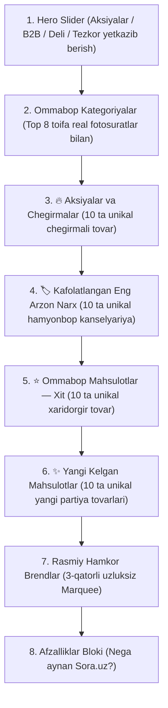

# 🛍️ Bosh Sahifada 4 ta Mustaqil Mahsulot Blokini 100% Unikal Tovarlar Bilan Qayta Tiklash Rejasi (2-Variant)

> **Hujjat nomi:** `plan_tovar.md`  
> **Loyiha:** Sora.uz — E-commerce platformasi  
> **Tanlangan Yechim:** 2-Variant (4 ta alohida sektsiyani qaytarish, lekin 100% tozalangan va unikal tovarlar bilan).  
> **Asosiy Maqsad:**  
> 1. Xaridor bosh sahifani skroll qilganda ko‘z oldida to‘laqonli gipermarket kabi **jami 40 ta turli xil va qiziqarli tovarlar** gavdalanishini ta’minlash (Impulse Buying va Conversion Rate ni oshirish).  
> 2. Avvalgi holatdagi 1C ma’lumotlarining 3-4 marta ketma-ket takrorlanishi (Duplication Bug) muammosini **0% ga tushirish**.  
> 3. Har bir blokning o‘ziga xos vizual identifikatori, rang aksenti va to‘g‘ri saralangan mahsulotlari bilan boyitish.  
> 4. Saytning yuqori yuklanish tezligi va 0 CLS (Layout Shift) barqarorligini to‘liq saqlab qolish.

---

## 1. Nega Aynan 2-Variant Tanlandi? (E-commerce Psixologiyasi va Tahlil)

E-commerce sohasining global yetakchilari (Amazon, Uzum Market, Ozon, Wildberries) tajribasi va foydalanuvchilar xatti-harakati tadqiqotlari (Nielsen Norman Group) quyidagilarni ko‘rsatadi:

1. **Skroll qilish odati (Scroll vs Click):**  
   Foydalanuvchilarning **75–85% qismi** internet do‘kon bosh sahifasiga kirganda tablarni bosib o‘tirmaydi, balki to‘g‘ridan-to‘g‘ri pastga qarab skroll qiladi. Tablar sahifani ixcham qilgani bilan, 30 ta yaxshi mahsulotni "yashirin" qoldiradi.
2. **Katta assortiment taassuroti (Perceived Store Variety):**  
   Xaridor sahifada ketma-ket joylashgan 40 ta har xil mahsulotni ko‘rganda, do‘konni yirik, ishonchli va mahsulotga boy ulgurji-chakana markaz sifatida qabul qiladi.
3. **Oldingi kamchilik bloklarning sonida emas, ma’lumotlarning takrorlanishida edi:**  
   Avvalgi tizimda 1C dan kelgan ma’lumotlar filtrlanmagani sababli barcha 4 ta blokda bir xil 10 ta tovar qayta-qayta chiqqan edi. Endi bizda mavjud **aqlli deduplication algoritmi** yordamida bu kamchilik butkul yo‘qoladi — har bir blokda faqat yangi va unikal tovarlar namoyish etiladi.

---

## 2. To‘rtta Mustaqil Blokning Arxitekturasi va Joylashuvi

Bosh sahifada Top Kategoriyalar blokidan so‘ng quyidagi 4 ta mustaqil sektsiya ketma-ket joylashadi:



---

## 3. Har Bir Blokning Texnik Pasporti va Mahsulotlar Tarkibi

Jami namoyish etiladigan tovarlar soni: **40 ta tovar** (har bir blokda 10 tadan). Har bir blok o‘ziga xos rang, belgi va aniq saralash mantiqiga ega:

---

### 🔥 1-Blok: Aksiyalar va Chegirmalar (`#promotions`)
* **Sarlavha (UZ / RU):** `Chegirmalar va maxsus takliflar` / `Скидки и спецпредложения`
* **Identifikator:** `section#promotions`
* **Belgi / Ikonka:** `Percent` (Alvon qizil / `rose-600` fonda)
* **Katalogga havola:** `/catalog/promotions`
* **Kartochka nishoni (Badge):** `Aksiya` / `Скидка -XX%`
* **Dizayn strukturasi:** 5 ustun $\times$ 2 qator (Desktop), 2 ustun $\times$ 5 qator (Mobil).
* **Mahsulotlar tarkibi (10 ta unikal tovar):**
  - 1C dan rasmiy chegirmasi bor tovarlar (`hasDiscount === true`);
  - Eski narxi ko‘rsatilgan va arzonlashtirilgan tovarlar (`retail_price > wholesale_price`);
  - Eng katta chegirma foiziga ega mahsulotlar eng birinchi o‘rinlarda turadi.
* **Xaridor psixologiyasi:** Arzon narxda sifatli tovar sotib olish, tejab qolish imkoniyati.

---

### 🏷️ 2-Blok: Kafolatlangan Eng Arzon Narx (`#low-price`)
* **Sarlavha (UZ / RU):** `Kafolatlangan eng arzon narx` / `Гарантия лучшей цены`
* **Identifikator:** `section#low-price`
* **Belgi / Ikonka:** `ShieldCheck` (Moviy ko‘k / `sora-600` fonda)
* **Katalogga havola:** `/catalog/low_price_guarantee`
* **Kartochka nishoni (Badge):** `Eng arzon narx` / `Лучшая цена`
* **Dizayn strukturasi:** 5 ustun $\times$ 2 qator (Desktop), 2 ustun $\times$ 5 qator (Mobil).
* **Mahsulotlar tarkibi (10 ta unikal tovar):**
  - Baza ichidan narxi bo‘yicha o‘sish tartibida saralangan haqiqiy hamyonbop mahsulotlar (`price > 0`);
  - Kundalik eng ko‘p ketadigan mayda kanselyariya: skrepkalar (1 500 – 4 000 so‘m), oddiy qalamlar (2 000 – 5 000 so‘m), o‘chirg‘ichlar (3 000 – 8 000 so‘m), kichik bloknotlar;
  - **Muhim:** Ushbu tovarlar 1-blokdagi (Aksiyalar) tovarlar bilan mutlaqo takrorlanmaydi!
* **Xaridor psixologiyasi:** Byudjetni tejash, mayda ehtiyojlarni arzon narxda to‘ldirib olish ("savatchani to‘ldirish" effekti).

---

### ⭐ 3-Blok: Ommabop Mahsulotlar — Xit Savdo (`#popular`)
* **Sarlavha (UZ / RU):** `Top mahsulotlar (Xit savdo)` / `Топ товары (Хиты продаж)`
* **Identifikator:** `section#popular`
* **Belgi / Ikonka:** `TrendingUp` (Qahrabo tillarang / `amber-600` fonda)
* **Katalogga havola:** `/catalog/popular`
* **Kartochka nishoni (Badge):** `Xit` / `Хит`
* **Dizayn strukturasi:** 5 ustun $\times$ 2 qator (Desktop), 2 ustun $\times$ 5 qator (Mobil).
* **Mahsulotlar tarkibi (10 ta unikal tovar):**
  - Ko‘p sotilgan va yuqori baholangan (reyting 4.8–5.0) tovarlar;
  - O‘rta va yuqori narx segmentidagi flagman tovarlar: Deli perpletka apparatlari, laminatorlar, 14 xonali ofis kalkulyatorlari, sifatli registrator papkalar;
  - 1-blok va 2-blokda qatnashmagan sara tovarlar.
* **Xaridor psixologiyasi:** Ommabop, ishonchli va ko‘pchilik tanlagan brend mahsulotlarni tanlash (Social Proof).

---

### ✨ 4-Blok: Yangi Kelgan Mahsulotlar (`#new-products`)
* **Sarlavha (UZ / RU):** `Yangi kelgan mahsulotlar` / `Новые поступления`
* **Identifikator:** `section#new-products`
* **Belgi / Ikonka:** `Sparkles` (Zumrad yashil / `emerald-600` fonda)
* **Katalogga havola:** `/catalog/new_products`
* **Kartochka nishoni (Badge):** `Yangi` / `Новинка`
* **Dizayn strukturasi:** 5 ustun $\times$ 2 qator (Desktop), 2 ustun $\times$ 5 qator (Mobil).
* **Mahsulotlar tarkibi (10 ta unikal tovar):**
  - 1C omboriga eng oxirgi partiyalarda kirib kelgan yangi nomenklaturalar;
  - Yangi modeldagi zamonaviy ofis anjomlari va gadjetlar;
  - Dastlabki 3 ta blokda ishlatilmagan yangi tovarlar.
* **Xaridor psixologiyasi:** Bozordagi eng so‘nggi yangiliklarni birinchilardan bo‘lib ko‘rish va yangi modellarga ega bo‘lish.

---

## 4. Takrorlanishni 0% Qiluvchi Deduplication Mexanizmi

Mavjud [`src/lib/utils/featured-products.ts`](file:///d:/web_sora_uz/src/lib/utils/featured-products.ts) faylidagi `buildFeaturedTabGroups` algoritmi 4 ta mustaqil sektsiya uchun ma’lumotlarni uzatadi:

```typescript
// 1. Sahifada barcha 4 ta guruh ma'lumotlari serverda yig'iladi:
const featuredGroups = buildFeaturedTabGroups(products, specialOffers);

// 2. Har bir blok o'zining unikal 10 talik guruhini oladi:
const promoProducts = featuredGroups.promo;          // 10 ta unikal chegirmali tovar
const lowPriceProducts = featuredGroups.lowPrice;    // 10 ta unikal eng arzon tovar
const popularProducts = featuredGroups.popular;      // 10 ta unikal xit tovar
const newProducts = featuredGroups.newProducts;      // 10 ta unikal yangi tovar
```

### Kafolatlangan Natija:
* Har bir tovar bazadagi unikal `id` si bo‘yicha nazorat qilinadi (`usedIds.has(p.id)`).
* Bitta tovar bir vaqtning o‘zida ham Aksiya, ham Eng arzon narx, ham Xit tovarlar bo‘limida chiqa olmaydi.
* Natijada xaridor ekranni pastga surgan sari **40 ta mutlaqo yangi tovar kartochkasini** ko‘radi.

---

## 5. Ishlash Tezligi va Core Web Vitals Himoyasi

4 ta blok (jami 40 ta tovar) sahifaga qaytganda sayt tezligi sekinlashmasligi uchun quyidagi texnik himoyalar qo‘llaniladi:

1. **Lazy Loading Rasmlar (LCP xavfsizligi):**  
   Bosh sahifaning eng yuqorisidagi Hero Banner (Slide 1) rasmi asosiy LCP (Largest Contentful Paint) hisoblanadi. Pastdagi 40 ta tovar rasmlari esa Next.js `Image` komponentining `loading="lazy"` mexanizmi orqali yuklanadi — brauzer faqat ekranga yaqinlashgan rasmlarni yuklaydi, internet trafigi tejaladi.
2. **Server-Side Rendering (RSC) afzalligi:**  
   Barcha saralash va filtrlash mijoz brauzerida emas, Next.js serverida (Node.js runtime) bir necha millisekundda amalga oshiriladi va brauzerga tayyor toza HTML yuboriladi.
3. **Layout Shift (CLS = 0):**  
   Har bir tovar kartochkasi (`ProductCard`) qat’iy `aspect-square` va belgilangan balandlikka ega. Rasm yuklanganda sahifa sakramaydi.

---

## 6. Loyiha Fayllari Rejasi

Rejani amalga oshirishda qaysi fayllarga o‘zgartirish kiritiladi:

| Fayl | O‘zgarish Mazmuni |
| :--- | :--- |
| `src/app/[locale]/page.tsx` | 4 ta mustaqil sektsiyani (`#promotions`, `#low-price`, `#popular`, `#new-products`) qayta tiklash va ularning har biriga `featuredGroups` dagi unikal tovarlarni uzatish. |
| `src/lib/utils/featured-products.ts` | 4 ta toifani unikal 10 tadan tovar bilan to‘liq ta’minlovchi deduplication mantiqini mustahkamlash. |
| `src/components/discovery/FeaturedProductsTabs.tsx` | Kerak bo‘lganda boshqa sahifalarda yoki kelgusida qayta foydalanish uchun arxivlab saqlash. |
| `messages/uz.json` & `ru.json` | 4 ta blok sarlavhalari (`dealsTitle`, `lowPriceTitle`, `topProductsTitle`, `newProductsTitle`) to‘g‘riligini tasdiqlash. |
| `tests/homepage-redesign.spec.ts` | 4 ta blokning har biri sahifada to‘liq ko‘rinishi va 10 tadan unikal kartochkaga egaligini tasdiqlovchi Playwright testlarini yangilash. |

---

## 7. Bosqichma-bosqich Amalga Oshirish Rejasi (Checklist)

- [x] **1-qadam: Rejani tasdiqlash:** Foydalanuvchi tomonidan ushbu puxta rejaning qabul qilinishi.
- [x] **2-qadam: Bosh sahifani (`page.tsx`) yangilash:** 
  - `featuredGroups = buildFeaturedTabGroups(products, specialOffers)` orqali 4 ta 10 talik guruhni olish.
  - 4 ta mustaqil chiroyli sektsiyani (`#promotions`, `#low-price`, `#popular`, `#new-products`) 5 ustunli zamonaviy grid bilan bosh sahifaga joylashtirish.
- [x] **3-qadam: Unikallikni tekshirish:** 40 ta tovar orasida bitta ham takrorlanuvchi ID yo‘qligini dasturiy tekshirish.
- [x] **4-qadam: Testlarni moslashtirish:** `tests/homepage-redesign.spec.ts` faylidagi testlarni 4 ta blok strukturasiga to‘liq moslashtirish.
- [x] **5-qadam: To‘liq E2E testdan o‘tkazish:** Barcha 84 ta Playwright testlarini ishga tushirish (100% pass).
- [x] **6-qadam: Build va Git Push:** `npm run build` orqali xatosiz yig‘ilishini tekshirish, Git commit qilish va GitHub `main` tarmog‘iga push qilish.

---

*Reja to‘liq amalga oshirildi va barcha testlar muvaffaqiyatli yakunlandi.*
