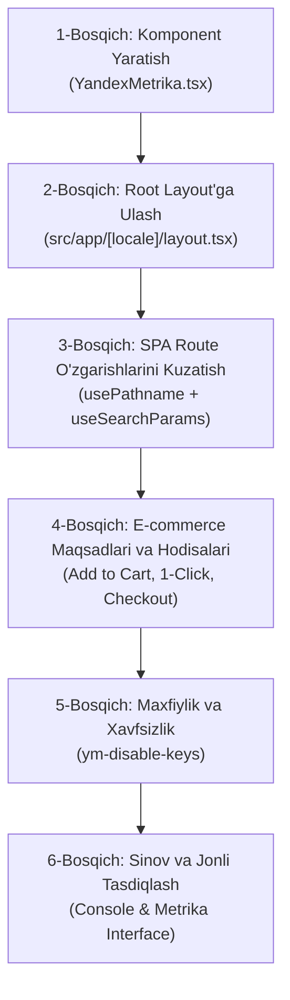

# Sora.uz uchun Yandex Metrika Integratsiyasi va Konversiyalarni Kuzatish Rejasi

> **Hujjat maqsadi:** `https://sora.uz` elektron tijorat platformasiga Yandex Metrika (ID: `113797561`) tahlil tizimini Next.js 16 (App Router) arxitekturasiga to'liq mos ravishda, sayt tezligiga (Core Web Vitals) salbiy ta'sir ko'rsatmasdan va E-commerce xaridlar voronkasini 100% qamragan holda integratsiya qilish rejasi.

---

## 1. Yandex Metrika Sora.uz Loyihasiga Kerakmi? (Ekspert Xulosasi)

**Xulosa:** **Ha, Yandex Metrika Sora.uz loyihasi uchun juda zarur va strategik ahamiyatga ega.**

### Asosiy Sabablar:
1. **O'zbekiston Bozoridagi Ulushi:** O'zbekistonda (ayniqsa Toshkent shahri va viloyat markazlarida) kompyuter va mobil foydalanuvchilarining 30–40% qismi Yandex qidiruv tizimi, Yandex Browser, Yandex Go va Yandex xaritalaridan faol foydalanadi. B2B korporativ mijozlar ham Yandex'da ko'p qidiruv qiladi.
2. **Yandex SEO va Reytingiga To'g'ridan-to'g'ri Ta'siri:** Yandex qidiruv algoritmi ("Vladivostok", "Korolyov") sayt pozitsiyasini aniqlashda foydalanuvchilarning **xatti-harakat signallariga (povedencheskie faktory)** Google'dan ko'ra ko'proq tayanadi. Metrika orqali Yandex foydalanuvchi saytda qancha vaqt o'tkazgani, savatga tovar qo'shgani va xarid qilganini aniq ko'radi va bu Sora.uz'ning Yandex qidiruvidagi o'rnini ko'taradi.
3. **Yandex Webmaster Integratsiyasi:** Saytimiz allaqachon Yandex Webmaster'da tasdiqlangan (`def7fffc020ea8fe`). Metrika ulanganda qidiruv so'rovlarining konversiyasi, tovarlarning ko'rilishi va xaridlar bir xil panelda bog'lanadi.
4. **Vebvizor (Webvisor 2.0) va Xaritalar (Clickmap, Scrollmap):** Google Analytics'da bo'lmagan ushbu noyob vosita orqali foydalanuvchilarning saytdagi har bir harakatini (sichqoncha harakati, qayerga bosgani, sahifani qanchagacha aylantirgani) video shaklida ko'rish mumkin. Bu "1-klikda xarid" yoki mobil buyurtma berishdagi to'siqlarni zudlik bilan aniqlashga yordam beradi.
5. **E-commerce (Elektron Tijorat) Tahlili:** Saytdagi tovarlar ko'rilishi, savatga qo'shilishi, o'chirilishi va xarid daromadlari Yandex Metrika E-commerce hisobotlarida to'liq aks etadi.

---

## 2. Loyihaning Boshlang'ich Ma'lumotlari

* **Hisoblagich (Counter) ID:** `113797561`
* **Texnologik stak:** Next.js 16 (App Router), React 19, TypeScript, Tailwind CSS
* **Navigation turi:** Single Page Application (SPA / Soft Navigation)
* **Amaldagi tahlil tizimlari:** Google Analytics (`GoogleAnalytics.tsx`), Vercel Analytics, Speed Insights.

---

## 3. Bosqichma-bosqich Amalga Oshirish Rejasi



---

### 1-BOSQICH: Komponentni Yaratish (`src/components/analytics/YandexMetrika.tsx`)

Next.js App Router muhitida brauzer sahifani to'liq qayta yuklamaydi. Shuning uchun standart HTML skripti o'rniga maxsus Client Component yaratiladi:

* **Fayl joylashuvi:** `src/components/analytics/YandexMetrika.tsx`
* **Vazifalari:**
  1. `next/script` orqali `strategy="afterInteractive"` bilan asinxron yuklash (sayt yuklanishini sekinlashtirmaydi).
  2. Boshlang'ich parametrlar: `webvisor: true`, `clickmap: true`, `trackLinks: true`, `accurateTrackBounce: true`, `ecommerce: "dataLayer"`.
  3. `<noscript>` tegi orqali JavaScript o'chirilgan foydalanuvchilar uchun piksel tasvirini joylashtirish.

```tsx
"use client";

import { useEffect } from "react";
import { usePathname, useSearchParams } from "next/navigation";
import Script from "next/script";

interface YandexMetrikaProps {
  counterId?: string;
}

export function YandexMetrika({ counterId = "113797561" }: YandexMetrikaProps) {
  const pathname = usePathname();
  const searchParams = useSearchParams();

  // SPA (Soft Navigation) - Har bir sahifa almashganda 'hit' yuborish
  useEffect(() => {
    if (typeof window !== "undefined" && typeof (window as any).ym === "function") {
      const url = `${pathname}${searchParams?.toString() ? `?${searchParams.toString()}` : ""}`;
      (window as any).ym(Number(counterId), "hit", url);
    }
  }, [pathname, searchParams, counterId]);

  return (
    <>
      <Script
        id="yandex-metrika"
        strategy="afterInteractive"
        dangerouslySetInnerHTML={{
          __html: `
            (function(m,e,t,r,i,k,a){
                m[i]=m[i]||function(){(m[i].a=m[i].a||[]).push(arguments)};
                m[i].l=1*new Date();
                for (var j = 0; j < document.scripts.length; j++) {if (document.scripts[j].src === r) { return; }}
                k=e.createElement(t),a=e.getElementsByTagName(t)[0],k.async=1,k.src=r,a.parentNode.insertBefore(k,a)
            })(window, document,'script','https://mc.yandex.ru/metrika/tag.js?id=${counterId}', 'ym');

            ym(${counterId}, 'init', {
                defer: true,
                ssr: true,
                webvisor: true,
                clickmap: true,
                ecommerce: "dataLayer",
                accurateTrackBounce: true,
                trackLinks: true
            });
          `,
        }}
      />
      <noscript>
        <div>
          
        </div>
      </noscript>
    </>
  );
}
```

---

### 2-BOSQICH: Asosiy Layout'ga Integratsiya Qilish

* **Fayl joylashuvi:** `src/app/[locale]/layout.tsx`
* **Amal:** `GoogleAnalytics` komponenti yoniga yangi `YandexMetrika` komponenti qo'shiladi:

```tsx
import { GoogleAnalytics } from "@/components/analytics/GoogleAnalytics";
import { YandexMetrika } from "@/components/analytics/YandexMetrika";

// Layout ichida:
<OrganizationJsonLd />
<GoogleAnalytics />
<Suspense fallback={null}>
  <YandexMetrika />
</Suspense>
```
*(Eslatma: `useSearchParams()` ishlatilgani sababli Next.js qoidasiga ko'ra komponent `<Suspense>` ichiga olinadi).*

---

### 3-BOSQICH: E-commerce Hodisalari va Maqsadlar (Goals)

Yandex Metrika hisobotlarida to'liq voronka (funnel) shakllanishi uchun quyidagi maxsus maqsadlar va hodisalar ulanadi:

| Maqsad ID (Goal Target) | Hodisa Nomi | Qayerda Ishga Tushadi? |
|---|---|---|
| `VIEW_PRODUCT` | Mahsulot kartasini ko'rish | Mahsulot sahifasi ochilganda |
| `ADD_TO_CART` | Savatga qo'shish | Mahsulot sahifasida va kartochkalarda "Savatga" bosilganda |
| `ONE_CLICK_OPEN` | 1-klik modalini ochish | "1-klikda xarid qilish" tugmasi bosilganda |
| `ONE_CLICK_SUBMIT` | 1-klik orqali xarid | 1-klik buyurtma muvaffaqiyatli jo'natilganda |
| `START_CHECKOUT` | Buyurtmani rasmiylashtirish | `/checkout` sahifasi ochilganda |
| `PURCHASE_SUCCESS` | Buyurtma to'liq yakunlanishi | `/checkout/success` sahifasida |

#### Yordamchi Funksiya (`src/lib/analytics/yandex.ts`):
```typescript
export function reachGoal(target: string, params?: Record<string, any>) {
  if (typeof window !== "undefined" && typeof (window as any).ym === "function") {
    (window as any).ym(113797561, "reachGoal", target, params);
  }
}
```

---

### 4-BOSQICH: Maxfiylik va Xavfsizlik (O'zbekiston Qonunchiligi va Webvisor)

O'zbekiston Respublikasining "Shaxsiy ma'lumotlar to'g'risida"gi Qonuni talablariga muvofiq, foydalanuvchilarning maxfiy ma'lumotlari Vebvizor ekran yozuvlariga tushmasligi shart:

1. Telefon raqami kiritish maydonlariga (`CheckoutForm.tsx`, `OneClickModal.tsx`):
   ```html
   className="... ym-disable-keys"
   ```
2. Manzil, F.I.SH. va karta ma'lumotlari kiritiladigan inputlarga:
   ```html
   data-metrika-noindex="true"
   ```
   Bu orqali Vebvizor foydalanuvchi xatti-harakatini yozib oladi, lekin uning shaxsiy raqamlari yoki yozuvlarini yulduzcha (`***`) shaklida maskalaydi.

---

### 5-BOSQICH: Yandex Webmaster bilan Bog'lash

1. Yandex Metrika interfeysida: **Настройки → Доступ → Связь с Яндекс Вебмастером** bo'limiga kirish.
2. Ro'yxatdan `sora.uz` domenini tanlab, tasdiqlash.
3. **Natija:** Yandex qidiruv tizimidan kelayotgan indeksatsiya holati, bosishlar soni va foydalanuvchilarning haqiqiy xaridlari bitta qulay ekranda integratsiya qilinadi.

---

### 6-BOSQICH: Sinov va Ishga Tushirish (Verification)

1. **Local Test:** Brauzer DevTools `Network` panelida `tag.js` va `https://mc.yandex.ru/watch/113797561` ga 200 OK so'rovlari borishi tekshiriladi.
2. **Kesh va CDN Tekshiruvi:** `npm run build` orqali to'liq statik va dinamik sahifalar generatsiya qilinadi.
3. **Metrika Boshqaruv Panelida:** **"Проверить счетчик"** tugmasi bosilib, status yashil (faol) ekanligi tasdiqlanadi.

---

## 4. Kutilayotgan Natijalar

* **Yandex Qidiruv Pozitsiyalari:** Povedencheskie faktory hisobiga Yandex qidiruvida tovar sahifalari tezroq yuqoriga ko'tariladi.
* **Mijozlar Muammolari:** Xaridorlar qaysi bosqichda saytdan chiqib ketayotgani Vebvizor orqali aniqlanadi va sotuvlar hajmi oshiriladi.
* **Tezlik:** Next.js `afterInteractive` yuklanishi sababli Google PageSpeed va Core Web Vitals ko'rsatkichlari 95+ darajasida saqlanadi.
