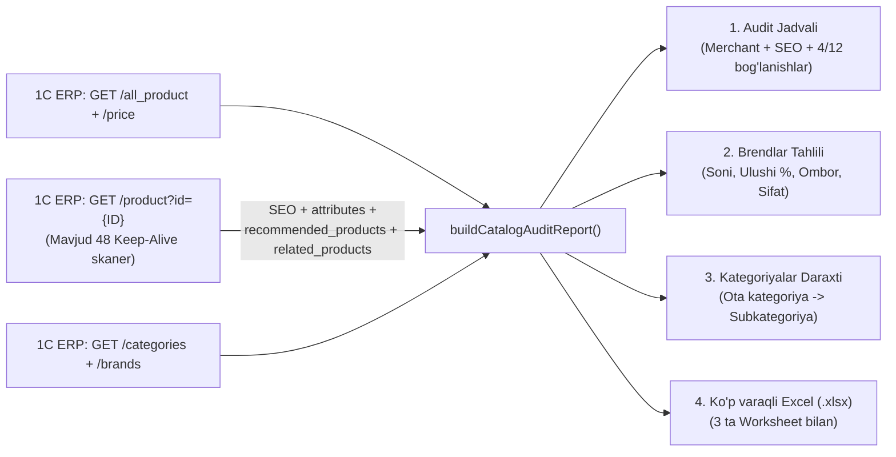

# 📊 SORA.UZ — ICHKI AUDIT PANELINI KENGAYTIRISH REJASI (`plus_internal_audit_plan.md`)

> **Hujjat nomi:** `plus_internal_audit_plan.md`  
> **Maqsad:** Mavjud `/[locale]/internal-audit` yopiq boshqaruv va tahlil paneliga **4 ta yangi chuqur analitik yo‘nalishni** (O‘xshash mahsulotlar auditi, Bilan birga xarid qilinadi auditi, Brendlar kesimida mahsulotlar taqsimoti, Kategoriyalar va Subkategoriyalar daraxti kesimida mahsulotlar taqsimoti) **qo‘shimcha 1C so‘rovlarisiz (0 ms ortiqcha yuklama bilan)** integratsiya qilish hamda `.xlsx` hisobotiga kiritish.  
> **Qoida:** Ushbu bosqichda loyiha kod fayllariga tegilmadi — faqat puxta texnik va arxitektura rejasi shakllantirildi.

---

## 1. Qo‘shiladigan 4 ta Yangi Tahlil Funksiyasining Umumiy Ko‘rinishi

| № | Tahlil yo‘nalishi | 1C Manbasi | Ajratish / Guruhlash mezonlari | Asosiy foydasi |
| :-: | :--- | :--- | :--- | :--- |
| **1** | **«O‘xshash mahsulotlar»** (*Похожие товары*) auditi | `GET /product?id={ID}` → `recommended_products` massivi | • 🔴 **4 tadan kam** (`0–3 ta`)<br>• 🟢 **4 ta** (`aynan 4 ta` — me’yor)<br>• 🔵 **4 tadan ko‘p** (`5+ ta`) | Har bir mahsulot kartochkasida up-sell/down-sell bloki to‘liq 4 ta mahsulot bilan to‘ldirilganini nazorat qilish |
| **2** | **«Bilan birga xarid qilinadi»** (*С этим товаром покупают*) auditi | `GET /product?id={ID}` → `related_products` massivi | • 🔴 **12 tadan kam** (`0–11 ta`)<br>• 🟢 **12 ta** (`aynan 12 ta` — me’yor)<br>• 🔵 **12 tadan ko‘p** (`13+ ta`) | Cross-sell (qo‘shimcha savdo) blokida 12 ta yondosh mahsulot biriktirilganini tekshirish va bo‘shlarini topish |
| **3** | **Brendlar kesimida mahsulotlar** statistikasi | `GET /all_product` (`brand`) + `GET /brands` | • Har bir brendda nechta mahsulot bor<br>• Omborda bor / tugagan / narxi `0` / Merchant tayyor / **Brendsiz** tovarlar | Qaysi brendlarda assortiment ko‘p yoki kamligini, hamda brendi kiritilmagan mahsulotlarni 1 klikda aniqlash |
| **4** | **Kategoriya va Subkategoriyalar** daraxti tahlili | `GET /categories` (`id`, `parent_id`) + `GET /all_product` | • **Ota kategoriya** (bevosita o‘zida + jami subkategoriyalari bilan)<br>• **Subkategoriyalar** (`2–3` daraja)<br>• **Bo‘sh (`0 ta`)** va **Kategoriyasiz** tovarlar | Katalog daraxtining qaysi bo‘g‘inida mahsulot yetishmasligini yoki noto‘g‘ri joylashganini ko‘rish |

---

## 2. Arxitektura va Tezlik: Nega Serverga Ortiqcha Yuklama Tushmaydi?

Hozirgi `/[locale]/internal-audit` sahifasi ochilganda [`src/lib/api/client.ts`](file:///d:/web_sora_uz/src/lib/api/client.ts#L531-L594) ichidagi `api.getAllProductsWithAuditDetails({ noCache: true })` funksiyasi:
1. `GET /all_product` va `GET /price` ni oladi;
2. `fetchAllProductSeoDetails()` orqali **48 ta parallel HTTP Keep-Alive worker** yordamida barcha mahsulotlarning `GET /product?id={ID}` javoblarini ~3.5–4.7 soniyada skanerlab chiqadi.

> [!TIP]
> **Eng muhim texnik ustunlik:** `GET /product?id={ID}` javobining ichida `recommended_products` va `related_products` massivlari **allaqachon kelmoqda**, faqat hozirgi `fetchAllProductSeoDetails` mapper’i (478–517-qatorlar) ularni tashlab ketib, faqat `title`, `description` va `attributes` ni ajratib olmoqda.  
> Demak, mapper ichiga **2 qator kod** qo‘shish orqali barcha ~1 930+ mahsulotning **«O‘xshash mahsulotlar»** va **«Bilan birga xarid qilinadi»** sonini **0 ta yangi HTTP so‘rov va 0 ms qo‘shimcha vaqt** bilan olamiz!



---

## 3. Har Bir Yo‘nalish Bo‘yicha Puxta Texnik Yechim

### 3.1. 1- va 2-Yo‘nalish: «O‘xshash mahsulotlar» (4 ta) va «Bilan birga xarid qilinadi» (12 ta) Auditi

#### A) Sayt PDP mantiqi bilan 100% moslik
[`src/app/[locale]/products/[slug]/page.tsx`](file:///d:/web_sora_uz/src/app/%5Blocale%5D/products/%5Bslug%5D/page.tsx#L141-L212) sahifasida 1C maydonlari quyidagicha bog‘langan:
- **«O‘xshash mahsulotlar»** (*Похожие товары*) bloki → 1C dagi `product.recommended_products` massividan olinadi (**maqsadli me’yor: `4 ta`**).
- **«Bilan birga xarid qilinadi»** (*С этим товаром также покупают*) bloki → 1C dagi `product.related_products` massividan olinadi (**maqsadli me’yor: `12 ta`**).

*(Eslatma: PDP sahifasida 1C da ushbu massivlar bo‘sh bo‘lsa, foydalanuvchiga bo‘sh joy ko‘rinmasligi uchun avtomatik fallback ishlaydi. Ammo **Internal Audit** paneli fallback’ni emas, aynan **1C ERP bazasida haqiqatda nechta mahsulot biriktirilganini** tekshiradi va dublikat yoki o‘z-o‘ziga havolalarni chegirib aniq sonni ko‘rsatadi).*

#### B) Ma’lumotlar modeli (`src/lib/utils/catalog-audit.ts`)
Har bir `AuditProductRow` obyektiga quyidagi maydonlar qo‘shiladi:

```typescript
export type SimilarCountBucket = "lt_4" | "eq_4" | "gt_4";      // < 4 | = 4 | > 4
export type CrossSellCountBucket = "lt_12" | "eq_12" | "gt_12"; // < 12 | = 12 | > 12

export interface AuditProductRow {
  // ...mavjud maydonlar...
  similarCount: number;              // "O'xshash mahsulotlar" soni (recommended_products)
  similarBucket: SimilarCountBucket; // "lt_4" | "eq_4" | "gt_4"
  crossSellCount: number;            // "Bilan birga xarid qilinadi" soni (related_products)
  crossSellBucket: CrossSellCountBucket; // "lt_12" | "eq_12" | "gt_12"
}
```

Umumiy hisobot xulosasiga (`CatalogAuditSummary`) esa quyidagi ko‘rsatkichlar qo‘shiladi:

```typescript
export interface CatalogAuditSummary {
  // ...mavjud ko'rsatkichlar...
  similarLt4: number;     // O'xshash mahsulotlar: 4 tadan kam (0..3)
  similarEq4: number;     // O'xshash mahsulotlar: aynan 4 ta
  similarGt4: number;     // O'xshash mahsulotlar: 4 tadan ko'p (5+)
  crossSellLt12: number;  // Bilan birga xarid: 12 tadan kam (0..11)
  crossSellEq12: number;  // Bilan birga xarid: aynan 12 ta
  crossSellGt12: number;  // Bilan birga xarid: 12 tadan ko'p (13+)
}
```

#### C) UI va Filtrlash (Bir klikda saralash)
Audit panelida 2 ta ko‘rgazmali mini-blok va filtr qo‘shiladi:

```text
┌──────────────────────────────────────────────────────────┐  ┌──────────────────────────────────────────────────────────┐
│ 🔗 O'xshash mahsulotlar (Me'yor: 4 ta)                   │  │ 🛒 Bilan birga xarid qilinadi (Me'yor: 12 ta)            │
│ ┌─────────────────┐ ┌─────────────────┐ ┌──────────────┐ │  │ ┌─────────────────┐ ┌─────────────────┐ ┌──────────────┐ │
│ │ 🔴 4 tadan kam  │ │ 🟢 4 ta (To'liq)│ │ 🔵 4 dan ko'p│ │  │ │ 🔴 12 tadan kam │ │ 🟢 12 ta (To'liq│ │ 🔵 12 dan ko'p│ │
│ │     1 420 ta    │ │      480 ta     │ │     31 ta    │ │  │ │     1 650 ta    │ │      240 ta     │ │     41 ta    │ │
│ └─────────────────┘ └─────────────────┘ └──────────────┘ │  │ └─────────────────┘ └─────────────────┘ └──────────────┘ │
└──────────────────────────────────────────────────────────┘  └──────────────────────────────────────────────────────────┘
```

- Har bir tugma **aktiv filtr** vazifasini bajaradi: masalan, **«🔴 4 tadan kam»** bosilsa, jadvalda faqat «O‘xshash mahsulotlar»i 4 tadan kam bo‘lgan mahsulotlar qoladi va **«📥 Excel (.xlsx) yuklab olish»** tugmasi aynan shu ro‘yxatni yuklab beradi.
- Jadvalning har bir qatorida **`O'xshash / Birga xarid`** ustuni bo‘lib, u yerda rangli badge ko‘rinadi:
  - `O'xshash: 4 ta` (yashil `emerald`), `O'xshash: 0 ta` yoki `2 ta` (qizil/sariq `amber`), `O'xshash: 6 ta` (ko‘k `sky`).
  - `Birga: 12 ta` (yashil `emerald`), `Birga: 3 ta` (qizil/sariq `amber`), `Birga: 15 ta` (ko‘k `sky`).

---

### 3.2. 3-Yo‘nalish: «Qaysi brend mahsulotlar nechta?» — Brendlar Analitikasi

#### A) Ma’lumotlar modeli
`buildCatalogAuditReport` funksiyasi barcha mahsulotlarni brendlar bo‘yicha guruhlab, `brandStats: AuditBrandStat[]` massivini shakllantiradi (1C `/brands` ro‘yxatidagi barcha rasmiy brendlarni ham qamrab oladi — hatto 0 ta tovari bo‘lsa ham):

```typescript
export interface AuditBrandStat {
  brand: string;             // Brend nomi (bo'sh bo'lsa: "(Brend ko'rsatilmagan)")
  isUnbranded: boolean;      // 1C da brend maydoni bo'sh qolgan mahsulotlar guruhi
  totalProducts: number;     // Jami mahsulotlar soni
  sharePercent: number;      // Umumiy katalogdagi ulushi (%)
  inStockCount: number;      // Omborda mavjud (InStock)
  outOfStockCount: number;   // Omborda tugagan (OutOfStock)
  noPriceCount: number;      // Narxi 0 so'm bo'lganlar
  noImageCount: number;      // Rasmi yo'qlar
  merchantReadyCount: number;// Google Merchant'ga 100% tayyorlar
  similarEq4Count: number;   // O'xshash mahsulotlari = 4 ta bo'lganlar
  crossSellEq12Count: number;// Birga xarid mahsulotlari = 12 ta bo'lganlar
}
```

#### B) UI ko‘rinishi («Brendlar tahlili» tabi)
Yuqori navigatsiya paneliga **«🏷️ Brendlar (N)»** tabi qo‘shiladi:
- **Yuqori KPI xulosasi:** Jami brendlar soni, eng ko‘p mahsulotli Top-3 brend (masalan, *Deli*, *SvetoCopy*, *Schneider*), hamda **Brendi kiritilmagan mahsulotlar** soni.
- **Qidiruv va Saralash:** Brend nomi bo‘yicha qidirish, mahsulot soni (`ko‘pdan kamga` / `kamdan ko‘pga`), ombor holati yoki muammolar soni bo‘yicha saralash.
- **Vizual Progress Bar va Jadval:**
  - `№ | Brend nomi | Jami mahsulot (Ulushi %) | Omborda bor / Yo'q | Narxi 0 | Merchant tayyor | O'xshash (4 ta) | Birga xarid (12 ta) | Amal`
  - **«Ko‘rish →»** tugmasi bosilganda asosiy Audit jadvaliga o‘tib, aynan shu brend mahsulotlarini filtrlab beradi.

---

### 3.3. 4-Yo‘nalish: «Qaysi kategoriya va subkategoriyalarda nechta mahsulot mavjud?» — Daraxtsimon Tahlil

#### A) Ierarxik (Ota kategoriya → Subkategoriya) hisoblash algoritmi
1C ERP’dan keladigan `api.getCategories()` (`tree` va `categories`) hamda `all_product` ichidagi `uz.category_slug_uz` / `uz.category_uz` (va `ru`) o‘zaro bog‘lanadi:

1. **Bevosita mahsulotlar (`directCount`):** Aynan shu kategoriya/subkategoriyaning o‘ziga biriktirilgan mahsulotlar soni.
2. **Jami shajara bo‘yicha (`totalTreeCount`):** Ota kategoriyaning o‘zidagi + uning barcha ostki subkategoriyalaridagi (`children`) mahsulotlar yig‘indisi.
3. **Maxsus diagnostika guruhlari:**
   - ⚠️ **Bo‘sh kategoriyalar / subkategoriyalar (`totalTreeCount === 0`):** 1C da ochilgan, ammo ichida 1 ta ham mahsulot yo‘q bo‘limlar.
   - 🔴 **Kategoriyasiz / Bog‘lanmagan mahsulotlar (`Uncategorized`):** 1C da `category_uz` / `category_slug_uz` bo‘sh qolgan yoki `/categories` ma’lumotnomasida mavjud bo‘lmagan mahsulotlar.

```typescript
export interface AuditCategoryNodeStat {
  id: string;
  parentId: string;
  depth: number;                   // 0 = Asosiy kategoriya, 1 = Subkategoriya, 2 = 3-daraja
  nameUz: string;
  nameRu: string;
  slugUz: string;
  slugRu: string;
  directCount: number;             // Bevosita shu tugunning o'ziga biriktirilgan tovarlar
  totalTreeCount: number;          // O'zi + barcha ichki subkategoriyalari yig'indisi
  inStockCount: number;            // Omborda borlari (shajara bo'yicha)
  outOfStockCount: number;         // Omborda yo'qlari
  noPriceCount: number;            // Narxi 0 so'm bo'lganlari
  merchantReadyCount: number;      // Merchantga tayyorlari
  children: AuditCategoryNodeStat[];
}
```

#### B) UI ko‘rinishi («Kategoriyalar va Subkategoriyalar» tabi)
Yuqori navigatsiya paneliga **«📂 Kategoriyalar daraxti»** tabi qo‘shiladi:

```text
📂 1. Qog'oz mahsulotlari (Бумажная продукция)           Jami shajarada: 342 ta (Bevosita: 0 ta)   [Barchasini ochish / yopish]
   ├── 📄 Ofis qog'ozi (Офисная бумага)                  48 ta mahsulot   (Omborda: 45 | Narxi 0: 3 | Merchant: 44)   [Jadvalda ko'rish →]
   ├── 📓 Daftarlar va bloknotlar                        164 ta mahsulot  (Omborda: 150 | Narxi 0: 14 | Merchant: 148) [Jadvalda ko'rish →]
   ├── 🏷️ Stikerlar va yopishqoq qog'ozlar               72 ta mahsulot   (Omborda: 70 | Narxi 0: 2 | Merchant: 69)    [Jadvalda ko'rish →]
   └── ⚠️ Vatman va chizma qog'ozlari                    0 ta mahsulot    [BO'SH SUBKATEGORIYA]
```

- Ota kategoriyalarni yig‘ish/yoyish (*Expand / Collapse All*) va qidiruv orqali istalgan subkategoriyani tez topish mumkin.
- Istalgan subkategoriya (yoki ota kategoriya) qatoridagi **«Jadvalda ko‘rish →»** tugmasi bosilsa, asosiy Audit jadvalida aynan shu bo‘limning mahsulotlari filtrlanadi.

---

## 4. Excel (`.xlsx`) va CSV Eksportini Boyitish

[`src/lib/utils/catalog-audit-excel.ts`](file:///d:/web_sora_uz/src/lib/utils/catalog-audit-excel.ts) generatori kengaytirilib, yuklab olinadigan `.xlsx` fayl **3 ta professional varaqdan (Worksheet)** iborat bo‘ladi:

1. **1-Varaq: `Katalog Auditi` (Mahsulotlar ro‘yxati)**
   - Mavjud 14 ta ustunga qo‘shimcha ravishda yangi 4 ta ustun qo‘shiladi:
     - `O'xshash_Soni` (raqam: `0, 1, 4...`)
     - `O'xshash_Holati` (`4 tadan kam` / `4 ta` / `4 tadan ko'p` — rangli yorliq bilan)
     - `Birga_Xarid_Soni` (raqam: `0, 3, 12...`)
     - `Birga_Xarid_Holati` (`12 tadan kam` / `12 ta` / `12 tadan ko'p` — rangli yorliq bilan)
2. **2-Varaq: `Brendlar Statistikasi`**
   - Barcha brendlar ro‘yxati, har bir brenddagi jami mahsulotlar soni, ulushi (`%`), ombordagi qoldiq, narxsizlar, Merchantga tayyorlar hamda O‘xshash (`4 ta`) va Birga xarid (`12 ta`) to‘ldirilganlik ko‘rsatkichi.
3. **3-Varaq: `Kategoriyalar va Subkategoriyalar`**
   - Ota kategoriya va subkategoriya darajasi (`Asosiy` / `Subkategoriya`), ota kategoriya nomi, subkategoriya nomi, bevosita mahsulotlar soni, jami shajara mahsulotlari soni, omborda bor/yo‘q va sifat ko‘rsatkichlari.

---

## 5. O‘zgartiriladigan Fayllar Xaritasi (Amalga Oshirish Bosqichida)

Tasdiqlanganidan so‘ng quyidagi 6 ta faylda toza va xavfsiz o‘zgarishlar bajariladi:

| № | Fayl manzili | Qilinadigan o‘zgarish |
| :-: | :--- | :--- |
| **1** | [`src/lib/api/client.ts`](file:///d:/web_sora_uz/src/lib/api/client.ts) | `fetchAllProductSeoDetails` va `getAllProductsWithAuditDetails` ichida `/product?id={ID}` javobidan `recommended_products` va `related_products` massivlarini ham mahsulot obyektiga biriktirish |
| **2** | [`src/lib/utils/catalog-audit.ts`](file:///d:/web_sora_uz/src/lib/utils/catalog-audit.ts) | • `similarCount` (`<4`, `=4`, `>4`) va `crossSellCount` (`<12`, `=12`, `>12`) hisob-kitobi va filtrlari<br>• `buildBrandAuditStats()` — brendlar kesimida hisobot<br>• `buildCategoryTreeAuditStats()` — kategoriya va subkategoriyalar daraxti hisoboti |
| **3** | [`src/app/[locale]/internal-audit/page.tsx`](file:///d:/web_sora_uz/src/app/%5Blocale%5D/internal-audit/page.tsx) | `api.getCategories()` va `api.getBrands()` ni `getAllProductsWithAuditDetails` bilan `Promise.all` orqali parallel olib, `buildCatalogAuditReport` ga uzatish |
| **4** | [`src/components/audit/InternalAuditDashboard.tsx`](file:///d:/web_sora_uz/src/components/audit/InternalAuditDashboard.tsx) | • O‘xshash (`<4`, `=4`, `>4`) va Birga xarid (`<12`, `=12`, `>12`) filtr kartochkalari va jadval ustunlari<br>• Yangi **«Brendlar tahlili»** va **«Kategoriyalar va Subkategoriyalar»** tablari |
| **5** | [`src/lib/utils/catalog-audit-excel.ts`](file:///d:/web_sora_uz/src/lib/utils/catalog-audit-excel.ts) va [`src/app/api/internal-audit/export/route.ts`](file:///d:/web_sora_uz/src/app/api/internal-audit/export/route.ts) | `.xlsx` eksportga yangi `similar`/`crossSell` filtrlarini, 4 ta yangi ustunni hamda 2- va 3-analitik Excel varaqlarini (`Brendlar`, `Kategoriyalar`) qo‘shish |
| **6** | [`tests/internal-audit.spec.ts`](file:///d:/web_sora_uz/tests/internal-audit.spec.ts) | Yangi 4 ta tahlil funksiyasi, filtrlar, tablar va 3 varaqli `.xlsx` eksportini avtomatik Playwright testlari bilan tekshirish |

---

## 6. Kutilayotgan Natija va Kafolatlar

1. **Tezlikka ta’siri `0 ms`:** Mavjud 48-workerli parallel 1C skaneri allaqachon `/product?id={ID}` ni o‘qiyotgani sababli qo‘shimcha tarmoq so‘rovi bo‘lmaydi.
2. **100% Xavfsizlik va SEO himoyasi:** Barcha yangi tablar va eksport varaqlar mavjud `AUDIT_ACCESS_KEY` avtorizatsiyasi hamda 4 qatlamli `noindex, nofollow` himoyasi ostida qoladi.
3. **1-Klikda Amaliy Ish:** Kontent-menejer *«O‘xshash mahsulotlari 4 tadan kam bo‘lgan DELI tovarlari»* yoki *«Birga xarid qilinadigan tovarlari 12 tadan kam bo‘lgan Ofis qog‘ozlari»*ni 1 klikda filtrlab, tayyor `.xlsx` jadvalini yuklab oladi.
