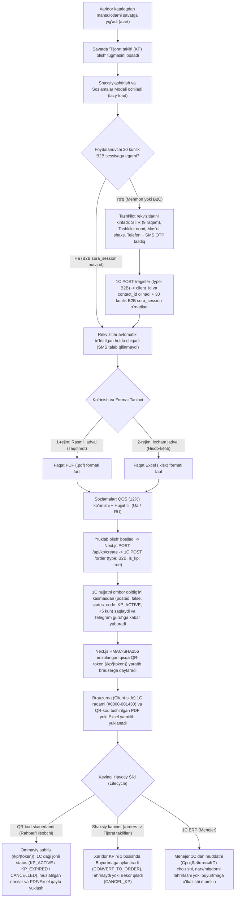

# Sora.uz — Avtomatik Tijorat Taklifi (KP: PDF, Excel va 1C ERP Integratsiyasi) Tizimi Uchun Yakuniy Mukammal Reja

> **Hujjat nomi:** `Loyixa_xujjatlari/yakuniy_plan.md`  
> **Birlashtirilgan tayanch hujjatlar:**  
> 1. `Loyixa_xujjatlari/plan_tijorat_taklifi.md` (PDF/Excel generatsiya va UX asoslari)  
> 2. `Loyixa_xujjatlari/dop_plan_tijorat.md` (1C ERP bazasida narxlarni muzlatish va ommaviy QR pasporti)  
> 3. `Loyixa_xujjatlari/Api/user_api/1C_da_xolat.txt` (`POST /order`, `GET /order`, `POST /order_action` yakuniy 1C API shartnomasi)  
> 4. `Loyixa_xujjatlari/new_order_stay_plan.md` («Mening buyurtmalarim» yagona markazi)  
>
> **Loyiha muhiti:** Next.js 16 (App Router) · React 19 · Tailwind CSS v4 · `next-intl` (UZ/RU) · Zustand (`useCartStore`, `useAuthStore`) · 1C:Предприятие 8.3.20 (`for_msp`) · Cloudflare R2 (`cdn.sora.uz`) · Vercel Serverless (`fra1`)  
> **Asosiy Maqsad:** B2B tashkilot xaridori savatga yig‘gan mahsulotlar asosida 5–10 soniya ichida **1C bazasida ro‘yxatga olingan, narxlari 5 kunga kafolatlangan (muzlatilgan), ommaviy QR-kodli Tijorat taklifi (KP)** ni **PDF (rasmli taqdimot)** yoki **Excel `.xlsx` (ixcham formulali hisob-kitob)** formatida yuklab olishi, QR-kod orqali hujjat holatini real vaqtda tekshirishi va 1 bosishda haqiqiy buyurtmaga aylantirishi.

---

## 1. Yaxlit Biznes Mantiq va Ish Jarayoni (End-to-End Workflow)



---

## 2. Texnologiyalar Arxitekturasi va Tanlov Asoslari

| Vazifa | Tanlangan Texnologiya | Qayerda ishlaydi | Arxitektura afzalligi |
| :--- | :--- | :--- | :--- |
| **1C da KP saqlash va narxni muzlatish** | `1C POST /order` (`is_kp: true`) | Next.js Server → 1C ERP | Alohida SQL baza qurmasdan, 1C ning o‘zida narxlarni 5 kunga muzlatadi, ombor qoldig‘ini band qilmaydi (`posted: false`) va savdo guruhiga Telegram xabar yuboradi. |
| **Rasmli PDF yaratish** | `@react-pdf/renderer` | Brauzer (Client-side, `import()` lazy-load) | Vercel Serverless RAM/CPU resursini umuman sarflamaydi (0 server xarajati); `cdn.sora.uz` rasmlari, brend shlyapa, bosiladigan havolalar, muhr/imzo va QR-kodni 1–1.5 soniyada yig‘adi. |
| **Ixcham Excel yaratish** | `exceljs` | Brauzer (Client-side, `import()` lazy-load) | Haqiqiy formatlangan **`.xlsx`** yaratadi: tirik Excel formulalari (`=E10*F10`, `=SUM(...)`, QQS `12%`), artikulda boshidagi `0` larni saqlovchi matn formati va A4 chop etish sozlamasi. |
| **Ommaviy QR-kod va Xavfsiz Token** | `qrcode` + Server `HMAC-SHA256` token | Brauzer (QR PNG) + Next.js Server (Token) | `order_id` va `client_id` kriptografik imzolangan qisqa token (`/kp/{token}`) ichiga joylanadi. Savatda 500 ta mahsulot bo‘lsa ham QR-kod kichik va 0.5 soniyada skanerlanadigan bo‘ladi. |
| **O‘zbek va Rus shriftlari** | **Roboto Regular** va **Roboto Bold** (`.ttf`) | `public/fonts/` (lokal statik) | O‘zbekcha `o‘`, `g‘`, `‘` va kirill harflari PDF ichida `???` bo‘lib buzilmasligini 100% kafolatlaydi. |
| **KP Boshqaruvi (Konvertatsiya / Bekor qilish)** | `1C GET /order` + `1C POST /order_action` | Next.js Server (`/api/orders`, `/api/kp/*`) → 1C | Shaxsiy kabinet (`/orders`) va ommaviy QR sahifasi (`/kp/{token}`) 1C bazasi bilan real vaqtda sinxron ishlaydi. |

---

## 3. Mavjud Buyurtmalar Tizimini 1C Yangi O‘zgarishlariga Moslashtirish (0-Bosqich / Poydevor)

`1C_da_xolat.txt` dagi yangi o‘zgarishlar joriy loyihadagi oddiy buyurtma yaratishni (`POST /order`) buzmaydi, biroq buyurtmalar ro‘yxati (`GET /order` — 2-rejim) va statuslar tizimi KP lar bilan aralashib ketmasligi uchun quyidagi **3 ta poydevor moslashtirish** birinchi bo‘lib bajariladi:

1. **Zod sxemalarini kengaytirish (`src/lib/schemas/order.ts`):**
   - `OrderStatusCodeSchema` ga **`"KP_ACTIVE"`** va **`"KP_EXPIRED"`** kodlarini qo‘shish (jami 9 ta standart kod: `CONFIRMED`, `PENDING`, `ASSEMBLED`, `SHIPPED`, `READY_FOR_PICKUP`, `DELIVERED`, `CANCELLED`, `KP_ACTIVE`, `KP_EXPIRED`).
   - `OneCOrderRequestSchema` ga ixtiyoriy `is_kp?: boolean` va `kp_valid_until?: string` maydonlarini qo‘shish.
   - `OneCOrderResponseSchema`, `OneCOrderDetailResponseSchema` va `OneCOrderHistoryItemSchema` ga `is_kp: z.boolean().optional().default(false)` va `kp_valid_until: z.string().nullable().optional().transform(v => v ?? null)` maydonlarini qo‘shish.
   - `OneCOrderCustomerSchema` ga `client_inn: z.string().nullable().optional().transform(v => v ?? null)` (B2B STIR raqami) maydonini qo‘shish.
   - Yangi `OneCOrderActionRequestSchema` va `OneCOrderActionResponseSchema` (`POST /order_action` uchun `CONVERT_TO_ORDER` va `CANCEL_KP`) sxemalarini qo‘shish.

2. **Yagona status modulini yangilash (`src/lib/utils/order-status.ts`):**
   - `normalizeOrderStatus` funksiyasiga `KP_ACTIVE` va `KP_EXPIRED` kodlarini hamda `isKp?: boolean` bayrog‘ini qo‘shish (hozirgi kodda ular tanilmay `"PENDING"` — *«Tekshirilmoqda»* bo‘lib qolishining oldi olinadi).
   - Agar `POST /order` da `is_kp: true` yuborilganda 1C javobida `status_code: "KP_ACTIVE"` yoki `"PENDING"` kelsa ham, `is_kp === true` va `status_code !== "CANCELLED"` bo‘lsa uni aniq **`"KP_ACTIVE"`** sifatida normalizatsiya qilish.
   - `STATUS_SPECS` ga ikki tilda (UZ / RU) yangi status ko‘rinishlarini qo‘shish:
     - **`KP_ACTIVE`**: Binafsha/Ko‘k (`indigo`/`blue`) badge — UZ: *«Tijorat taklifi (Faol)»*, RU: *«Коммерческое предложение (Активно)»*.
     - **`KP_EXPIRED`**: Sariq/To‘q sariq (`amber`) badge — UZ: *«Muddati tugagan (KP)»*, RU: *«Срок действия истёк (КП)»*.

3. **`GET /order` (2-Rejim) ro‘yxatida `is_kp` filtrini qo‘llash (`src/lib/api/client.ts` va `src/app/api/orders/route.ts`):**
   - `api.getOrderHistory` metodiga va `/api/orders` endpointiga ixtiyoriy `is_kp` (`"true"` | `"false"`) query parametrini qo‘shish.
   - Shunda oddiy buyurtmalar ro‘yxati (`is_kp=false`) va Tijorat takliflari ro‘yxati (`is_kp=true`) 1C darajasida toza ajratiladi, sahifalash (`limit`, `offset`, `has_more`) buzilmaydi.

---

## 4. Oldingi 6 ta Ochiq Nuqta Bo‘yicha Qat’iy Arxitektura Qarorlari

`dop_plan_tijorat.md` va `1C_da_xolat.txt` qiyosiy tahlilida aniqlangan 6 ta ochiq masala quyidagi xavfsiz va aniq qoidalar asosida yopiladi:

| № | Masala | Qabul qilingan Yakuniy Yechim |
| :-: | :--- | :--- |
| **1** | **Ommaviy `/kp/{token}` sahifasidan «Buyurtmaga aylantirish» (`CONVERT_TO_ORDER`) xavfsizligi** | • QR-kodni skanerlagan **har qanday shaxs** login/SMS siz `/kp/{token}` sahifasini ochib, KP holatini (`KP_ACTIVE`, `KP_EXPIRED`, `CANCELLED`), muzlatilgan narxlarni ko‘rishi va PDF/Excel nusxasini yuklab olishi mumkin.<br>• Biroq **«Xaridni tasdiqlash (Buyurtmaga aylantirish)»** tugmasi bosilganda: agar foydalanuvchi brauzerida aynan shu tashkilotning (`client_id`) tasdiqlangan `sora_session` sessiyasi bo‘lsa — darhol tasdiqlanadi; agar boshqa qurilmadan (masalan, direktor telefonidan) kirilgan bo‘lsa — qisqa SMS OTP tasdiqlash oynasi chiqadi va tasdiqlangach `POST /order_action (CONVERT_TO_ORDER)` bajariladi. Bu qog‘ozdagi QR-kod begona qo‘lga tushganda ruxsatsiz buyurtma rasmiylashtirilishidan 100% himoya qiladi. |
| **2** | **KP ni tahrirlashda (`Savatga ko‘chirish`) eski KP ni bekor qilish (`CANCEL_KP`) payti** | • Xaridor *«Tahrirlash (Savatga ko‘chirish)»* tugmasini bosgan zahoti eski KP **bekor qilinmaydi** (xaridor fikridan qaytsa, eski KP kuymasligi shart).<br>• Savat xotirasida `editingKpOrderId` saqlanadi. Faqatgina xaridor savatda o‘zgarish qilib, **yangi KP (yoki yangi Buyurtma) muvaffaqiyatli yaratilgandan (`201 Created`) so‘nggina**, server avtomatik ravishda eski `editingKpOrderId` uchun `POST /order_action (CANCEL_KP)` so‘rovini yuboradi. |
| **3** | **Tashkilotning bank rekvizitlari (H/R, MFO, Manzil) va `comment` 350 belgi limiti** | • Asosiy yuridik rekvizitlar (**Tashkilot nomi** `customer.client_name` va **STIR/INN** `customer.client_inn`) 1C `GET /order` dan to‘g‘ridan-to‘g‘ri qaytadi.<br>• Qo‘shimcha ixtiyoriy rekvizitlar (H/R, MFO, Manzil) kiritilsa, `POST /order` dagi `comment` maydoniga ixcham prefiks bilan (`[KP H/R: 20208... | MFO: 00444 | Manzil: ...]`, 350 belgi doirasida) yoziladi. `/kp/{token}` sahifasidan PDF/Excel qayta yuklanganda `client_name` va `client_inn` 1C dan olinadi, `comment` ichida `[KP ...]` tegi bo‘lsa H/R va MFO ham avtomatik ajratib ko‘rsatiladi. |
| **4** | **`POST /order (is_kp: true)` javobidagi `status_code` mosligi** | • `normalizeOrderStatus` funksiyasi `is_kp: true` bo‘lgan yangi hujjatda 1C dan `status_code: "KP_ACTIVE"` kelsa ham, `"PENDING"` kelsa ham uni bir xil **`"KP_ACTIVE"`** deb qabul qiladi. |
| **5** | **`POST /order_action (CONVERT_TO_ORDER)` da B2B mas’ul shaxs va yetkazib berish ma’lumotlari** | • `CONVERT_TO_ORDER` bosilganda kichik tasdiqlash modalida xaridorga **Yetkazib berish usuli** (`Kuryer orqali` + manzil/geolokatsiya yoki `O‘zi olib ketish / Samovivoz`) va **Buyurtma izohi** (`comment`) ni aniqlashtirish imkoni beriladi. Agar tasdiqlayotgan mas’ul shaxs telefoni sessiyada mavjud bo‘lsa, `comment` oxiriga mas’ul kontakt sifatida qo‘shib yuboriladi. |
| **6** | **1C serverida `GET /order` va `POST /order_action` tayyorligi va orqaga moslik (Fallback)** | • Web-ilova kodi shunday yoziladiki, agar 1C serverida `is_kp` maydoni kelmasa (eski javob formati bo‘lsa), default `is_kp: false` sifatida xatosiz ishlayveradi; `1C_da_xolat.txt` dagi yangi maydonlar kelishi bilan barcha KP imkoniyatlari to‘liq ishga tushadi. |

---

## 5. Foydalanuvchi Tajribasi (UI/UX) va Hujjatlar Tarkibi

### 5.1. Savatchada KP Yaratish Modali (`CommercialOfferModal.tsx`)
Savatcha sahifasida (`/[locale]/cart`) `CartSummary` blokida **«Buyurtmani rasmiylashtirish»** tugmasining ostiga **«Tijorat taklifi (KP) olish»** (*PDF yoki Excel*) tugmasi qo‘shiladi. Tugma bosilganda 3 blokli modal ochiladi:

1. **1-Blok: Tashkilot (B2B) Rekvizitlari (Majburiy identifikatsiya):**
   - **Majburiy maydonlar:**
     - **STIR / INN** (9 ta raqam — `formatInnInput` maskasi bilan);
     - **Tashkilotning rasmiy nomi** (masalan: *«ALPHA SERVICE» MCHJ*);
     - **Mas’ul shaxs F.I.Sh.**;
     - **Telefon raqami** (`+998 XX XXX-XX-XX` — `formatUzPhoneInput` bilan).
   - **Ixtiyoriy (kengaytirilgan) rekvizitlar** (*«+ Bank va manzil rekvizitlarini qo‘shish»* ochiluvchi qismi):
     - **Hisob raqami (H/R, 20 raqam)**, **Bank MFO (5 raqam)**, **Yuridik manzil**.
   - **30 kunlik B2B Sessiya va SMS OTP Mantiqi:**
     - Agar foydalanuvchi tizimga B2B sifatida kirgan bo‘lsa (`user.type === "B2B"`), barcha maydonlar avtomatik to‘ldiriladi va **SMS kod so‘ralmaydi**.
     - Agar mehmon yoki telefon raqami tasdiqlanmagan bo‘lsa, shu modalning o‘zida 1 marta SMS OTP kodi orqali tasdiqlanadi → 1C da `POST /register (type: "B2B")` orqali `client_id` va `contact_id` olinadi → qurilmada 30 kunlik `sora_session` saqlanadi.

2. **2-Blok: Ko‘rinish va Format Tanlovi (Qat’iy 2 rejim):**
   - **«Rasmli jadval (Taqdimot uchun)»** → faqat **PDF (`.pdf`)** yuklab olish faol. Rahbariyatga ko‘rsatish, vizual tasdiqlash, muhr va imzo bilan.
   - **«Ixcham jadval (Hisob-kitob / Tender uchun)»** → faqat **Excel (`.xlsx`)** yuklab olish faol. Buxgalteriya va ta’minot bo‘limi uchun tirik Excel formulalari bilan.

3. **3-Blok: Hujjat Sozlamalari:**
   - **QQS (12%) ko‘rsatish usuli:**
     - *«Umumiy narx ichida (shu jumladan QQS 12%)»* — pastki yakuniy blokda `Shu jumladan QQS (12%): Jami × 12 / 112` ko‘rsatiladi.
     - *«QQS (12%) alohida ustunda»* — jadvalda har bir qatorda `QQSsiz narx`, `QQS 12%` va `QQS bilan summa` ustunlari alohida chiqadi.
   - **Hujjat tili:** `O‘zbekcha (UZ)` yoki `Русский (RU)`.

---

### 5.2. PDF Hujjat Dizayni («Rasmli jadval» — A4 format)
1. **Yuqori shlyapa (Header):** Chapda `Sora.uz` logotipi va tavsifi, o‘ngda Sotuvchi (`Sora.uz` yuridik rekvizitlari: Nomi, STIR, H/R, Bank, MFO, Manzil, Telefon).
2. **Hujjat metama’lumotlari:**
   - Sarlavha: **TIJORAT TAKLIFI № 0000-001430** (1C `POST /order` qaytargan haqiqiy `order_number`!).
   - Tuzilgan sana (`order_date`) va **Amal qilish muddati** (1C qaytargan `kp_valid_until` — standart +5 kun, masalan: *"27.11.2026 23:59 gacha narxlar 1C bazasida kafolatlangan"*).
   - **Buyurtmachi tashkilot:** Tashkilot nomi, STIR (`client_inn`), Mas’ul shaxs va kiritilgan bank rekvizitlari.
3. **Rasmli mahsulotlar jadvali:**
   - Ustunlar: `№` · `Rasm` (`36×36 px`, `cdn.sora.uz` dan CORS orqali) · `Mahsulot nomi va Artikul` (`sora.uz` dagi mahsulot sahifasiga bosiladigan `<Link>`) · `Birlik` · `Miqdori` · `Narxi` *(+ QQS alohida rejimi bo‘lsa: `QQSsiz narx`, `QQS 12%`)* · `Summa`.
   - Ko‘p sahifali jadval: har sahifada jadval sarlavhasi takrorlanadi va pastda `Sahifa X / Y` chiqadi.
4. **Yakuniy hisob-kitob, Muhr/Imzo va Ommaviy QR-kod (Footer):**
   - Jami summa (1C qaytargan `total_amount`), QQS (12%) summasi, yetkazib berish shartlari.
   - Chapda: Rasmiy to‘lov shartlari (Didox EHF), rahbar imzosi va korxona muhri (`public/assets/kp/` ichidagi PNG, sozlama orqali yoqib-o‘chiriladigan).
   - O‘ngda: **Ommaviy Tekshiruv QR-kodi (`https://sora.uz/{locale}/kp/{token}`)** + izoh: *"Hujjatning 1C bazasidagi jonli holatini (Faol/Bekor qilingan) tekshirish va 1 bosishda buyurtma berish uchun QR-kodni skanerlang"*.

---

### 5.3. Excel `.xlsx` Hujjat Dizayni («Ixcham jadval»)
1. **1–8-qatorlar:** `TIJORAT TAKLIFI № 0000-001430`, sana, amal qilish muddati (`kp_valid_until`), Sotuvchi (`Sora.uz`) va Xaridor tashkilot rekvizitlari (Nomi, STIR, Mas’ul shaxs).
2. **Rasmsiz, ixcham jadval va Tirik Formulalar:**
   - Ustunlar: `№`, `Artikul (SKU)` (matn formatida — `0` lar yo‘qolmaydi), `Mahsulot nomi` (bosiladigan `HYPERLINK`), `O‘lchov birligi`, `Miqdori`, `Birlik narxi`, *(QQS alohida bo‘lsa: `QQSsiz summa`, `QQS 12%`)*, `Jami summa`.
   - Har bir qator summasi: `=E10*F10`, umumiy jami: `=SUM(...)`, QQS 12%: `=ROUND(TOTAL*12/112, 0)`.
3. **Pastki blok:** Yetkazib berish sharti, Didox EHF eslatmasi va **`https://sora.uz/{locale}/kp/{token}`** bosiladigan tekshiruv havolasi. A4 sahifaga 1 kenglikda (`fitToWidth = 1`) chop etishga tayyor.

---

### 5.4. Ommaviy QR Tekshiruv Sahifasi (`/[locale]/kp/[token]`)
QR-kod skanerlanganda (yoki Excel/PDF ichidagi havola bosilganda) ochiladigan ommaviy elektron hujjat pasporti:
1. **Maxfiylik filtri (Next.js Server qatlamida):**
   - Server `token` ichidagi HMAC-SHA256 imzoni tekshirib, `order_id` va `client_id` ni oladi hamda 1C `GET /order?order_id=...&type=B2B&client_id=...` ni chaqiradi.
   - `1C_da_xolat.txt` (3-bo‘lim) qoidasiga muvofiq, ommaviy sahifaga `customer.contact` (shaxsiy telefonlar, Telegram username) va ichki izohlar **chiqarilmaydi** — mijoz blokidan faqat **`customer.client_name`** va **`customer.client_inn`** ko‘rsatiladi.
2. **4 xil Jonli Holat Indikatori:**
   - 🟢 **`KP_ACTIVE` (Faol):** *"Ushbu tijorat taklifi kuchda. Narxlar {kp_valid_until} gacha 1C bazasida kafolatlangan."*
   - 🟡 **`KP_EXPIRED` (Muddati tugagan):** *"Amal qilish muddati ({kp_valid_until}) tugagan. Muddatni uzaytirish uchun menejer bilan bog‘laning yoki yangi KP shakllantiring."*
   - 🔴 **`CANCELLED` (Bekor qilingan / Noaktiv):** *"Ushbu tijorat taklifi bekor qilingan (noaktiv)."*
   - 🔵 **`is_kp: false` (Buyurtmaga aylantirilgan):** *"Ushbu tijorat taklifi asosida #{order_number}-sonli xarid buyurtmasi rasmiylashtirilgan (Joriy holati: {status})."*
3. **Muzlatilgan narxlar jadvali va Qiyosiy ustunlik:**
   - 1C hujjatidagi `products[]` (`product_name`, `unit`, `quantity`, `price`, `amount`) katalogdagi rasm va mahsulot havolasi bilan boyitib ko‘rsatiladi.
   - Agar katalogdagi joriy narx KP dagi muzlatilgan narxdan oshgan bo‘lsa, yonida yashil yorliq chiqadi: *"Joriy narx: X so‘m → Sizning kafolatlangan KP narxingiz: Y so‘m"*.
4. **Sahifadagi amallar:**
   - **«PDF (Rasmli) yuklab olish»** va **«Excel (.xlsx) yuklab olish»** (istalgan telefondan yoki kompyuterdan hujjatni qayta yuklab olish);
   - **«Buyurtmaga aylantirish (Tasdiqlash)»** (`status_code === "KP_ACTIVE"` bo‘lganda faol).

---

### 5.5. «Mening Buyurtmalarim» (`/orders`) Shaxsiy Kabinet Integratsiyasi
`1C_da_xolat.txt` (3-bo‘lim) tavsiyasiga binoan `/[locale]/orders` sahifasida:
1. **Asosiy Bo‘lim / Tablar:**
   - **«Buyurtmalarim» (`GET /api/orders?is_kp=false`)** — ichida mavjud `Barchasi`, `Faol`, `Yetkazilgan`, `Bekor qilingan` filtr tablari bilan.
   - **«Tijorat takliflarim (KP)» (`GET /api/orders?is_kp=true`)** — faqat Tijorat takliflari ro‘yxati (`KP_ACTIVE`, `KP_EXPIRED`, `CANCELLED`).
2. **KP Kartochkasi va Tafsilot Oynasidagi Tugmalar (`1C_da_xolat.txt` qoidasi bo‘yicha):**
   - **«Buyurtmaga aylantirish» (`CONVERT_TO_ORDER`)** — **faqat `status_code === "KP_ACTIVE"`** holatida faol bo‘ladi. Bosilganda yetkazib berish usulini (`Kuryer` / `Samovivoz`), manzil va izohni tasdiqlab `POST /api/kp/action` (`action: "CONVERT_TO_ORDER"`) yuboradi. Muvaffaqiyatli javob qaytgach (`is_kp: false`, yangi `order_date`), hujjat darhol **«Buyurtmalarim»** ro‘yxatiga o‘tkaziladi va 4 qadamli `timeline` bilan ko‘rsatiladi (`posted: false` kelsa ham qayta so‘rov yuborilmaydi!).
   - **«Bekor qilish (Noaktiv qilish)» (`CANCEL_KP`)** — **`KP_ACTIVE` va `KP_EXPIRED`** holatlarida ko‘rsatiladi. Bosilganda `POST /api/kp/action` (`action: "CANCEL_KP"`) yuboriladi va status `CANCELLED` ga o‘zgaradi.
   - **«Tahrirlash (Savatga ko‘chirish)»** — KP mahsulotlarini savatga yuklaydi (yangi KP yaratilgach eski KP avtomatik `CANCEL_KP` qilinadi).
   - **«PDF / Excel yuklab olish»** va **«QR-kod havolasini nusxalash»**.
   - **`KP_EXPIRED` holatida:** «Buyurtmaga aylantirish» tugmasi o‘rniga **«Muddatni uzaytirish uchun menejerga yozish»** (Telegram havola, KP raqami bilan) va **«Joriy narxlarda savatga ko‘chirish»** tugmalari chiqadi.
3. **409 Conflict va Xatolar Boshqaruvi (`POST /order_action`):**
   - `400 Bad Request` (muddati o‘tgan yoki bekor qilingan KP): serverdan kelgan `error` matni chiqariladi.
   - `409 Conflict` (KP allaqachon buyurtmaga aylantirilgan yoki ayni damda 1C da menejer tomonidan tahrirlanmoqda/bloklangan): foydalanuvchiga aniq `error` matni va **«Sahifani yangilash / Qayta urinish»** tugmasi ko‘rsatiladi.

---

## 6. Barcha 7 ta Texnik Nyuan va Xavfsizlik Yechimlari

### 1) `cdn.sora.uz` rasmlari va Cloudflare R2 CORS Siyosati — ✅ HAL QILINDI
Cloudflare R2 (`cdn.sora.uz`) bucket sozlamalarida quyidagi CORS Policy JSON qoidasi o‘rnatildi va brauzerdan `@react-pdf/renderer` orqali rasmlarni to‘g‘ridan-to‘g‘ri o‘qish to‘liq ta’minlandi:
```json
[
  {
    "AllowedOrigins": [
      "https://sora.uz",
      "https://www.sora.uz",
      "http://localhost:3000"
    ],
    "AllowedMethods": [
      "GET",
      "HEAD"
    ],
    "AllowedHeaders": [
      "*"
    ],
    "ExposeHeaders": [],
    "MaxAgeSeconds": 3600
  }
]
```

### 2) O‘zbek (Lotin) va Rus (Kirill) Shriftlari
Standart PDF shriftlari (Helvetica) o‘zbekcha `o‘`, `g‘`, `‘` hamda kirill harflarini ko‘rsata olmasligi sababli, `public/fonts/` papkasiga to‘liq Unicode (Latin Extended + Cyrillic) qo‘llab-quvvatlovchi **`Roboto-Regular.ttf`** va **`Roboto-Bold.ttf`** joylanadi va `@react-pdf/renderer` `Font.register()` orqali ulanadi.

### 3) "Jonli savat" QR Havolasi Uzunligi Yechimi
Mahsulotlar ro‘yxatini URL ichiga yozish o‘rniga, KP 1C bazasida saqlanadi va QR-kodga faqat kriptografik imzolangan qisqa tokenli havola (`https://sora.uz/uz/kp/{token}`) joylanadi:
- Token tarkibi: `base64url(16_bayt_order_id + 16_bayt_client_id + 16_bayt_hmac_sha256)` — jami atigi **64 ta belgi**.
- Savatda 1 ta mahsulot bo‘lsa ham, 500 ta mahsulot bo‘lsa ham QR-kod hajmi o‘zgarmaydi va har qanday telefon kamerasida 0.5 soniyada o‘qiladi.

### 4) Narxlarning Dolzarbligi va 1C Bazasida Muzlatilishi
- KP yaratilayotgan lahzada mahsulotlarning katalogdagi narxi 1C `POST /order (is_kp: true)` orqali 1C hujjatiga yoziladi.
- Saytda ertasi kuni narxlar o‘zgarsa ham, 1C hujjatidagi narxlar `kp_valid_until` (+5 kun yoki menejer cho‘zgan sana) davomida o‘zgarishsiz saqlanadi.

### 5) Sayt Tezligiga Ta’siri (`fast.md` qoidasi)
- `@react-pdf/renderer`, `exceljs` va `qrcode` kutubxonalari bosh sahifa, katalog yoki savatcha yuklanishida **umuman yuklanmaydi (0 KB initial bundle)**.
- Ular faqat foydalanuvchi KP modalini ochib, *«Yuklab olish»* tugmasini bosgandagina `await import(...)` (dinamik lazy-load) orqali chaqiriladi.

### 6) Spamdan Himoya va Rate-Limit (Telegram va 1C Himoyasi)
1C serveri har bir yangi KP (`POST /order`) va holat o‘zgarishida (`POST /order_action`) savdo bo‘limining Telegram guruhiga avtomatik xabar yuborgani sababli, botlar va spam hujumlardan himoya qilish uchun `/api/kp/create` va `/api/kp/action` endpointlarida:
- **IP bo‘yicha Rate-Limit:** Bitta IP manzildan **soatiga maksimal 60–90 ta KP so‘rovi** (`60–90 req/hour`) chegarasi o‘rnatiladi (oshganda `429 Too Many Requests` qaytadi).
- **Qat’iy Avtorizatsiya va Zod Validatsiyasi:** Tasdiqlangan B2B sessiya (`sora_session`) yoki SMS OTP tokeni majburiy; savat bo‘sh emasligi (`products.length >= 1`), `quantity > 0`, `price >= 0` va 9 xonali STIR (`inn`) qat’iy Zod sxemasi bilan tekshiriladi.

### 7) SEO Himoyasi (`noindex, nofollow`)
Tijorat takliflari va ommaviy QR havolalari qidiruv tizimlari (Google, Yandex) indeksiga tushmasligi uchun 3 qavatli himoya qo‘llanadi:
- `/uz/cart` va `/ru/cart` allaqachon `robots.txt` da `Disallow` qilingan; qo‘shimcha ravishda `/uz/kp/` va `/ru/kp/` yo‘llari ham `src/app/robots.ts` da `Disallow` ro‘yxatiga qo‘shiladi.
- `/[locale]/kp/[token]/page.tsx` sahifasida Next.js `metadata` orqali `robots: { index: false, follow: false, nocache: true }` o‘rnatiladi.
- Barcha `/api/kp/*` API javoblariga `X-Robots-Tag: noindex, nofollow` HTTP sarlavhasi qo‘yiladi.

---

## 7. Bosqichma-Bosqich Amalga Oshirish Rejasi (Bajariladigan Ishlar Tartibi)

### 1-Bosqich: Mavjud Buyurtmalar Qatlamini 1C Yangi KP Formatiga Moslashtirish (Data & API Layer)
1. **`src/lib/schemas/order.ts` ni yangilash:**
   - `OrderStatusCodeSchema` ga `"KP_ACTIVE"` va `"KP_EXPIRED"` qo‘shish.
   - `OneCOrderRequestSchema`, `OneCOrderResponseSchema`, `OneCOrderDetailResponseSchema`, `OneCOrderHistoryItemSchema` ga `is_kp` va `kp_valid_until` qo‘shish.
   - `OneCOrderCustomerSchema` ga `client_inn` qo‘shish.
   - `OneCOrderActionRequestSchema` va `OneCOrderActionResponseSchema` (`CONVERT_TO_ORDER` va `CANCEL_KP` uchun) yaratish.
2. **`src/lib/utils/order-status.ts` ni yangilash:**
   - `normalizeOrderStatus` va `getOrderStatusUiMeta` ga `KP_ACTIVE` va `KP_EXPIRED` statuslarini (UZ/RU matnlari va badge ranglari bilan) qo‘shish.
3. **`src/lib/api/client.ts` va `/api/orders/route.ts` ni kengaytirish:**
   - `createOrder` metodida `is_kp` va `kp_valid_until` maydonlarini 1C ga uzatish.
   - `getOrderHistory` metodiga va `/api/orders` route’iga `is_kp?: boolean` filtrini qo‘shish.
   - `client.ts` ga yangi `performOrderAction(payload)` (`POST /SORA/hs/for_msp/order_action` — `200`, `400`, `403`, `404`, `409`, `500` javoblarini aniq qaytaruvchi) metodini qo‘shish.

### 2-Bosqich: Kriptografik QR-Token, Kompaniya Rekvizitlari va Backend KP API Route’lari
1. **`src/lib/kp/token.ts` yaratish:**
   - `encodeKpPublicToken({ orderId, clientId })` — 2 ta UUID ni 32 bayt binary + 16 bayt HMAC-SHA256 imzo bilan 64 belgili `base64url` tokenga o‘girish.
   - `verifyKpPublicToken(token)` — `crypto.timingSafeEqual` bilan imzoni tekshirib `{ orderId, clientId } | null` qaytarish.
2. **`src/lib/config/company.ts` va Shriftlar (`public/fonts/`):**
   - `Sora.uz` sotuvchi yuridik rekvizitlari (Korxona nomi, STIR, H/R, Bank, MFO, Manzil, Telefon, Didox EHF shartlari) markaziy konfiguratsiyasini yaratish.
   - `public/fonts/Roboto-Regular.ttf` va `public/fonts/Roboto-Bold.ttf` shriftlarini joylashtirish.
3. **Yangi KP API Endpointlarini yaratish (`X-Robots-Tag: noindex, nofollow` bilan):**
   - `POST /api/kp/create`:
     - IP bo‘yicha rate-limit (**soatiga max 60–90 ta so‘rov**);
     - B2B rekvizitlar va SMS OTP / `sora_session` tekshiruvi → 1C `POST /register (type: "B2B")` orqali `client_id` va `contact_id` olish → 30 kunlik B2B `sora_session` cookie yozish;
     - 1C `POST /order (type: "B2B", is_kp: true)` yuborish;
     - Agar `editingKpOrderId` yuborilgan bo‘lsa, yangi KP `201 Created` bo‘lgach fonda eski KP uchun `CANCEL_KP` yuborish;
     - Javobda `order_id`, `order_number`, `kp_valid_until`, `total_amount`, `public_token` va `public_url` (`/kp/{token}`) qaytarish.
   - `GET /api/kp/public?token=...`:
     - `verifyKpPublicToken` orqali tokenni tekshirish → 1C `GET /order` dan ma’lumot olish → `customer.contact` (shaxsiy telefon, Telegram) ni olib tashlab, faqat ommaviy KP pasporti ma’lumotlarini qaytarish.
   - `POST /api/kp/action`:
     - Egalik tekshiruvi (`sora_session` yoki SMS OTP) + rate-limit → 1C `POST /order_action` (`CONVERT_TO_ORDER` yoki `CANCEL_KP`) chaqirish.

### 3-Bosqich: PDF («Rasmli jadval») va Excel `.xlsx` («Ixcham jadval») Generatorlari
1. **Paketlar:** `@react-pdf/renderer`, `exceljs`, `qrcode` (`@types/qrcode`) paketlarini o‘rnatish.
2. **QR-kod generatori (`src/lib/kp/qrcode.ts`):**
   - `https://sora.uz/{locale}/kp/{token}` manzilidan yuqori aniqlikdagi PNG Data URL yaratuvchi funksiya.
3. **PDF Generator (`src/lib/kp/generate-pdf.tsx`):**
   - `@react-pdf/renderer` yordamida A4 shablon: `Sora.uz` va Xaridor tashkilot rekvizitlari, `TIJORAT TAKLIFI № {order_number}`, amal qilish muddati (`kp_valid_until`), `cdn.sora.uz` rasmli va bosiladigan havolali jadval, QQS 12% rejimi (ichida yoki alohida ustunda), muhr/imzo va ommaviy QR-kod.
4. **Excel Generator (`src/lib/kp/generate-excel.ts`):**
   - `exceljs` yordamida `.xlsx` shablon: rekvizitlar shlyapasi, rasmsiz ixcham jadval, artikul matn formati, tirik Excel formulalari (`=E*F`, `=SUM`, QQS `12%`), mahsulot `HYPERLINK` lari va `/kp/{token}` tekshiruv havolasi.

### 4-Bosqich: Savatchada KP Modali (`CommercialOfferModal.tsx` va `CartSummary.tsx`)
1. `CartSummary.tsx` ga **«Tijorat taklifi (KP) olish»** tugmasini qo‘shish.
2. `CommercialOfferModal.tsx` (`next/dynamic` bilan lazy-load):
   - Majburiy B2B tashkilot formasi (STIR, Tashkilot nomi, Mas’ul shaxs, Telefon + ixtiyoriy H/R, MFO, Manzil) — 30 kunlik B2B sessiyadan avto-to‘ldirish va mehmonlar uchun inline SMS OTP tasdiqlash bilan;
   - Rejim tanlovi: **Rasmli jadval → faqat PDF**, **Ixcham jadval → faqat Excel**;
   - QQS (12%) ko‘rinishi va Hujjat tili (UZ/RU) tanlovi;
   - *«Yuklab olish»* bosilganda `POST /api/kp/create` chaqirilib, 1C dan olingan `order_number`, `kp_valid_until` va `public_url` asosida PDF yoki Excel fayl brauzerda yaratilib yuklab olinadi.

### 5-Bosqich: Ommaviy QR Sahifasi (`/[locale]/kp/[token]`) va Shaxsiy Kabinet (`/orders`)
1. **Ommaviy QR Pasporti Sahifasi (`src/app/[locale]/kp/[token]/page.tsx` + `KpPublicView.tsx`):**
   - `noindex, nofollow` metadata va `robots.ts` himoyasi;
   - 1C dagi jonli status banneri (`KP_ACTIVE`, `KP_EXPIRED`, `CANCELLED` yoki buyurtmaga aylangan status);
   - Tashkilot nomi (`client_name`), STIR (`client_inn`), muzlatilgan narxlar jadvali (katalog rasmlari va narx farqi yorlig‘i bilan);
   - Shu sahifadan **PDF / Excel qayta yuklab olish** va **«Buyurtmaga aylantirish»** tugmalari.
2. **Shaxsiy Kabinet (`src/components/orders/OrdersHistoryClient.tsx` va `OrderDetailModal.tsx`):**
   - **«Buyurtmalarim» (`is_kp=false`)** va **«Tijorat takliflarim (KP)» (`is_kp=true`)** bo‘limlarini ajratish;
   - `KP_ACTIVE` da **«Buyurtmaga aylantirish»** (`CONVERT_TO_ORDER` — yetkazib berish va izoh kiritish oynasi bilan), `KP_ACTIVE`/`KP_EXPIRED` da **«Bekor qilish»** (`CANCEL_KP`), **«Tahrirlash (Savatga ko‘chirish)»** va **«PDF / Excel yuklab olish»** tugmalarini ulash;
   - `CONVERT_TO_ORDER` muvaffaqiyatli bajarilgach, hujjatni darhol «Buyurtmalarim» ro‘yxatiga o‘tkazib, 4 qadamli `timeline` ni ko‘rsatish.
3. **Tarjimalar (`messages/uz.json` va `messages/ru.json`):**
   - Barcha yangi KP modali, ommaviy QR sahifasi, `KP_ACTIVE` / `KP_EXPIRED` statuslari va `/orders` tugmalari uchun to‘liq UZ va RU tarjimalar.

### 6-Bosqich: Sifat Nazorati va Avtomatlashtirilgan Testlar
1. **Unit va API Testlar (`tests/order.spec.ts` va `tests/kp.spec.ts`):**
   - `KP_ACTIVE` va `KP_EXPIRED` status normalizatsiyasi;
   - HMAC-SHA256 `kpToken` kodlash, dekodlash va qalbaki imzoni rad etish testi;
   - QQS 12% (ichida va alohida ustunda) matematik hisob-kitob testi;
   - Rate-limit (`60–90 req/hour`), B2B STIR validatsiyasi va `/kp/{token}` da shaxsiy telefonlar filtrlanishi testi.
2. **Playwright E2E va Build Tekshiruvi:**
   - Savatchada KP modali ochilishi, Rasmli jadval → PDF va Ixcham jadval → Excel qoidasi, `/orders` da KP tabi;
   - `npx tsc --noEmit`, `npx eslint`, `npm run build` — 0 xato bilan yakunlash.

---

## 8. Yangi Yaratiladigan va O‘zgaradigan Fayllar Xaritasi

| Fayl manzili | Holat | Vazifasi |
| :--- | :---: | :--- |
| `src/lib/schemas/order.ts` | O‘zgaradi | `KP_ACTIVE`, `KP_EXPIRED`, `is_kp`, `kp_valid_until`, `client_inn` va `POST /order_action` Zod sxemalari |
| `src/lib/utils/order-status.ts` | O‘zgaradi | `KP_ACTIVE` va `KP_EXPIRED` normalizatsiyasi hamda UZ/RU badge dizaynlari |
| `src/lib/api/client.ts` | O‘zgaradi | `createOrder` (`is_kp`), `getOrderHistory` (`is_kp` filtri) va `performOrderAction` (`POST /order_action`) |
| `src/app/api/orders/route.ts` | O‘zgaradi | `is_kp=true|false` query filtri qo‘llab-quvvatlashi |
| `src/lib/config/company.ts` | **Yangi** | `Sora.uz` sotuvchi yuridik rekvizitlari va KP standart sozlamalari |
| `public/fonts/Roboto-Regular.ttf`, `Roboto-Bold.ttf` | **Yangi** | PDF uchun O‘zbek (lotin) va Rus (kirill) Unicode shriftlari |
| `src/lib/kp/token.ts` | **Yangi** | QR-kod uchun HMAC-SHA256 imzolangan qisqa `kpToken` generatori va tekshiruvchisi |
| `src/lib/kp/qrcode.ts` | **Yangi** | Ommaviy KP havolasidan QR-kod PNG Data URL yaratuvchi modul |
| `src/lib/kp/calculations.ts` | **Yangi** | QQS 12% (narx ichida va alohida ustunda) hamda qator summalari hisob-kitobi |
| `src/lib/kp/generate-pdf.tsx` | **Yangi** | `@react-pdf/renderer` asosidagi A4 rasmli PDF generatori (lazy-load) |
| `src/lib/kp/generate-excel.ts` | **Yangi** | `exceljs` asosidagi tirik formulali `.xlsx` generatori (lazy-load) |
| `src/app/api/kp/create/route.ts` | **Yangi** | B2B tekshiruv, rate-limit (60–90/soat), 1C `POST /order (is_kp: true)` va QR-token qaytarish |
| `src/app/api/kp/public/route.ts` | **Yangi** | QR-token orqali 1C dan KP holatini olib, shaxsiy telefon/izohlarsiz qaytarish |
| `src/app/api/kp/action/route.ts` | **Yangi** | 1C `POST /order_action` (`CONVERT_TO_ORDER` va `CANCEL_KP`) ni xavfsiz chaqirish |
| `src/components/cart/CommercialOfferModal.tsx` | **Yangi** | Savatchada B2B rekvizitli KP sozlamalari va PDF/Excel yuklab olish modali |
| `src/components/cart/CartSummary.tsx` | O‘zgaradi | «Tijorat taklifi (KP) olish» tugmasi va modal integratsiyasi |
| `src/app/[locale]/kp/[token]/page.tsx` | **Yangi** | Ommaviy QR-kod tekshiruv sahifasi (`noindex, nofollow`) |
| `src/components/kp/KpPublicView.tsx` | **Yangi** | Ommaviy KP pasporti UI (status, muzlatilgan narxlar, PDF/Excel yuklash, buyurtmaga aylantirish) |
| `src/components/orders/OrdersHistoryClient.tsx` | O‘zgaradi | «Buyurtmalarim» (`is_kp=false`) va «Tijorat takliflarim» (`is_kp=true`) bo‘limlari hamda KP amallari |
| `src/components/orders/OrderDetailModal.tsx` | O‘zgaradi | KP tafsilotlarida `CONVERT_TO_ORDER`, `CANCEL_KP`, tahrirlash va PDF/Excel yuklab olish |
| `src/app/robots.ts` | O‘zgaradi | `/uz/kp/` va `/ru/kp/` yo‘llarini qidiruv indeksidan yopish (`Disallow`) |
| `messages/uz.json`, `messages/ru.json` | O‘zgaradi | KP tizimi uchun barcha UZ va RU tarjimalar |
| `tests/order.spec.ts`, `tests/kp.spec.ts` | O‘zgaradi / **Yangi** | Yangi 1C KP sxemalari, QR-token, QQS hisob-kitobi va UI oqimi testlari |
